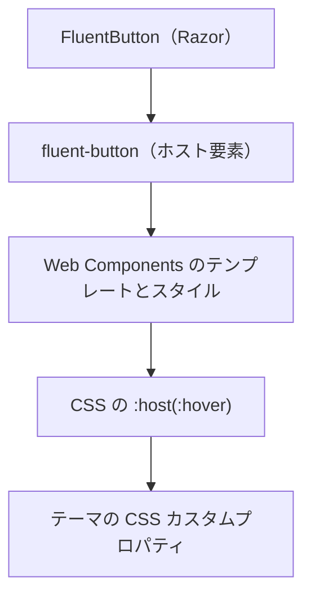

## はじめに

Fluent UI Blazor のボタンにマウスポインターを重ねると、背景や枠線の色が滑らかに変わります。この表現は、Blazor のマウスイベントで色を変更しているのでしょうか。それとも、ボタンの内側に何か特別なエフェクトがあるのでしょうか。

本記事では、`FluentButton` の Razor コンポーネントから、実際にスタイルを持つ Web Components、テーマのカラートークンまでをソースコードで追います。通常表示、ホバー、押下の違いに加え、通常時とホバー時のコントラスト比、無効状態や動きを減らす設定、色をカスタマイズするときの注意点も確認します。

先に結論を言うと、標準のホバー表現は **Web Components の CSS 疑似クラスとデザイントークン**で実装されています。ホバーのたびに C# のイベント処理で色を切り替える仕組みではありません。

## 今回のゴール 🎯

この記事を読み終えると、次のことが分かるようになります。

- ✅ `FluentButton` から `<fluent-button>` とそのスタイルにたどり着ける
- ✅ ホバー時に背景色、文字色、枠線色がどのトークンに切り替わるか説明できる
- ✅ `Appearance`、ライト / ダークテーマ、無効状態による違いを理解できる
- ✅ 通常時とホバー時の文字色・背景色のコントラスト比を比較できる
- ✅ 特定のボタンだけホバー色を変更し、ブラウザーで確認できる

## 調査対象と前提

2026 年 11 月 12 日時点で公開されている、次のソースを対象にします。

| 対象 | 参照点 |
|------|--------|
| 🧩 Fluent UI Blazor | [`v5.0.1`](https://github.com/microsoft/fluentui-blazor/releases/tag/v5.0.1)、コミット `e31b214c2c1b499f0322013bdc2f1c4f05e3f5d0` |
| 🧱 Fluent UI Web Components | `@fluentui/web-components` `3.1.3`、コミット `44cf3fb9906b4f98243589e0b078e4df9ca6227b` |
| 🎨 Fluent UI Tokens | `@fluentui/tokens` `1.0.0-alpha.24`、コミット `2dd2a9a96210919c35b210a1aa8e873ab67dbada` |

Web Components と Tokens のバージョンは、Blazor 側の [v5.0.1 のロックファイル](https://github.com/microsoft/fluentui-blazor/blob/e31b214c2c1b499f0322013bdc2f1c4f05e3f5d0/src/Core.Scripts/package-lock.json)で確認できます。対応するソースのコミットは、それぞれの npm メタデータの `gitHead`（[Web Components](https://registry.npmjs.org/%40fluentui%2Fweb-components/3.1.3)、[Tokens](https://registry.npmjs.org/%40fluentui%2Ftokens/1.0.0-alpha.24)）に基づいています。以降のソースリンクは、この参照点に固定しています。

:::message
この記事は **v5** の実装です。v4 では `Appearance.Accent` など別の API を使います。v5 の `ButtonAppearance.Primary` との対応は、[公式の移行ガイド](https://github.com/microsoft/fluentui-blazor/blob/e31b214c2c1b499f0322013bdc2f1c4f05e3f5d0/examples/Demo/FluentUI.Demo.Client/Documentation/GetStarted/Migration/MigrationFluentButton.md)を確認してください。
:::

コード例は、`Microsoft.FluentUI.AspNetCore.Components` v5.0.1 をセットアップ済みの Blazor アプリを前提とします。対象のコンポーネントは[公式デモ](https://www.fluentui-blazor.net/Buttons/Button)でも確認できます。

## まずは実装の全体像を見てみる

処理をたどる順番は次のとおりです。



Blazor 側の `FluentButton` は `<fluent-button>` を出力します。これはカスタム要素で、そのテンプレートとスタイルは `@fluentui/web-components` 側にあります。

起動時には、Blazor ライブラリの [`Startup.ts`](https://github.com/microsoft/fluentui-blazor/blob/e31b214c2c1b499f0322013bdc2f1c4f05e3f5d0/src/Core.Scripts/src/Startup.ts#L36-L45) がテーマを初期化し、Web Components を登録します。[`FluentUIWebComponents.ts`](https://github.com/microsoft/fluentui-blazor/blob/e31b214c2c1b499f0322013bdc2f1c4f05e3f5d0/src/Core.Scripts/src/FluentUIWebComponents.ts#L1-L29) では、`Button` とその定義を登録しています。

つまり、**初期化には JavaScript を使います**。一方、初期化後の標準的なホバー状態の切り替えは、ブラウザーが CSS を評価して行います。この区別が最初のポイントです。

## Razor から `<fluent-button>` へ

まずは、次の 2 つのボタンを考えます。

```razor
<FluentButton>通常</FluentButton>
<FluentButton Appearance="ButtonAppearance.Primary">保存</FluentButton>
```

[`FluentButton.razor`](https://github.com/microsoft/fluentui-blazor/blob/e31b214c2c1b499f0322013bdc2f1c4f05e3f5d0/src/Core/Components/Button/FluentButton.razor#L7-L33) の関係部分を抜粋すると、次のようになっています。

```razor
<fluent-button
    appearance="@(Appearance == ButtonAppearance.Default ? null : Appearance.ToAttributeValue())"
    @onclick="@OnClickHandlerAsync">
    @* その他の属性とコンテンツは省略 *@
</fluent-button>
```

`Appearance` は Web Components の `appearance` 属性に渡されます。`ButtonAppearance.Default` の場合は属性を出力せず、`Primary` の場合は `appearance="primary"` になります。`@onclick` はクリック処理のためのもので、ホバー時の色を切り替える処理ではありません。

では、`<fluent-button>` のどこにスタイルがあるのでしょうか。

## ホバー対象は Shadow DOM のホスト

Web Components の定義は、[`button.definition.ts`](https://github.com/microsoft/fluentui/blob/44cf3fb9906b4f98243589e0b078e4df9ca6227b/packages/web-components/src/button/button.definition.ts#L3-L16) でテンプレートとスタイルを結び付けています。

[`button.template.ts`](https://github.com/microsoft/fluentui/blob/44cf3fb9906b4f98243589e0b078e4df9ca6227b/packages/web-components/src/button/button.template.ts#L13-L21) には、内容を受け取る `slot` と `span` があります。構造を概念的に表すと次のようになります。

```text
fluent-button appearance="primary"   ← ホスト要素
├─ #shadow-root
│  ├─ slot name="start"
│  ├─ span part="content" → デフォルトの slot
│  └─ slot name="end"
└─ 保存                             ← ホストの子として渡した内容
```

このテンプレートは、通常表示用の内側の `<button>` を常設するのではなく、ホストの `<fluent-button>` をボタンとして扱います。[`BaseButton`](https://github.com/microsoft/fluentui/blob/44cf3fb9906b4f98243589e0b078e4df9ca6227b/packages/web-components/src/button/button.base.ts#L238-L258) は `ElementInternals` にボタンのロールを設定し、フォーカスやクリックなどを扱います。

Shadow DOM 内の CSS では、`:host` がこのホスト要素を指します。したがって、`:host(:hover)` は「ホストにポインターが重なっている状態」の指定です。内側の `span` の背景ではなく、**`<fluent-button>` 自体**の背景や枠線を変えています。

## 通常・ホバー・押下で何が変わるのか

実際のスタイルは [`button.styles.ts`](https://github.com/microsoft/fluentui/blob/44cf3fb9906b4f98243589e0b078e4df9ca6227b/packages/web-components/src/button/button.styles.ts#L100-L111) にあります。以下は、TypeScript の `css` タグ付きテンプレートから、デフォルトのホバーと押下に関係する部分を抜粋したものです。

```typescript
:host(:hover) {
  background-color: ${colorNeutralBackground1Hover};
  color: ${colorNeutralForeground1Hover};
  border-color: ${colorNeutralStroke1Hover};
}

:host(:hover:active) {
  background-color: ${colorNeutralBackground1Pressed};
  border-color: ${colorNeutralStroke1Pressed};
  color: ${colorNeutralForeground1Pressed};
  outline-style: none;
}
```

ここで使われている `${...}` は、TypeScript のテンプレート文字列に埋め込まれる値です。例えば [`design-tokens.ts`](https://github.com/microsoft/fluentui/blob/44cf3fb9906b4f98243589e0b078e4df9ca6227b/packages/web-components/src/theme/design-tokens.ts) の `colorNeutralBackground1Hover` は、CSS の `var(--colorNeutralBackground1Hover)` を表します。対応する [CSS ファイル](https://github.com/microsoft/fluentui/blob/44cf3fb9906b4f98243589e0b078e4df9ca6227b/packages/web-components/src/button/button.styles.css#L42-L54)でも、その形を確認できます。

整理すると、デフォルトのボタンでは次のトークンが使われます。

| 状態 | 背景色 | 文字色 | 枠線色 |
|------|--------|--------|--------|
| ⚪ 通常 | `--colorNeutralBackground1` | `--colorNeutralForeground1` | `--colorNeutralStroke1` |
| 🖱️ ホバー | `--colorNeutralBackground1Hover` | `--colorNeutralForeground1Hover` | `--colorNeutralStroke1Hover` |
| 👆 ホバー中の押下 | `--colorNeutralBackground1Pressed` | `--colorNeutralForeground1Pressed` | `--colorNeutralStroke1Pressed` |

押下のセレクターは単なる `:active` ではなく、`:hover:active` です。これは、ここに示した規則がホバーと押下の両方に一致する場合の指定であることを意味します。

また、トークン名が変わっても、実際の値が必ず変わるとは限りません。例えば標準の Web ライトテーマでは、通常とホバーの文字色はいずれも `#242424` です。背景と枠線は変わりますが、文字色は同じです。

## `Appearance` によるホバー表現の違い

`Appearance` によって、共通のホバー規則に加えて別の規則が適用されます。例えば Primary は、[`button.styles.ts`](https://github.com/microsoft/fluentui/blob/44cf3fb9906b4f98243589e0b078e4df9ca6227b/packages/web-components/src/button/button.styles.ts#L190-L210) で背景色を次のように切り替えています。

```typescript
:host([appearance='primary']) {
  background-color: ${colorBrandBackground};
  color: ${colorNeutralForegroundOnBrand};
  border-color: transparent;
}

:host([appearance='primary']:hover) {
  background-color: ${colorBrandBackgroundHover};
}

:host([appearance='primary']:is(:hover, :hover:active):not(:focus-visible)) {
  border-color: transparent;
}

:host([appearance='primary']:is(:hover, :hover:active)) {
  color: ${colorNeutralForegroundOnBrand};
}

:host([appearance='primary']:hover:active) {
  background-color: ${colorBrandBackgroundPressed};
}
```

Primary のホバー時は、共通のニュートラル背景ではなく、ブランド背景のホバー用トークンを使います。前景色はブランド背景用のトークンを維持し、フォーカス表示がない間は枠線を透明にします。フォーカス時には、別途フォーカス用の枠線やシャドウが適用されます。

ほかの外観も含めて、主なホバー表現を整理します。

| 外観 | 主なホバー時の指定 |
|------|--------------------|
| ⚪ `Default` | ニュートラルの背景・文字・枠線の `Hover` トークンを使用 |
| 🔵 `Primary` | 背景に `--colorBrandBackgroundHover` を使用 |
| ▫️ `Outline` | 背景に `--colorTransparentBackgroundHover`、文字と枠線に共通のホバー規則を使用 |
| ◻️ `Subtle` | `--colorSubtleBackgroundHover` と `--colorNeutralForeground2Hover` を使用 |
| 🫥 `Transparent` | `--colorTransparentBackgroundHover` と `--colorNeutralForeground2BrandHover` を使用 |

標準の Web テーマでは `--colorTransparentBackgroundHover` 自体も透明です。そのため、`Outline` は主に枠線、`Transparent` は主に文字色で変化を表します。テーマが変数の値を変更した場合は、見え方も変わります。

`Subtle` にはもう 1 つ特徴があります。スロットに直接割り当てられた SVG には、ホバー時に `--colorNeutralForeground2BrandHover` を `fill` として指定しています。詳細は [Subtle / Transparent のスタイル](https://github.com/microsoft/fluentui/blob/44cf3fb9906b4f98243589e0b078e4df9ca6227b/packages/web-components/src/button/button.styles.ts#L229-L272)を参照してください。

## 色の実値はテーマが決める

ボタンのスタイルは `#ffffff` や `#0f6cbd` を直接決めているのではなく、`var(--color...)` を参照しています。Blazor 側の[テーマ処理](https://github.com/microsoft/fluentui-blazor/blob/e31b214c2c1b499f0322013bdc2f1c4f05e3f5d0/src/Core.Scripts/src/Utilities/Theme.ts#L426-L450)はテーマを選択し、Web Components の [`setTheme`](https://github.com/microsoft/fluentui/blob/44cf3fb9906b4f98243589e0b078e4df9ca6227b/packages/web-components/src/theme/set-theme.ts#L30-L64) で CSS カスタムプロパティとして適用します。グローバルテーマでは、基本的に `<html>` に設定された値が子要素に継承されます。

例として、標準の Web ライト / ダークテーマでの**背景色**を比べます。

| ボタンとテーマ | 通常 | ホバー | ホバー中の押下 |
|----------------|------|--------|----------------|
| ☀️ Default / Light | `#ffffff` | `#f5f5f5` | `#e0e0e0` |
| 🌙 Default / Dark | `#292929` | `#3d3d3d` | `#1f1f1f` |
| ☀️ Primary / Light | `#0f6cbd` | `#115ea3` | `#0c3b5e` |
| 🌙 Primary / Dark | `#115ea3` | `#0f6cbd` | `#0c3b5e` |

この値は、[ライトの色トークン](https://github.com/microsoft/fluentui/blob/2dd2a9a96210919c35b210a1aa8e873ab67dbada/packages/tokens/src/alias/lightColor.ts#L67-L126)、[ダークの色トークン](https://github.com/microsoft/fluentui/blob/2dd2a9a96210919c35b210a1aa8e873ab67dbada/packages/tokens/src/alias/darkColor.ts#L67-L126)、[グレーパレット](https://github.com/microsoft/fluentui/blob/2dd2a9a96210919c35b210a1aa8e873ab67dbada/packages/tokens/src/global/colors.ts)、[Web ブランドパレット](https://github.com/microsoft/fluentui/blob/2dd2a9a96210919c35b210a1aa8e873ab67dbada/packages/tokens/src/global/brandColors.ts#L3-L11)をたどったものです。

Primary のライトテーマでは、通常が `brand[80]`、ホバーが `brand[70]`、押下が `brand[40]` です。ダークテーマでは、通常とホバーに `brand[70]` / `brand[80]` を使います。実際の色は渡されたブランドパレットによって決まるため、色トークンのソース中のコメントだけでなく、パレットの値も確認することが大切です。

:::message
この表は標準の Web テーマの例です。Teams テーマ、カスタムブランド、個別の CSS 変数上書きなどを使う場合、同じトークン名でも実際の色は変わります。
:::

## 通常時とホバー時のコントラスト比

背景色が変わると、文字の読みやすさに関わるコントラスト比も変わります。ここでは、**それぞれの状態における文字色と、その文字のすぐ背後にある背景色**を比較します。

WCAG 2.2 の達成基準 1.4.3「コントラスト（最低限）」は、次のように定めています。

> The visual presentation of text and images of text has a contrast ratio of at least 4.5:1, except for the following:
>
> — [Understanding SC 1.4.3: Contrast (Minimum)](https://www.w3.org/WAI/WCAG22/Understanding/contrast-minimum.html)

通常サイズの文字は原則 `4.5:1` 以上、大きな文字は `3:1` 以上です。無効な UI コンポーネントの文字などには例外があります。また、W3C はホバーやキーボードフォーカスで表示される文字にも、この達成基準が適用されると説明しています。

### 標準テーマの文字色と背景色を比較する

次の表は、前節の背景色と、ソース上の文字色を組み合わせて計算した結果です。いずれも不透明な単色の標準 Web テーマを前提とし、比率は表示のため小数第 2 位に丸めています。

| ボタンとテーマ | 文字色 | 通常時の背景と比率 | ホバー時の背景と比率 | 変化 |
|----------------|--------|--------------------|----------------------|------|
| ☀️ Default / Light | `#242424` | `#ffffff` / **15.52:1** | `#f5f5f5` / **14.24:1** | 比率が下がる |
| 🌙 Default / Dark | `#ffffff` | `#292929` / **14.55:1** | `#3d3d3d` / **10.86:1** | 比率が下がる |
| ☀️ Primary / Light | `#ffffff` | `#0f6cbd` / **5.38:1** | `#115ea3` / **6.66:1** | 比率が上がる |
| 🌙 Primary / Dark | `#ffffff` | `#115ea3` / **6.66:1** | `#0f6cbd` / **5.38:1** | 比率が下がる |

文字色は [ライト](https://github.com/microsoft/fluentui/blob/2dd2a9a96210919c35b210a1aa8e873ab67dbada/packages/tokens/src/alias/lightColor.ts#L8-L55) / [ダーク](https://github.com/microsoft/fluentui/blob/2dd2a9a96210919c35b210a1aa8e873ab67dbada/packages/tokens/src/alias/darkColor.ts#L8-L55)のニュートラルトークンと、両テーマの `colorNeutralForegroundOnBrand` から確認できます。Primary は白い文字のまま背景色が切り替わります。

この組み合わせでは、通常時とホバー時のどちらも、通常サイズの文字に対する `4.5:1` を上回っています。ただし、**ホバー時に常に比率が上がるわけではありません**。Primary はライトとダークで背景色の組み合わせが逆になり、比率の変化方向も逆になります。

表の値だけでアプリ全体の WCAG 適合を判断することはできません。カスタムテーマ、画像や半透明の背景、上書きした文字色、強制色などによって、実際に比較すべき色が変わるためです。判定時は丸める前の値を使います。例えば `4.499:1` は `4.5:1` を満たしません。

### 背景が透明な場合

`Outline` や `Transparent` の標準 Web テーマでは、ホバー時もボタンの背景が透明です。この場合、`background-color` の `transparent` だけでは比率を計算できず、文字の背後に実際に見えている色が必要です。

例えば `Transparent` を不透明な単色の上に置くと、次のようになります。

| ボタンの背後の色 | 通常時の文字色と比率 | ホバー時の文字色と比率 |
|------------------|----------------------|------------------------|
| ☀️ Light / `#ffffff` | `#424242` / **10.05:1** | `#0f6cbd` / **5.38:1** |
| 🌙 Dark / `#292929` | `#d6d6d6` / **10.01:1** | `#479ef5` / **5.18:1** |

`Transparent` は背景を透明のまま、文字色を `colorNeutralForeground2` から `colorNeutralForeground2BrandHover` に切り替えます。値の対応は、[ライト](https://github.com/microsoft/fluentui/blob/2dd2a9a96210919c35b210a1aa8e873ab67dbada/packages/tokens/src/alias/lightColor.ts#L12-L16) / [ダーク](https://github.com/microsoft/fluentui/blob/2dd2a9a96210919c35b210a1aa8e873ab67dbada/packages/tokens/src/alias/darkColor.ts#L12-L16)のトークンと Web ブランドパレットを参照してください。背景が別の色や画像であれば、この表の比率は変わります。

### 枠線と「状態間」の比率は別に考える

文字のコントラストと、枠線やアイコンのコントラストは同じ評価ではありません。WCAG 2.2 の達成基準 1.4.11「非テキストのコントラスト」は、次のように定めています。

> The visual presentation of the following have a contrast ratio of at least 3:1 against adjacent color(s):
>
> — [Understanding SC 1.4.11: Non-text Contrast](https://www.w3.org/WAI/WCAG22/Understanding/non-text-contrast.html)

対象には、操作可能な UI コンポーネントやその状態を識別するために**必要な**視覚情報が含まれます。例えば、枠線が操作対象を識別するために必要な場合は、隣接する色との `3:1` が論点になります。無効なコンポーネントなどには例外があります。

試しに、ボタンの外側が不透明な白 `#ffffff` である場合、Default / Light の[枠線トークン](https://github.com/microsoft/fluentui/blob/2dd2a9a96210919c35b210a1aa8e873ab67dbada/packages/tokens/src/alias/lightColor.ts#L150-L151)と外側の背景の比率を計算します。

| 状態 | 枠線色 | 外側の背景色 | 枠線と外側の比率 |
|------|--------|--------------|------------------|
| ⚪ 通常 | `#d1d1d1` | `#ffffff` | **1.53:1** |
| 🖱️ ホバー | `#c7c7c7` | `#ffffff` | **1.69:1** |

ホバーで枠線の比率は少し上がりますが、この数値だけで当該ボタンが 1.4.11 に適合するかは決まりません。枠線が識別に必要か、文字や別の視覚情報で操作対象を識別できるか、実際に隣接する色は何かを判断する必要があります。W3C は、十分に識別できる文字やアイコンがある場合、常に枠線が必要になるわけではないと説明しています。

また、Default / Light の**通常時の背景 `#ffffff` とホバー時の背景 `#f5f5f5` 同士**の比率は `1.09:1` です。これは状態変化の小ささを理解するための比較であり、そのまま文字の `4.5:1` や隣接色の `3:1` に当てはめる値ではありません。W3C は、隣り合って表示されない通常状態とホバー状態の色同士に、1.4.11 の `3:1` を求めるものではないと明記しています。

### 比率を再現する

WCAG のコントラスト比は、2 色を sRGB から相対輝度に変換し、明るい方と暗い方の輝度から求めます。次の JavaScript は、不透明な `#RRGGBB` の色に限定して計算する例です。

```javascript
function luminance(hex) {
  if (!/^#[0-9a-f]{6}$/i.test(hex)) {
    throw new Error("#RRGGBB 形式で指定してください");
  }

  const [r, g, b] = [1, 3, 5]
    .map(i => parseInt(hex.slice(i, i + 2), 16) / 255)
    .map(value => value <= 0.04045
      ? value / 12.92
      : ((value + 0.055) / 1.055) ** 2.4);
  return 0.2126 * r + 0.7152 * g + 0.0722 * b;
}

function contrast(first, second) {
  const a = luminance(first);
  const b = luminance(second);
  return (Math.max(a, b) + 0.05) / (Math.min(a, b) + 0.05);
}

const normal = contrast("#ffffff", "#0f6cbd");
const hover = contrast("#ffffff", "#115ea3");
console.log(`通常: ${normal.toFixed(2)}:1 / ホバー: ${hover.toFixed(2)}:1`);
// 通常: 5.38:1 / ホバー: 6.66:1
```

式と係数は、W3C の [Technique G18](https://www.w3.org/WAI/WCAG22/Techniques/general/G18) に示された算出方法に基づきます。`toFixed` は表示用です。閾値との比較には、丸める前の `normal` / `hover` を使ってください。この関数は透明色、グラデーション、画像の合成後の色を扱いません。

## 色が滑らかに変わる理由

ホバーの前後で色を補間するのも CSS です。[`button.styles.ts`](https://github.com/microsoft/fluentui/blob/44cf3fb9906b4f98243589e0b078e4df9ca6227b/packages/web-components/src/button/button.styles.ts#L89-L91) に次の指定があります。

```typescript
transition-duration: ${durationFaster};
transition-property: background, border, color;
transition-timing-function: ${curveEasyEase};
```

標準のトークンでは、[`durationFaster`](https://github.com/microsoft/fluentui/blob/2dd2a9a96210919c35b210a1aa8e873ab67dbada/packages/tokens/src/global/durations.ts#L5) は `100ms`、[`curveEasyEase`](https://github.com/microsoft/fluentui/blob/2dd2a9a96210919c35b210a1aa8e873ab67dbada/packages/tokens/src/global/curves.ts#L11) は `cubic-bezier(0.33,0,0.67,1)` です。背景、枠線、文字色の変化を短い時間で補間するため、ふわっと切り替わって見えます。

一方、[`prefers-reduced-motion: reduce`](https://github.com/microsoft/fluentui/blob/44cf3fb9906b4f98243589e0b078e4df9ca6227b/packages/web-components/src/button/button.styles.ts#L119-L123) では、このトランジション時間を `0.01ms` に短縮しています。テーマ側で値を変更した場合や、ユーザーの環境設定によって、実際の動きは変わります。

確認した標準のホバー経路には、ポインターの座標を追跡して光を動かす処理や、ホバーのたびに Blazor の再描画を要求する処理はありません。状態の判定と色の補間は、上記の CSS が担っています。

## 無効状態とアクセシビリティ

ホバー色だけを見ると、無効なボタンでも色が変わりそうに思えます。しかし、Web Components の[無効状態用スタイル](https://github.com/microsoft/fluentui/blob/44cf3fb9906b4f98243589e0b078e4df9ca6227b/packages/web-components/src/button/button.styles.ts#L280-L312)には、`disabled` や `disabled-focusable` の通常・ホバー・押下時に、ホストの背景・文字・枠線を無効状態にする規則があります。外観によって背景や枠線を透明にする追加指定もあります。

Blazor 側は [`Disabled` または `Loading` が有効なとき](https://github.com/microsoft/fluentui-blazor/blob/e31b214c2c1b499f0322013bdc2f1c4f05e3f5d0/src/Core/Components/Button/FluentButton.razor#L21-L24)、`disabled` を出力します。`Loading` 時には `disabled-focusable` も出力します。`DisabledFocusable` だけを有効にした場合は、無効状態のままキーボードフォーカスを受けられます。`Disabled` も有効な場合は、[フォーカスを外す処理](https://github.com/microsoft/fluentui/blob/44cf3fb9906b4f98243589e0b078e4df9ca6227b/packages/web-components/src/button/button.base.ts#L381-L391)が働きます。

ただし、ホストの色が無効用でも、子要素まで必ず同じ色になるとは限りません。`Subtle` の[直接スロットに割り当てた SVG のホバー規則](https://github.com/microsoft/fluentui/blob/44cf3fb9906b4f98243589e0b078e4df9ca6227b/packages/web-components/src/button/button.styles.ts#L247-L249)は、無効属性を条件から除外していません。他に優先されるスタイルがなければ、無効時でも SVG の `fill` がホバー用のブランド色に変わる場合があります。アイコンを含むボタンでは、この組み合わせも確認が必要です。

フォーカス表示はホバー表示とは別です。ボタンには [`:focus-visible`](https://github.com/microsoft/fluentui/blob/44cf3fb9906b4f98243589e0b078e4df9ca6227b/packages/web-components/src/button/button.styles.ts#L113-L117) 用の枠線やシャドウがあり、Primary 用の追加指定もあります。ホバー色をカスタマイズするときは、キーボード操作時のフォーカスも確認してください。

さらに、[`forced-colors: active`](https://github.com/microsoft/fluentui/blob/44cf3fb9906b4f98243589e0b078e4df9ca6227b/packages/web-components/src/button/button.styles.ts#L314-L343) では `ButtonFace`、`ButtonText`、`Highlight` などのシステム色を使う規則があります。高コントラスト環境では、通常のテーマ色や無効時の見え方だけを前提にしないことが重要です。

タッチ画面では、`:hover` が一致しなかったり、タッチ後に残ったりすることがあります。ホバーだけで操作方法や重要な情報を伝えず、タッチとキーボードでも確認しましょう。挙動の注意点は [MDN の `:hover` の説明](https://developer.mozilla.org/en-US/docs/Web/CSS/Reference/Selectors/:hover)にも記載されています。

## 特定のボタンのホバー色を変更する

標準の状態切り替えを活かしながら、特定の Primary ボタンだけ色を変える例です。まず Razor 側でクラスを付けます。

```razor
@using Microsoft.FluentUI.AspNetCore.Components

<FluentButton Appearance="ButtonAppearance.Primary"
              Class="custom-hover">
    保存
</FluentButton>
```

次に、アプリで読み込む**グローバル CSS**に次の規則を追加します。

```css
fluent-button.custom-hover {
  --colorBrandBackgroundHover: #005a9e;
  --colorBrandBackgroundPressed: #003e73;
}
```

ホバー用と押下用の変数を分けているため、それぞれ異なる状態を表せます。この例では通常時の背景色はテーマの値のままです。変数の上書きは、そのホスト要素とそこから継承する範囲に適用され、ほかの Primary ボタンのテーマ値を一括変更しません。

ただし、ここで指定した 2 色は固定値です。ライト / ダークテーマを切り替えても自動的に別の値にはなりません。実際のアプリでは、両テーマの背景、ボタンの文字色、ホバー・押下・フォーカス・無効状態を組み合わせて、視認性やコントラストを確認してください。

例えば標準 Web ライトテーマの白い文字を使う場合、このカスタム色との比率はホバー時が **7.10:1**、押下時が **10.84:1** です。通常時はテーマの `#0f6cbd` との組み合わせで **5.38:1** です。これらは文字と背景の組み合わせの例であり、枠線、アイコン、フォーカス表示などを含む適合性の保証ではありません。

### `BackgroundColor` を設定したときの注意

`FluentButton` の `BackgroundColor` と `Color` は、通常表示時、ホストのインラインスタイルに `background-color` と `color` を設定します。[`StyleValue`](https://github.com/microsoft/fluentui-blazor/blob/e31b214c2c1b499f0322013bdc2f1c4f05e3f5d0/src/Core/Components/Button/FluentButton.razor.cs#L35-L38) で確認できます。

```razor
<FluentButton Appearance="ButtonAppearance.Primary"
              BackgroundColor="#0f6cbd"
              Color="white">
    固定色
</FluentButton>
```

通常のカスケードでは、インラインの背景色・文字色が標準のホバー規則より優先されるため、そのプロパティの状態変化は見えなくなります。枠線など、設定していないプロパティまで必ず固定されるわけではありません。強制色や `!important` を使った別の規則もあるため、実際の計算済みスタイルで確認してください。

ホバー・押下の違いを残したい場合は、固定色を直接指定するより、先ほどのように各状態のトークンを分けて設定する方法が分かりやすいです。

## ブラウザーで確認してみる 🔍

セットアップ済みのアプリで、次のボタンを表示します。

```razor
@using Microsoft.FluentUI.AspNetCore.Components

<FluentButton>Default</FluentButton>
<FluentButton Appearance="ButtonAppearance.Primary">Primary</FluentButton>
<FluentButton Appearance="ButtonAppearance.Primary"
              Disabled="true">Disabled</FluentButton>
```

ブラウザーの開発者ツールで各 `<fluent-button>` を選択し、次の順に確認します。

1. Shadow DOM のテンプレートと、ホストに適用されるスタイルを確認します。
2. 要素の `:hover` を有効にし、計算済みの `background-color`、`color`、`border-color` を確認します。
3. `--colorNeutralBackground1Hover` や `--colorBrandBackgroundHover` の実値を確認し、通常時とホバー時それぞれの文字・背景のコントラスト比を計算します。トランジション中は途中の色になるため、変化が終わってから値を見ます。
4. 無効ボタンにもポインターを重ね、ホストやアイコンの色を確認します。必要な枠線やアイコンは、実際に隣接する色とのコントラストも確認します。
5. キーボードフォーカス、動きを減らす設定、強制色、ライト / ダークテーマでも見え方を確認します。

## おわりに

Fluent UI Blazor v5 のボタンは、Razor が `<fluent-button>` と属性を出力し、Web Components がホストの `:hover` / `:hover:active` に応じてテーマのトークンを選びます。変化の滑らかさも、CSS のトランジションによるものです。

ソースを読むときは、`FluentButton.razor` だけで終わらず、**Web Components のスタイル → トークンの対応付け → テーマの実値**までたどると、見た目とコントラスト比が決まる理由を理解できます。カスタマイズ後は、通常・ホバー時の文字と背景に加え、押下、フォーカス、無効状態や異なる表示環境もあわせて確認してみてください。

:::message
記事中のソースコード抜粋は Microsoft Corporation のコードです。参照元の [Fluent UI](https://github.com/microsoft/fluentui/blob/44cf3fb9906b4f98243589e0b078e4df9ca6227b/LICENSE) および [Fluent UI Blazor](https://github.com/microsoft/fluentui-blazor/blob/e31b214c2c1b499f0322013bdc2f1c4f05e3f5d0/LICENSE.TXT) は MIT License で公開されています。
:::
