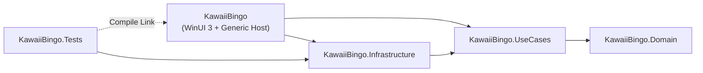
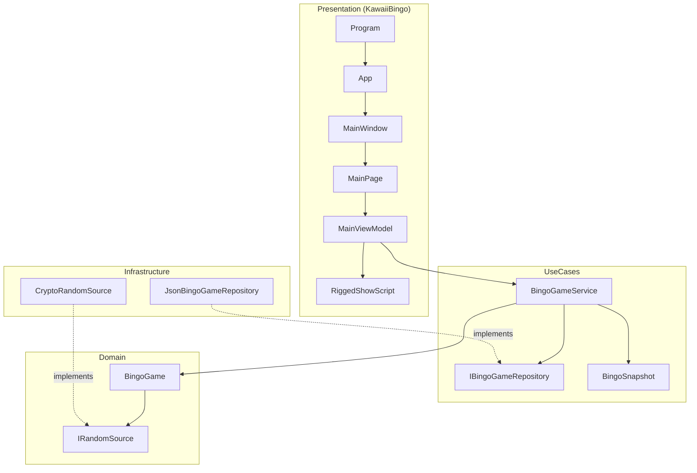
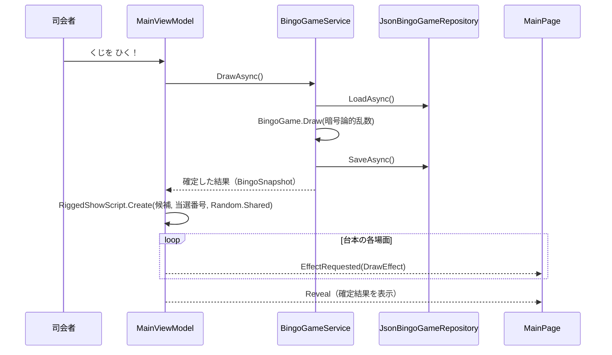

## はじめに 🎉

私が運営している [.NETラボ勉強会](https://dotnetlab.connpass.com/) では、毎年 12 月に「いらないもの交換会」をしています。<!-- TODO: 一次情報で要確認（2026年12月回の connpass イベント URL） --> 参加者が持ち寄った「自分にはもういらないけれど、誰かには刺さるかもしれないもの」を、抽選で交換していく企画です🎁

この交換会の抽選では、楽しく盛り上がるように**毎年演出に凝る**ことにしています。今年用に作ったのが、うさぎと一緒に楽しめるビンゴ抽選アプリ「かわいいビンゴ」です。ソースコードは GitHub で公開しています。

https://github.com/tomokusaba/winui3kawaiiBingo

技術的なポイントは次の 2 つです。

- 🆕 **2026 年 11 月にリリースされたばかりの .NET 11 を基盤にしたこと**
- 🪟 **デスクトップフレームワークに、私が今一押しの WinUI 3 を採用したこと**

この記事では、まずアプリ全体の概要を示し、そのあとで**エントリーポイント（`Program.cs`）から順番に**ソースコードを読んでいきます。WinUI 3 で Generic Host を使いたい方や、「結果は公平なまま、演出だけを派手にしたい」方の参考になればうれしいです🐰

関連記事:

- [.NET 10の概要](https://zenn.dev/tomokusaba/articles/085011c656f22e)
- [【周年行事】チャットアプリの.NET 10化 + 今年はMicrosoft Agent Frameworkも](https://zenn.dev/tomokusaba/articles/05e76f34a3274d)
- [.NET Conf 2024 .NETラボ 勉強会 2024年12月ふりかえり](https://zenn.dev/tomokusaba/articles/e58a7601b9aeaa)

## 本記事の目的

この記事を読み終えると、次のことが分かります。

1. かわいいビンゴの全体構成（4 層構成と依存の向き）
2. WinUI 3 アプリで自前の `Main` を書き、Generic Host の DI から `App` を生成する方法
3. 「当選番号は暗号論的乱数で先に決め、演出はその結果に向けて逆算する」仕組み
4. WinUI 3 の Storyboard とコードで組み立てるアニメーションの使い分け
5. WinUI に依存しないロジックをテストする工夫

## 前提条件

- ✅ Windows 10 1809（ビルド 17763）以降
- ✅ .NET 11 SDK（執筆時点では 11.0.100）
- ✅ Windows App SDK 2.6.5 に対応する Windows App Runtime

起動とテストは、リポジトリのルートで次のコマンドを実行します。

```pwsh
# アプリを起動（既定はアンパッケージ実行）
dotnet run --project src\KawaiiBingo\KawaiiBingo.csproj --no-launch-profile

# テストを実行
dotnet test tests\KawaiiBingo.Tests\KawaiiBingo.Tests.csproj
```

`--no-launch-profile` を付けている理由と、アンパッケージ実行については「ビルド設定のポイント」で説明します。

前提がそろったところで、なぜ .NET 11 と WinUI 3 なのかを先に説明します。

## なぜ .NET 11 と WinUI 3 なのか

### .NET 11 が GA に

.NET 11 は米国時間 2026 年 11 月 10 日（日本時間 11 月 11 日）に一般提供（GA）が始まりました。2026 年 11 月 11 日時点で、ランタイムは 11.0.0、SDK は 11.0.100、言語は C# 15 です。サポート期間 2 年の STS（Standard Term Support）リリースです。

- [Announcing .NET 11](https://devblogs.microsoft.com/dotnet/announcing-dotnet-11/?WT.mc_id=DT-MVP-5004827)
- [What's new in .NET 11](https://learn.microsoft.com/dotnet/core/whats-new/dotnet-11/overview?WT.mc_id=DT-MVP-5004827)

勉強会でお披露目するアプリなので、せっかくならリリースされたばかりの .NET 11 で作りたいと考えました。かわいいビンゴは、全プロジェクトの TFM（ターゲット フレームワーク）を `net11.0`（UI は `net11.0-windows10.0.26100.0`）にしています🚀

### WinUI 3 は新しい Windows デスクトップアプリの推奨フレームワーク

.NET 11 のアナウンス記事では、新しい Windows デスクトップアプリには、ネイティブ UI フレームワークとして WinUI 3 を推奨すると説明されています。Microsoft Learn の WinUI 3 のページにも同じ説明があります。WinUI 3 は Windows App SDK の一部として提供されています。

- [WinUI 3](https://learn.microsoft.com/windows/apps/winui/winui3/?WT.mc_id=DT-MVP-5004827)
- [Windows App SDK 2.x リリースノート](https://learn.microsoft.com/windows/apps/windows-app-sdk/release-notes/windows-app-sdk-2-0?WT.mc_id=DT-MVP-5004827)

ビンゴの演出では、ボールを揺らしたり、紙ふぶきを飛ばしたり、全画面でプロジェクターに映したりします。Storyboard によるアニメーション、`TitleBar` コントロール、`AppWindow` による全画面切り替えなどがそろっている WinUI 3 は、この用途にぴったりでした✨

:::message
Windows App SDK 2.6.5 と .NET 11 の組み合わせについて、公式の互換性表は執筆時点で見つけられていません。手元ではこの組み合わせでビルド・実行できています。
:::

選定理由が分かったところで、アプリ全体の構成を見ていきます。

## アプリの全体像

### できること

1〜75 の番号を重複なく抽選する、ビンゴの抽選専用アプリです。B・I・N・G・O の各列に 15 個ずつ番号があります。

| 領域 | 内容 |
|------|------|
| 🎱 抽選ステージ | うさぎの吹き出し、大きなボール、抽選ボタン「くじを ひく！」、「さっき でた ばんごう」 |
| 🔢 ばんごうボード | 75 個の番号ボード、カウント「n / 75」、「みんなの ビンゴメーター」 |
| ↶ 操作 | 「ひとつ もどす」（Undo）、「はじめから」（リセット） |
| 🖥️ 表示 | F11 またはボタンで全画面、Esc で解除 |
| 💾 保存 | 抽選履歴を JSON で保存し、再起動しても続きから再開 |

<!-- TODO: アプリのスクリーンショットを追加（例: ） -->

### ソリューション構成

ソリューションには新しい XML 形式の `.slnx`（`KawaiiBingo.slnx`）を使い、5 つのプロジェクトで構成しています。

| プロジェクト | TFM | 役割 |
|---|---|---|
| 🧠 `KawaiiBingo.Domain` | `net11.0` | 抽選ルールと状態（`BingoGame`）、乱数の抽象（`IRandomSource`） |
| ⚙️ `KawaiiBingo.UseCases` | `net11.0` | 抽選・取り消し・リセットの手順（`BingoGameService`）、保存の抽象 |
| 💾 `KawaiiBingo.Infrastructure` | `net11.0` | 暗号論的乱数、JSON ファイル保存 |
| 🎨 `KawaiiBingo` | `net11.0-windows10.0.26100.0` | WinUI 3 の画面、Generic Host、ViewModel、演出 |
| 🧪 `KawaiiBingo.Tests` | `net11.0` | MSTest によるテスト |

依存の向きは次のとおりです。内側（Domain）に向かって依存し、画面やファイル保存の方法に抽選ルールが依存しないようにしています。



主なクラスの関係も図にしておきます。Infrastructure が Domain の `IRandomSource` と UseCases の `IBingoGameRepository` を実装する、依存性逆転（Dependency Inversion）の形です。



### 演出の見どころ ― 結果は公平、演出は「いかさま風」

このアプリでいちばん凝ったのが抽選の演出です。ルーレットが止まって「B の 3 に けってい…？」と思わせたあと、肉球がこっそり番号をずらしたり、UFO が番号をさらったりします。最後に本当の番号が出ると、うさぎは口笛を吹いて「…ぐうぜん♡」としらばっくれます🐰

ただし、いかさまに見えるのは**演出だけ**です。1 回の抽選は次の順番で進みます。



当選番号は暗号論的乱数で**先に**決まり、保存まで済んでいます。演出の台本は、その当選番号に着地するように逆算して作ります。演出には別の乱数（`Random.Shared`）を使うので、演出の種類やレア度によって当たりやすさが変わることはありません。

### この記事の読み方

ここから先は、Step 1〜10 の順にコードを読んでいきます。途中で並び方の基準が変わるので、先に地図を示しておきます🗺️

| 区分 | Step | 並び方 |
|------|------|--------|
| 🚀 起動編 | Step 1〜4（Program → Hosting → App → MainWindow） | アプリが起動する順 |
| 🎱 抽選編 | Step 5〜9（MainPage → ViewModels → UseCases → Domain → Infrastructure） | 「くじを ひく！」を押したときの呼び出し順（外側から内側へ）。上のシーケンス図の順番です |
| 🧪 検証編 | Step 10（テスト） | ここまでのコードをどう確かめているか |

全体像がつかめたところで、いよいよエントリーポイントからコードを読んでいきます。

## Step 1: Program.cs ― 自前のエントリーポイント

### 概要

通常の WinUI 3 アプリでは、XAML コンパイラーが `Main` メソッドを自動生成します。かわいいビンゴでは、csproj で `DISABLE_XAML_GENERATED_MAIN` を定義して自動生成を止め、自前の `Main` を書いています。

```xml
<DefineConstants>$(DefineConstants);DISABLE_XAML_GENERATED_MAIN</DefineConstants>
```

狙いは、**`App` を Generic Host の DI コンテナーから生成すること**です。こうすると `App` のコンストラクターにもロガーなどを注入できます。

### コード

```csharp:src/KawaiiBingo/Program.cs
using System.Runtime.InteropServices;
using KawaiiBingo.Hosting;
using Microsoft.Extensions.DependencyInjection;
using Microsoft.Extensions.Hosting;
using Microsoft.UI.Dispatching;
using Microsoft.UI.Xaml;

namespace KawaiiBingo;

/// <summary>Generic Host と WinUI の起動を管理します。</summary>
internal static partial class Program
{
    /// <summary>アプリケーションを開始します。</summary>
    /// <param name="args">起動時の引数です。</param>
    [STAThread]
    private static void Main(string[] args)
    {
        XamlCheckProcessRequirements();
        WinRT.ComWrappersSupport.InitializeComWrappers();

        using var host = AppHostBuilder.Build(args);
        host.Start();
        try
        {
            Application.Start(_ =>
            {
                var context = new DispatcherQueueSynchronizationContext(DispatcherQueue.GetForCurrentThread());
                SynchronizationContext.SetSynchronizationContext(context);
                host.Services.GetRequiredService<App>();
            });
        }
        finally
        {
            host.StopAsync(TimeSpan.FromSeconds(5)).GetAwaiter().GetResult();
        }
    }

    /// <summary>WinUI のプロセス要件を確認します。</summary>
    [LibraryImport("Microsoft.ui.xaml.dll")]
    private static partial void XamlCheckProcessRequirements();
}
```

### 解説

自動生成される `Main` が行う処理を、手書きで再現しています。

1. `XamlCheckProcessRequirements()` で WinUI のプロセス要件を確認
2. `ComWrappersSupport.InitializeComWrappers()` で COM 相互運用を初期化
3. `AppHostBuilder.Build(args)` で Generic Host を構築し、`Start()` で開始
4. `Application.Start` のコールバックで `DispatcherQueueSynchronizationContext` を設定
5. `new App()` の代わりに `host.Services.GetRequiredService<App>()` で `App` を生成

`Application.Start` はメッセージループが終わるまで（ウィンドウを閉じるまで）戻りません。戻ったあと、`finally` でホストを最大 5 秒かけて停止します。

P/Invoke には `DllImport` ではなく、ソース生成型の `LibraryImport` を使っています。メソッドを `partial` にしておくと、マーシャリングのコードがコンパイル時に生成されます。csproj で `AllowUnsafeBlocks` を `true` にしているのも、この生成コードのためです。

- [P/Invoke ソース生成](https://learn.microsoft.com/dotnet/standard/native-interop/pinvoke-source-generation?WT.mc_id=DT-MVP-5004827)

次は、ここで呼んでいる `AppHostBuilder` を見ます。

## Step 2: Hosting ― WinUI 3 で Generic Host を使う

### 概要

`Hosting` フォルダーには 2 つのクラスがあります。

- `AppHostBuilder`: DI・設定・ログを組み立てる
- `WinUiHostLifetime`: ホストの生存期間を WinUI のメッセージループに委ねる

Generic Host を使うと、ASP.NET Core やワーカーサービスと同じ書き方で、デスクトップアプリにも DI・設定・ログを持ち込めます。

- [.NET 汎用ホスト](https://learn.microsoft.com/dotnet/core/extensions/generic-host?WT.mc_id=DT-MVP-5004827)

### コード

```csharp:src/KawaiiBingo/Hosting/AppHostBuilder.cs（抜粋）
/// <summary>アプリケーションの依存関係を組み立てます。</summary>
internal static class AppHostBuilder
{
    /// <summary>WinUI 用の Generic Host を構築します。</summary>
    /// <param name="args">起動時の引数です。</param>
    /// <returns>構築されたホストです。</returns>
    public static IHost Build(string[] args)
    {
        var builder = Host.CreateApplicationBuilder(new HostApplicationBuilderSettings
        {
            Args = args,
            ApplicationName = typeof(App).Assembly.GetName().Name,
            ContentRootPath = AppContext.BaseDirectory
        });

        builder.Logging.ClearProviders();
        builder.Logging.AddDebug();
        builder.ConfigureContainer(new DefaultServiceProviderFactory(new ServiceProviderOptions
        {
            ValidateOnBuild = true,
            ValidateScopes = true
        }));

        builder.Services.AddSingleton<IHostLifetime, WinUiHostLifetime>();
        builder.Services.AddUseCases();
        builder.Services.AddInfrastructure(builder.Configuration);
        builder.Services.AddSingleton<App>();
        builder.Services.AddSingleton<MainWindow>();
        builder.Services.AddSingleton<MainPage>();
        builder.Services.AddSingleton<MainViewModel>();
        return builder.Build();
    }
}
```

```csharp:src/KawaiiBingo/Hosting/WinUiHostLifetime.cs（抜粋）
/// <summary>WinUI のメッセージループにホストの生存期間を委ねます。</summary>
internal sealed class WinUiHostLifetime : IHostLifetime
{
    /// <summary>ホストの起動を待機します。</summary>
    /// <param name="cancellationToken">待機のキャンセルを通知します。</param>
    /// <returns>完了済みのタスクです。</returns>
    public Task WaitForStartAsync(CancellationToken cancellationToken) => Task.CompletedTask;

    /// <summary>ホストの停止を待機します。</summary>
    /// <param name="cancellationToken">待機のキャンセルを通知します。</param>
    /// <returns>完了済みのタスクです。</returns>
    public Task StopAsync(CancellationToken cancellationToken) => Task.CompletedTask;
}
```

### 解説

`AppHostBuilder` のポイントは次のとおりです。

| 設定 | 意図 |
|------|------|
| 📁 `ContentRootPath = AppContext.BaseDirectory` | `appsettings.json` を exe と同じフォルダーから読む（csproj で `CopyToOutputDirectory="PreserveNewest"`） |
| 📝 `AddDebug()` のみ | コンソールのない GUI アプリなので、ログの出力先はデバッガーだけ |
| 🔍 `ValidateOnBuild` / `ValidateScopes` | `ValidateOnBuild` はプロバイダーの構築時に、すべてのサービスを生成できるか（登録漏れがないか）を検証する。`ValidateScopes` は、スコープ付きサービスがルートのプロバイダーから解決されないことを、解決時に検証する |
| 🧩 `AddUseCases()` / `AddInfrastructure()` | 各層が自分の拡張メソッドで DI 登録を受け持つ |
| 🪟 UI の型はすべて Singleton | ウィンドウが 1 枚だけのアプリなので、これで十分 |

- [ServiceProviderOptions クラス](https://learn.microsoft.com/dotnet/api/microsoft.extensions.dependencyinjection.serviceprovideroptions?WT.mc_id=DT-MVP-5004827)

各層の登録内容（`AddUseCases()` と `AddInfrastructure()` の中身）は、Step 7 と Step 9 で見ます。

`WinUiHostLifetime` は、既定の `ConsoleLifetime`（Ctrl+C や SIGTERM を監視する）を、何もしない実装に置き換えています。ホストの終了は WinUI のメッセージループ次第で、きっかけは `Program.cs` の `finally` だけになります。

:::message
UseCases と Infrastructure の csproj には `PackageReference` が 1 つもありません。それでも `Microsoft.Extensions.DependencyInjection` や `Microsoft.Extensions.Configuration`、`Microsoft.Extensions.Logging` の抽象型を使ってビルドできています。.NET 11 から、`Microsoft.Extensions.*.Abstractions` などの 9 つのライブラリが共有フレームワークに含まれるようになったためです。`net11.0` だけをターゲットにするなら、これらの `PackageReference` は不要です（明示的に参照すると NU1510 の警告が出ます）。

- [Some Microsoft.Extensions packages included in shared framework](https://learn.microsoft.com/dotnet/core/compatibility/extensions/11/extensions-in-shared-framework?WT.mc_id=DT-MVP-5004827)
:::

DI の準備ができたので、次はそこから生成される `App` を見ます。

## Step 3: App ― DI から生まれるアプリケーション

### 概要

`App` はアプリ全体のリソース（テーマ・フォント）を定義し、起動時に `MainWindow` を表示します。ここでも `MainWindow` を `new` せず、DI から取り出しています。

### コード

```xml:src/KawaiiBingo/App.xaml（抜粋）
<Application
    x:Class="KawaiiBingo.App"
    xmlns="http://schemas.microsoft.com/winfx/2006/xaml/presentation"
    xmlns:x="http://schemas.microsoft.com/winfx/2006/xaml"
    RequestedTheme="Light">
    <Application.Resources>
        <ResourceDictionary>
            <ResourceDictionary.MergedDictionaries>
                <XamlControlsResources xmlns="using:Microsoft.UI.Xaml.Controls" />
            </ResourceDictionary.MergedDictionaries>
            <FontFamily x:Key="CuteJapaneseFont">ms-appx:///Assets/Fonts/MochiyPopOne-Regular.ttf#Mochiy Pop One</FontFamily>
            <FontFamily x:Key="CuteNumberFont">ms-appx:///Assets/Fonts/Fredoka-Variable.ttf#Fredoka</FontFamily>
        </ResourceDictionary>
    </Application.Resources>
</Application>
```

```csharp:src/KawaiiBingo/App.xaml.cs（抜粋）
/// <summary>ビンゴアプリケーションの起動を管理します。</summary>
public partial class App : Application
{
    /// <summary>起動するウィンドウの依存関係を解決します。</summary>
    private readonly IServiceProvider _services;

    /// <summary>未処理のエラーを記録します。</summary>
    private readonly ILogger<App> _logger;

    /// <summary>表示中のウィンドウを保持します。</summary>
    private Window? _window;

    /// <summary>アプリケーションを初期化します。</summary>
    /// <param name="services">依存関係の提供元です。</param>
    /// <param name="logger">ログの記録先です。</param>
    public App(IServiceProvider services, ILogger<App> logger)
    {
        _services = services;
        _logger = logger;
        InitializeComponent();
        UnhandledException += OnUnhandledException;
    }

    /// <summary>起動時にメインウィンドウを表示します。</summary>
    /// <param name="args">起動時の情報です。</param>
    protected override void OnLaunched(LaunchActivatedEventArgs args)
    {
        _window = _services.GetRequiredService<MainWindow>();
        _window.Activate();
    }

    /// <summary>未処理の例外をログに記録します。</summary>
    /// <param name="sender">イベントの送信元です。</param>
    /// <param name="args">発生した例外の情報です。</param>
    private void OnUnhandledException(object sender, Microsoft.UI.Xaml.UnhandledExceptionEventArgs args)
    {
        _logger.LogCritical(args.Exception, "アプリケーションで予期しないエラーが発生しました。");
    }
}
```

### 解説

- 🎨 **テーマを Light に固定**: パステル調の配色を崩さないためです。
- 🔤 **フォントを同梱**: 日本語は Mochiy Pop One、数字と英字は Fredoka（可変フォント）を使います。どちらも SIL Open Font License です。XAML 側ではリソース名 `CuteJapaneseFont` と `CuteNumberFont` で使い分けます。
- 🧯 **未処理例外はログに残すだけ**: `Handled` は設定していないので、既定の挙動（アプリの終了）は変わりません。

- [Application.UnhandledException イベント](https://learn.microsoft.com/windows/windows-app-sdk/api/winrt/microsoft.ui.xaml.application.unhandledexception?WT.mc_id=DT-MVP-5004827)

<!-- TODO: 一次情報で要確認（アンパッケージ実行での ms-appx:/// によるフォント参照の扱い） -->

`App` が表示する `MainWindow` に進みます。

## Step 4: MainWindow ― タイトルバーと全画面

### 概要

`MainWindow` は、コンストラクターで `MainPage` を受け取って表示するだけの薄いウィンドウです。Frame によるナビゲーションは使っていません。そのかわり、会場のプロジェクターで映すための**全画面切り替え**と、**ウィンドウサイズの調整**を受け持ちます。

### コード

```xml:src/KawaiiBingo/MainWindow.xaml
<Window
    x:Class="KawaiiBingo.MainWindow"
    xmlns="http://schemas.microsoft.com/winfx/2006/xaml/presentation"
    xmlns:x="http://schemas.microsoft.com/winfx/2006/xaml"
    Title="かわいいビンゴ">
    <Grid Background="#FFF4F6">
        <Grid.RowDefinitions>
            <RowDefinition x:Name="TitleBarRow" Height="40" />
            <RowDefinition Height="*" />
        </Grid.RowDefinitions>
        <TitleBar x:Name="AppTitleBar" Title="かわいいビンゴ" Background="Transparent" />
        <ContentPresenter x:Name="PageHost" Grid.Row="1" />
        <Grid.KeyboardAccelerators>
            <KeyboardAccelerator Key="F11" Invoked="OnFullScreenAccelerator" />
            <KeyboardAccelerator Key="Escape" Invoked="OnExitFullScreenAccelerator" />
        </Grid.KeyboardAccelerators>
    </Grid>
</Window>
```

```csharp:src/KawaiiBingo/MainWindow.xaml.cs（抜粋）
    /// <summary>メイン画面をウィンドウに配置します。</summary>
    /// <param name="page">表示するメイン画面です。</param>
    public MainWindow(MainPage page)
    {
        _page = page;
        InitializeComponent();
        ExtendsContentIntoTitleBar = true;
        SetTitleBar(AppTitleBar);
        PageHost.Content = page;
        page.FullScreenRequested += OnFullScreenRequested;
        AppWindow.Changed += OnAppWindowChanged;
        ConfigureWindow();
    }
```

```csharp:src/KawaiiBingo/MainWindow.xaml.cs（抜粋）
    /// <summary>現在のウィンドウ位置を維持して、全画面表示を切り替えます。</summary>
    private void ToggleFullScreen() => AppWindow.SetPresenter(
        AppWindow.Presenter.Kind == AppWindowPresenterKind.FullScreen
            ? AppWindowPresenterKind.Overlapped
            : AppWindowPresenterKind.FullScreen);

    /// <summary>全画面ではタイトルバーの余白をなくし、終了の案内を更新します。</summary>
    /// <param name="sender">変更されたウィンドウです。</param>
    /// <param name="args">変更の情報です。</param>
    private void OnAppWindowChanged(AppWindow sender, AppWindowChangedEventArgs args)
    {
        if (args.DidPresenterChange)
        {
            var isFullScreen = sender.Presenter.Kind == AppWindowPresenterKind.FullScreen;
            TitleBarRow.Height = new GridLength(isFullScreen ? 0 : 40);
            AppTitleBar.Visibility = isFullScreen ? Visibility.Collapsed : Visibility.Visible;
            _page.SetFullScreenState(isFullScreen);
        }
    }
```

### 解説

- 🪟 **タイトルバーまで広げる**: `TitleBar` コントロールと `ExtendsContentIntoTitleBar = true` で、アプリの背景色をタイトルバーまで広げています。
- 🖥️ **全画面の切り替え**: `AppWindow.SetPresenter` で `FullScreen` と `Overlapped` を切り替えます。F11 と画面右上のボタンで切り替え、全画面中だけ Esc で解除できます。
- 📐 **全画面中はタイトルバーを隠す**: `AppWindow.Changed` の `DidPresenterChange` を見て、タイトルバーの行の高さを 0 にします。`MainPage` 側のボタン表示（「全画面」/「全画面を終了」）もここで更新します。
- 📏 **ウィンドウサイズ**: `ConfigureWindow` では、`GetDpiForWindow`（こちらも `LibraryImport` で user32.dll を呼びます）で倍率を求めます。論理サイズ 1420×900 を基本に、作業領域の 94% を上限として中央に配置し、最小サイズを 650×480 にしています。

- [アプリ ウィンドウを管理する](https://learn.microsoft.com/windows/apps/develop/ui/manage-app-windows?WT.mc_id=DT-MVP-5004827)

ウィンドウの中身である `MainPage` が、このアプリでいちばん大きなファイルです。

## Step 5: MainPage ― 画面と演出の再生役

### 概要

`MainPage` は画面のレイアウトと、演出（アニメーション）の再生を受け持ちます。ViewModel から届く `DrawEffect` を受け取り、対応する Storyboard を再生する「再生役」です。

どの演出をどの順に出すかは、Step 6 で読む台本（`RiggedShowScript`）が決めます。この Step では、届いた効果をどう見せるかに絞って読みます。「けってい…？」（FakeStop）や急変（Twist）といった演出の意味は、全体像の「演出の見どころ」と Step 6 で説明します。

### コンストラクターと番号ボード

```csharp:src/KawaiiBingo/MainPage.xaml.cs（抜粋）
    /// <summary>画面を作成します。</summary>
    /// <param name="viewModel">画面の状態と操作です。</param>
    public MainPage(MainViewModel viewModel)
    {
        ViewModel = viewModel;
        InitializeComponent();
        InitializeNumberBoard();
        Loaded += OnLoaded;
        ViewModel.Revealed += OnRevealed;
        ViewModel.EffectRequested += OnEffectRequested;
    }

    /// <summary>画面の表示時に保存済みの状態を読み込みます。</summary>
    /// <param name="sender">イベントの送信元です。</param>
    /// <param name="args">イベントの情報です。</param>
    private async void OnLoaded(object sender, RoutedEventArgs args) => await ViewModel.InitializeAsync();

    /// <summary>番号と見出しを、表示領域全体に広がる均等なマスへ配置します。</summary>
    private void InitializeNumberBoard()
    {
        var letterTemplate = (DataTemplate)Resources["BoardLetterTemplate"];
        var numberTemplate = (DataTemplate)Resources["BoardNumberTemplate"];
        var columnCount = ViewModel.Rows[0].Cells.Count + 1;
        for (var column = 0; column < columnCount; column++)
        {
            NumberBoard.ColumnDefinitions.Add(new ColumnDefinition { Width = new GridLength(1, GridUnitType.Star) });
        }

        for (var row = 0; row < ViewModel.Rows.Count; row++)
        {
            NumberBoard.RowDefinitions.Add(new RowDefinition { Height = new GridLength(1, GridUnitType.Star) });
            AddBoardItem(ViewModel.Rows[row], letterTemplate, row, 0);
            for (var column = 0; column < ViewModel.Rows[row].Cells.Count; column++)
            {
                AddBoardItem(ViewModel.Rows[row].Cells[column], numberTemplate, row, column + 1);
            }
        }
    }
```

番号ボードは、16 列（見出しの文字 1 列＋番号 15 列）× 5 行の `Grid` をコードで組み立てています。すべて Star（`*` による比率）指定にしているので、ボードは余白を残さず画面いっぱいに広がります。各マスは `ContentPresenter` に `DataTemplate` を割り当てて表示します。

### レスポンシブな拡大

プロジェクターの解像度は会場によってまちまちです。そこで、画面全体を `Viewbox` で一様に拡大する作りにしています。

```xml:src/KawaiiBingo/MainPage.xaml（抜粋）
        <ScrollViewer HorizontalScrollMode="Disabled" HorizontalScrollBarVisibility="Disabled"
                      VerticalScrollBarVisibility="Auto">
            <Viewbox Stretch="Uniform" HorizontalAlignment="Stretch" VerticalAlignment="Top">
                <Grid x:Name="ContentSurface" Width="1280" Height="720" Padding="20,12,20,20">
```

`ContentSurface` の論理サイズは `BingoLayout.Fit` で求めます。

```csharp:src/KawaiiBingo/Layout/BingoLayout.cs（抜粋）
/// <summary>縦横比を保って拡大する画面の論理サイズと配置を表します。</summary>
/// <param name="Width">画面の論理幅です。</param>
/// <param name="Height">画面の論理高さです。</param>
/// <param name="IsWide">抽選と番号ボードを左右に配置するかどうかです。</param>
internal readonly record struct BingoLayout(double Width, double Height, bool IsWide)
{
    /// <summary>表示領域を使い切り、操作部を小さくしすぎない画面サイズを求めます。</summary>
    /// <param name="width">利用できる表示領域の幅です。</param>
    /// <param name="height">利用できる表示領域の高さです。</param>
    /// <param name="errorHeight">エラー表示に必要な追加の高さです。</param>
    /// <returns>拡大前の画面サイズと配置です。</returns>
    public static BingoLayout Fit(double width, double height, double errorHeight)
    {
        ArgumentOutOfRangeException.ThrowIfNegativeOrZero(width);
        ArgumentOutOfRangeException.ThrowIfNegativeOrZero(height);
        ArgumentOutOfRangeException.ThrowIfNegative(errorHeight);

        var isWide = width >= 1000 && width / height >= 1.2;
        var minimumHeight = (isWide ? 720 : 1180) + errorHeight;
        var widthScale = width / (isWide ? 1280 : 720);
        var scale = isWide
            ? Math.Max(0.78, Math.Min(widthScale, height / minimumHeight))
            : widthScale;

        return new BingoLayout(width / scale, Math.Max(minimumHeight, height / scale), isWide);
    }
}
```

| 画面 | 条件 | 配置 |
|------|------|------|
| ↔️ 横長 | 幅 1000 以上かつ縦横比 1.2 以上 | 左に抽選ステージ、右にボード（列幅 `1* : 2.15*`）。基準 1280×720、倍率の下限 0.78 |
| ↕️ それ以外 | 上記以外 | 縦に積む。論理幅 720・最低高さ 1180。足りない分は縦スクロール |

論理サイズを計算してから `Viewbox` で拡大するので、文字も演出も同じ倍率で大きくなります。4K のプロジェクターでも、余白ばかりが増えることはありません📽️

`BingoLayout` は WinUI に依存しない `record struct` なので、あとで紹介するテストから直接検証できます。

### アクセシビリティ

抽選アプリでも、スクリーンリーダーで結果が分かるようにしています。

- 現在の番号を表示する `CurrentBallText` に `AutomationProperties.LiveSetting="Polite"` を付けています。
- 番号が確定すると、`OnRevealed` が `LiveRegionChanged` を発火し、スクリーンリーダーが読み上げます。
- 演出中は「抽選演出中です。表示中の番号は確定結果ではありません。」と名前を切り替え、見えている番号と確定結果を区別できるようにしています。
- 装飾用の要素には `AccessibilityView="Raw"` を付け、ボードの各マスには「B の 3、抽選済み」のような名前を付けています。

```csharp:src/KawaiiBingo/MainPage.xaml.cs（抜粋）
    /// <summary>新しい番号が決まったときに読み上げを行います。</summary>
    /// <param name="sender">イベントの送信元です。</param>
    /// <param name="args">イベントの情報です。</param>
    private void OnRevealed(object? sender, EventArgs args)
    {
        var peer = FrameworkElementAutomationPeer.CreatePeerForElement(CurrentBallText);
        peer?.RaiseAutomationEvent(AutomationEvents.LiveRegionChanged);
    }
```

関連記事: [Windows標準アクセシビリティ機能を3分類で整理してみる](https://zenn.dev/tomokusaba/articles/fb0f4137b05a3c)

### 演出の振り分け

ViewModel から届いた `DrawEffect` を、Storyboard の再生に振り分けるのが `OnEffectRequested` です。

```csharp:src/KawaiiBingo/MainPage.xaml.cs（抜粋）
    /// <summary>抽選演出の各場面に合わせてアニメーションを再生します。</summary>
    /// <param name="sender">イベントの送信元です。</param>
    /// <param name="effect">再生する効果です。</param>
    private void OnEffectRequested(object? sender, DrawEffect effect)
    {
        switch (effect)
        {
            case DrawEffect.Begin:
                ResetEffects();
                _currentTrick = null;
                break;
            case DrawEffect.Tick:
                TickStoryboard.Begin();
                break;
            case DrawEffect.FakeStop:
                TickStoryboard.Stop();
                StopSuspense();
                DecoyBadgeText.Text = "けってい…？";
                FakeStopStoryboard.Begin();
                break;
            case DrawEffect.Heartbeat:
                StopSuspense();
                HeartbeatStoryboard.Begin();
                break;
            case DrawEffect.FakeConfirm:
                StopSuspense();
                DecoyBadgeText.Text = "けってい♡";
                FakeConfirmStoryboard.Begin();
                break;
            case DrawEffect.Twist:
                StopSuspense();
                DecoyBadgeText.Text = "！？";
                TwistStoryboard.Begin();
                break;
            case DrawEffect.SneakStart:
                StartTrick(effect);
                SneakStoryboard.Begin();
                break;
            case DrawEffect.Nudge:
                NudgeStoryboard.Begin();
                break;
            case DrawEffect.Magic:
            case DrawEffect.Magnet:
            case DrawEffect.Gift:
            case DrawEffect.Stamp:
            case DrawEffect.Ufo:
            case DrawEffect.Cloud:
            case DrawEffect.Reverse:
            case DrawEffect.Carrot:
            case DrawEffect.Rainbow:
                StartTrick(effect);
                break;
            case DrawEffect.Reveal:
                var trick = _currentTrick;
                ResetEffects();
                RevealStoryboard.Begin();
                BurstConfetti(trick);
                break;
            case DrawEffect.Cancel:
                ResetEffects();
                _currentTrick = null;
                break;
        }
    }
```

### XAML で定義した Storyboard

決まった動きの演出は、`MainPage.xaml` に Storyboard として定義しています。

| Storyboard | 動き |
|------------|------|
| 🎱 `TickStoryboard` | ボールを 0.12 秒で横に伸ばし縦に縮めてから戻す。ルーレットの 1 コマ |
| 🤔 `FakeStopStoryboard` | ボールが左右に揺れ、「けってい…？」バッジがポップアップ |
| 💓 `HeartbeatStoryboard` | ボールが 2 回脈打ち、光の輪が広がって消える |
| 🎊 `FakeConfirmStoryboard` | ボールが跳ねて BounceEase で着地。「けってい♡」でぬか喜びさせる |
| ❗ `TwistStoryboard` | ボールが激しく揺れ、つぶれて伸びる |
| 🐾 `SneakStoryboard` | うさぎが横目になって汗を垂らし、肉球が右からこっそり現れる |
| 👉 `NudgeStoryboard` | ボールと肉球が押され、ボールは ElasticEase で弾んで戻る |
| ✨ `RevealStoryboard` | ボールが弾んで登場。うさぎが口笛（♪）を吹いてしらばっくれる |

たとえば `FakeStopStoryboard` は次のように書いています。

```xml:src/KawaiiBingo/MainPage.xaml（抜粋）
        <Storyboard x:Name="FakeStopStoryboard">
            <DoubleAnimationUsingKeyFrames Storyboard.TargetName="BallTransform" Storyboard.TargetProperty="Rotation">
                <LinearDoubleKeyFrame KeyTime="0:0:0" Value="0" />
                <EasingDoubleKeyFrame KeyTime="0:0:0.14" Value="-9" />
                <EasingDoubleKeyFrame KeyTime="0:0:0.30" Value="6" />
                <EasingDoubleKeyFrame KeyTime="0:0:0.46" Value="-3" />
                <EasingDoubleKeyFrame KeyTime="0:0:0.62" Value="0" />
            </DoubleAnimationUsingKeyFrames>
            <DoubleAnimation Storyboard.TargetName="DecoyBadge" Storyboard.TargetProperty="Opacity"
                             From="0" To="1" Duration="0:0:0.2" />
            <DoubleAnimationUsingKeyFrames Storyboard.TargetName="DecoyBadgeTransform" Storyboard.TargetProperty="ScaleX">
                <LinearDoubleKeyFrame KeyTime="0:0:0" Value="0.4" />
                <EasingDoubleKeyFrame KeyTime="0:0:0.3" Value="1">
                    <EasingDoubleKeyFrame.EasingFunction><BackEase Amplitude="0.8" EasingMode="EaseOut" /></EasingDoubleKeyFrame.EasingFunction>
                </EasingDoubleKeyFrame>
            </DoubleAnimationUsingKeyFrames>
            <DoubleAnimationUsingKeyFrames Storyboard.TargetName="DecoyBadgeTransform" Storyboard.TargetProperty="ScaleY">
                <LinearDoubleKeyFrame KeyTime="0:0:0" Value="0.4" />
                <EasingDoubleKeyFrame KeyTime="0:0:0.3" Value="1">
                    <EasingDoubleKeyFrame.EasingFunction><BackEase Amplitude="0.8" EasingMode="EaseOut" /></EasingDoubleKeyFrame.EasingFunction>
                </EasingDoubleKeyFrame>
            </DoubleAnimationUsingKeyFrames>
        </Storyboard>
```

うさぎのマスコットは、耳・ほっぺ・目・汗などを `Ellipse` と `Path` で、口（「ᴗ」）と口笛（「♪」）を文字で描いています。画像を使わないので、`Viewbox` で拡大しても劣化しません🐰

### コードで組み立てる演出

いたずら（いかさま風の演出）は肉球を含めて 10 種類あり、それぞれ動きが違います。これを全部 XAML に書くと大変なので、`StartTrick` でコードから組み立てています。まず、演出ごとに小道具の絵文字・ラベル・色・大きさを決めます。

```csharp:src/KawaiiBingo/MainPage.xaml.cs（抜粋）
        var (symbol, label, color, size) = effect switch
        {
            DrawEffect.SneakStart => ("", "にくきゅう", Color.FromArgb(255, 0xEF, 0x9E, 0xBB), 76d),
            DrawEffect.Magic => ("🪄", "まほうのつえ", Color.FromArgb(255, 0xB1, 0x89, 0xE5), 76d),
            DrawEffect.Magnet => ("🧲", "くっつきじしゃく", Color.FromArgb(255, 0x66, 0xB7, 0xD6), 82d),
            DrawEffect.Gift => ("🎁", "ひみつのはこ", Color.FromArgb(255, 0xEF, 0x8B, 0xB1), 104d),
            DrawEffect.Stamp => ("💮", "こっそり はんこ", Color.FromArgb(255, 0xEC, 0x84, 0x98), 104d),
            DrawEffect.Ufo => ("🛸", "うちゅうから！？", Color.FromArgb(255, 0x6C, 0xC9, 0xBD), 82d),
            DrawEffect.Cloud => ("☁️", "くもの かくれんぼ", Color.FromArgb(255, 0x89, 0xB8, 0xDB), 150d),
            DrawEffect.Reverse => ("↺", "ぎゃくかいてん", Color.FromArgb(255, 0xE7, 0xAD, 0x48), 110d),
            DrawEffect.Carrot => ("🥕", "にんじんで よそみ", Color.FromArgb(255, 0xEC, 0xA1, 0x5E), 100d),
            DrawEffect.Rainbow => ("🌈", "レインボー！", Color.FromArgb(255, 0xDF, 0x9D, 0xCE), 110d),
            _ => throw new ArgumentOutOfRangeException(nameof(effect), effect, "未知の演出です。")
        };
```

肉球（`SneakStart`）だけは、XAML の `SneakyPaw` で描いているため絵文字が空文字列です。

動きは `AddKeyFrames` ヘルパーで組み立てます。`(ミリ秒, 値)` の組を可変長で受け取り、CubicEase 付きの `DoubleAnimationUsingKeyFrames` に変換します。

```csharp:src/KawaiiBingo/MainPage.xaml.cs（抜粋）
    /// <summary>複数の時点と値を指定してアニメーションを追加します。</summary>
    /// <param name="storyboard">追加先のストーリーボードです。</param>
    /// <param name="target">動かす要素または変形です。</param>
    /// <param name="property">動かすプロパティ名です。</param>
    /// <param name="frames">開始からのミリ秒と、その時点の値です。</param>
    private static void AddKeyFrames(
        Storyboard storyboard,
        DependencyObject target,
        string property,
        params (int Milliseconds, double Value)[] frames)
    {
        var animation = new DoubleAnimationUsingKeyFrames();
        foreach (var (milliseconds, value) in frames)
        {
            animation.KeyFrames.Add(new EasingDoubleKeyFrame
            {
                KeyTime = KeyTime.FromTimeSpan(TimeSpan.FromMilliseconds(milliseconds)),
                Value = value,
                EasingFunction = new CubicEase { EasingMode = EasingMode.EaseOut }
            });
        }

        Storyboard.SetTarget(animation, target);
        Storyboard.SetTargetProperty(animation, property);
        storyboard.Children.Add(animation);
    }
```

たとえば魔法（Magic）では、杖を振りながらボールを 0.08 倍まで縮めて元に戻し、「番号がすり替わった」ように見せます。

```csharp:src/KawaiiBingo/MainPage.xaml.cs（抜粋）
            case DrawEffect.Magic:
                AddKeyFrames(storyboard, TrickSymbolTransform, "TranslateX", (0, -110), (500, 60), (1000, 90));
                AddKeyFrames(storyboard, TrickSymbolTransform, "TranslateY", (0, -65), (500, 40), (1000, -75));
                AddKeyFrames(storyboard, TrickSymbolTransform, "Rotation", (0, -60), (500, 65), (1000, -20));
                AddKeyFrames(storyboard, BallTransform, "ScaleX", (0, 1), (400, 0.08), (550, 0.08), (1050, 1));
                AddKeyFrames(storyboard, BallTransform, "ScaleY", (0, 1), (400, 0.08), (550, 0.08), (1050, 1));
                break;
```

ほかにも、UFO では光線を出してボールを持ち上げ、逆回転（Reverse）ではボールを -720 度回転させます。レアな虹（Rainbow）のときは、その場で紙ふぶきも飛ばします。

決まった動きは XAML、組み合わせが多い動きはコード、という使い分けです。キーフレームを数値の組で書けるので、演出の調整がとても楽でした🪄

### 紙ふぶき

`BurstConfetti` は、22 片（Rainbow は 32 片）の `TextBlock` を放射状に飛ばし、回転させながらフェードアウトさせます。形と色は演出の種類ごとのテーマで決まります（たとえば雲なら ☁♡✧）。結果発表（Reveal）のときは、直前に再生したいたずらのテーマで紙ふぶきを出します🎊

画面の再生役が分かったので、次は演出の「指揮者」である ViewModel を見ます。

## Step 6: ViewModels ― 抽選と演出の指揮者

### 概要

`ViewModels` フォルダーの中心は `MainViewModel` です。CommunityToolkit.Mvvm の `ObservableObject` を継承し、コマンドは `AsyncRelayCommand` で作っています。全体像のシーケンス図でいうと `VM → S → R` の部分を、ここから Step 9 まで順にたどります。

| ファイル | 役割 |
|----------|------|
| 🎯 `MainViewModel.cs` | 画面の状態とコマンド。抽選と演出の進行役 |
| 📜 `RiggedShowScript.cs` | 演出の台本を組み立てる（この Step の後半で解説） |
| 🎬 `DrawEffect.cs` | 演出の種類（19 個の列挙値） |
| 🔲 `BingoCellViewModel.cs` | ボードの 1 マス。抽選済み・最新・スポットライトの 3 状態から見た目を決める |
| 📏 `BingoRowViewModel.cs` | ボードの 1 行（見出し 1 文字＋15 マス） |
| 🕘 `RecentNumberViewModel.cs` | 「さっき でた ばんごう」の 1 件（「B-12」形式） |
| 🎨 `BingoPalette.cs` | 5 列ぶんのパステルカラー |

:::details BingoPalette の配色
文字色を濃くして、淡い背景とのコントラストを確保しています。

| 用途 | B | I | N | G | O |
|---|---|---|---|---|---|
| 🔴 ボール | #F578A6 | #F39B62 | #EFC443 | #68CAA2 | #A88BEE |
| 🌸 淡い色 | #FFD5E5 | #FFE1C9 | #FFEFB4 | #CBF0DF | #E7DEFF |
| 🖋️ 文字色 | #942F59 | #954719 | #765B0C | #177050 | #60429D |
:::

### コンストラクター

```csharp:src/KawaiiBingo/ViewModels/MainViewModel.cs（抜粋）
    /// <summary>画面の状態と操作を初期化します。</summary>
    /// <param name="gameService">抽選のユースケースです。</param>
    /// <param name="logger">ログの記録先です。</param>
    public MainViewModel(BingoGameService gameService, ILogger<MainViewModel> logger)
    {
        _gameService = gameService;
        _logger = logger;
        Rows = Enumerable.Range(0, 5).Select(index => new BingoRowViewModel(index * 15 + 1)).ToArray();
        DrawCommand = new AsyncRelayCommand(DrawAsync, CanDrawNumber);
        UndoCommand = new AsyncRelayCommand(UndoAsync, CanUndoNumber);
        RetryCommand = new AsyncRelayCommand(InitializeAsync, CanRetry);
    }

    /// <summary>新しい番号が決まったときに発生します。</summary>
    public event EventHandler? Revealed;

    /// <summary>抽選演出の効果を画面で再生してほしいときに発生します。</summary>
    public event EventHandler<DrawEffect>? EffectRequested;
```

ViewModel は Storyboard を直接触りません。`EffectRequested` イベントで「この演出を再生して」と View に頼むだけです。これで ViewModel に UI の都合を持ち込まずに済みます。

### DrawAsync ― 抽選の中心

```csharp:src/KawaiiBingo/ViewModels/MainViewModel.cs（抜粋）
    /// <summary>番号を一つ抽選して保存し、その結果に合わせた演出を再生します。</summary>
    /// <returns>抽選の完了を表すタスクです。</returns>
    private async Task DrawAsync()
    {
        if (!CanDrawNumber() || _snapshot is null)
        {
            return;
        }

        SetBusy(true);
        SetDrawing(true);
        SetDrawButtonText("まぜまぜ…");
        ErrorMessage = string.Empty;
        Message = "まぜまぜ まぜまぜ…♪";
        var previous = _snapshot;
        BingoSnapshot? saved = null;
        try
        {
            var candidates = previous.RemainingNumbers;
            saved = await _gameService.DrawAsync();
            var winner = saved.LastNumber ?? throw new InvalidOperationException("抽選結果の番号がありません。");

            await PlayRiggedShowAsync(candidates, winner);

            SetSpotlight(null);
            SetDrawing(false);
            ApplySnapshot(saved);
            Message = saved.IsComplete
                ? "ぜんぶ でたよ！ おめでとう！"
                : $"{CurrentLetter} の {CurrentNumberText} が でたよ！ …ぐうぜん♡";
            RaiseEffect(DrawEffect.Reveal);
        }
        catch (Exception exception)
        {
            SetSpotlight(null);
            SetDrawing(false);
            ApplySnapshot(saved ?? previous);
            RaiseEffect(DrawEffect.Cancel);
            if (saved is null)
            {
                ReportError(exception);
            }
            else
            {
                _logger.LogError(exception, "抽選演出を再生できませんでした。抽選結果は保存されています。");
                Message = $"{CurrentLetter} の {CurrentNumberText} が でたよ！";
                ErrorMessage = $"演出を再生できませんでした。抽選結果は保存されています。 ({exception.Message})";
            }
        }
        finally
        {
            SetDrawing(false);
            SetDrawButtonText(null);
            SetBusy(false);
        }

        if (saved is not null)
        {
            try
            {
                Revealed?.Invoke(this, EventArgs.Empty);
            }
            catch (Exception exception)
            {
                _logger.LogError(exception, "抽選結果の読み上げ通知を送信できませんでした。");
                var notificationError = $"結果の読み上げ通知に失敗しました。抽選結果は保存されています。 ({exception.Message})";
                ErrorMessage = string.IsNullOrEmpty(ErrorMessage) ? notificationError : $"{ErrorMessage} {notificationError}";
            }
        }
    }
```

流れを整理すると次のとおりです。

1. 抽選前に残っていた番号（`candidates`）を控えておく
2. `_gameService.DrawAsync()` で**公平な抽選と保存を済ませる**
3. 確定した当選番号（`winner`）に向けて、いかさま風の演出を再生する
4. 確定結果を表示し、「…ぐうぜん♡」でオチをつける

エラーは 2 種類に分けて扱います。保存に失敗した場合（`saved is null`）は、履歴を前の状態のまま表示します。演出だけが失敗した場合は、「抽選結果は保存されています」と案内します。本番の会場で演出が止まっても、結果は失われません。

### PlayRiggedShowAsync と SpinAsync

```csharp:src/KawaiiBingo/ViewModels/MainViewModel.cs（抜粋）
    /// <summary>ルーレットと、ランダムに選ばれたいたずら演出を順番に再生します。</summary>
    /// <param name="candidates">抽選前に残っていた番号です。</param>
    /// <param name="winner">実際に抽選された番号です。</param>
    /// <returns>演出の完了を表すタスクです。</returns>
    private async Task PlayRiggedShowAsync(IReadOnlyList<int> candidates, int winner)
    {
        var script = RiggedShowScript.Create(candidates, winner, Random.Shared);
        RaiseEffect(DrawEffect.Begin);
        await SpinAsync(candidates, 19, script.FirstStop);

        foreach (var step in script.Steps)
        {
            Message = step.Message;
            SetDrawButtonText(step.ButtonText);
            if (step.Number is int number)
            {
                SetDisplayNumber(number);
                SetSpotlight(number);
            }

            if (step.Effect is DrawEffect effect)
            {
                RaiseEffect(effect);
            }

            await Task.Delay(step.DurationMilliseconds);
        }
    }

    /// <summary>ボールとボードのスポットライトを、だんだん遅くしながら回します。</summary>
    /// <param name="candidates">表示に使う番号です。</param>
    /// <param name="steps">回す回数です。</param>
    /// <param name="stopAt">最後に止まって見せる番号です。</param>
    /// <returns>回転の完了を表すタスクです。</returns>
    private async Task SpinAsync(IReadOnlyList<int> candidates, int steps, int stopAt)
    {
        for (var step = 0; step < steps; step++)
        {
            var number = step == steps - 1 ? stopAt : candidates[Random.Shared.Next(candidates.Count)];
            SetDisplayNumber(number);
            SetSpotlight(number);
            RaiseEffect(DrawEffect.Tick);
            var progress = (double)step / steps;
            await Task.Delay((int)(45 + 380 * progress * progress * progress * progress));
        }
    }
```

ルーレットは 19 コマ回ります。各コマの待ち時間は `45 + 380 × p⁴` ミリ秒（`p` は進み具合）なので、最初は速く、最後に向けてぐっと遅くなります。合計はおよそ 2.1 秒です。最後のコマは、台本の最初の停止番号（`FirstStop`）に止まります。

台本の各場面（`step`）は、メッセージ・ボタンの文字・表示番号・効果・待ち時間を持つだけのデータです。ViewModel はそれを順番に再生するだけなので、台本そのものは次の `RiggedShowScript` に任せています。

### RiggedShowScript ― 結果から逆算する演出の台本

「Rigged」は「八百長・いかさま」という意味です。ただし実際にいかさまはしません。**すでに決まった当選番号に着地するように、逆算して作る演出の台本**です。

```csharp:src/KawaiiBingo/ViewModels/RiggedShowScript.cs（抜粋）
/// <summary>演出中の一場面を表します。</summary>
/// <param name="Effect">再生する効果、または表示だけを変える場合の null です。</param>
/// <param name="Number">表示する候補番号、または変更しない場合の null です。</param>
/// <param name="Message">マスコットの案内文です。</param>
/// <param name="ButtonText">抽選ボタンに表示する文字列です。</param>
/// <param name="DurationMilliseconds">次の場面までの時間です。</param>
internal sealed record RiggedShowStep(
    DrawEffect? Effect,
    int? Number,
    string Message,
    string ButtonText,
    int DurationMilliseconds);

/// <summary>確定済みの抽選結果を変えずに、0〜3回のいかさま風演出とためを組み立てます。</summary>
internal sealed class RiggedShowScript
{
    /// <summary>一回の抽選で行う、いかさまの最大回数です。</summary>
    public const int MaxTricks = 3;

    /// <summary>演出の種類と、それぞれが選ばれる重みです。</summary>
    private static readonly (RiggedShowPattern Pattern, int Weight)[] PatternWeights =
    [
        (RiggedShowPattern.Paw, 14),
        (RiggedShowPattern.Magic, 13),
        (RiggedShowPattern.Magnet, 12),
        (RiggedShowPattern.Gift, 11),
        (RiggedShowPattern.Stamp, 10),
        (RiggedShowPattern.Ufo, 10),
        (RiggedShowPattern.Cloud, 9),
        (RiggedShowPattern.Reverse, 8),
        (RiggedShowPattern.Carrot, 8),
        (RiggedShowPattern.Rainbow, 5)
    ];

    /// <summary>いかさまの回数（0〜3回）と、それぞれが選ばれる重みです。</summary>
    private static readonly int[] TrickCountWeights = [20, 35, 30, 15];
```

いかさまの回数と種類は、重み付きの抽選で決まります。

| 🎲 いかさまの回数 | 0 回 | 1 回 | 2 回 | 3 回 |
|---|---|---|---|---|
| 確率 | 20% | 35% | 30% | 15% |

| 種類 | 重み | 演出 |
|------|------|------|
| 🐾 Paw | 14 | 肉球で番号を押してずらす |
| 🪄 Magic | 13 | 魔法の杖で番号を変える |
| 🧲 Magnet | 12 | 磁石で番号を引き寄せる |
| 🎁 Gift | 11 | プレゼントの箱から番号が現れる |
| 💮 Stamp | 10 | こっそりスタンプを押す |
| 🛸 Ufo | 10 | 空飛ぶ円盤が番号をさらう |
| ☁️ Cloud | 9 | 雲に隠れて番号が入れ替わる |
| ↺ Reverse | 8 | ルーレットが逆回転する |
| 🥕 Carrot | 8 | にんじんで目をそらす |
| 🌈 Rainbow | 5 | 虹と星が飛び出す特別な演出（レア） |

1 回の抽選の中で、同じ種類は繰り返しません。使用済みの種類を除外してから重み付きで選びます。

台本づくりの核心は、停止番号を**後ろから**決めるところです。

```csharp:src/KawaiiBingo/ViewModels/RiggedShowScript.cs（抜粋）
        var others = candidates.Where(number => number != winner).ToArray();
        var played = patterns.Take(Math.Min(MaxTricks, others.Length)).ToArray();
        var stops = new int[played.Length + 1];
        stops[^1] = winner;
        for (var index = played.Length - 1; index >= 0; index--)
        {
            var next = stops[index + 1];
            var pool = others.Where(number => number != next && !stops[(index + 1)..^1].Contains(number)).ToArray();
            if (played[index] == RiggedShowPattern.Paw)
            {
                pool = pool.OrderBy(number => Math.Abs(number - next)).Take(4).ToArray();
            }

            stops[index] = pool[random.Next(pool.Length)];
        }

        var steps = new List<RiggedShowStep>();
        for (var index = 0; index < stops.Length; index++)
        {
            AddHold(steps, stops[index], candidates.Count == 1, random);
            if (index < played.Length)
            {
                steps.Add(new(DrawEffect.Twist, null, Pick(random, TwistMessages), "！？", 650));
                AddTrick(steps, played[index], candidates, stops[index], stops[index + 1], random);
            }
        }

        return new RiggedShowScript(played, stops, steps);
```

- `stops` の最後の要素は、必ず当選番号（`winner`）です。
- それより前の「おとり」の番号を、後ろから順に決めます。おとりは**まだ出ていない番号**からだけ選び、同じおとりは 2 回使いません。
- 肉球のおとりは、次に止まる番号に近い 4 つの中から選びます。肉球で「ずりずり」と少しずつずらす見た目に合わせるためです。
- 残りが 1 個のときはおとりを作れないので、いかさまは 0 回になります。

停止番号が決まったら、各停止番号で「ため」（`AddHold`）を入れます。「B の 3 に けってい…？」のあとは、「ドキドキ 2 回」「ぬか喜びの『で けってい～♡』」「沈黙の『……』」の 3 パターンからランダムに選びます。待ち時間も毎回少しずつ変えています。

おとりの番号では、続けて「…と おもったら！？」などの急変（`Twist`）を挟み、いたずらの寸劇（`AddTrick`）で次の停止番号に移ります。

```csharp:src/KawaiiBingo/ViewModels/RiggedShowScript.cs（抜粋）
            case RiggedShowPattern.Ufo:
                steps.Add(new(DrawEffect.Ufo, null, "おそらから なにかが…！？", "ふわふわ…", 700));
                steps.Add(new(null, to, "さらわれて… もどってきた！", "ぴぴぴっ！", 700));
                break;
```

いかさまが 3 回出ると、1 回の抽選に 10 秒以上かかります。会場で「えっ、まだ終わらない！？」と声が上がるのを想像しながら調整しました😆

:::message
当選番号を決める乱数（暗号論的乱数）と、演出の台本を決める乱数（`Random.Shared`）は、型のレベルで分かれています。演出の種類やレア度によって当たりやすさが変わることはありません。
:::

ViewModel から呼び出していた `BingoGameService` は UseCases 層にあります。次はそちらに進みます。

## Step 7: UseCases ― 抽選の手順と排他制御

### 概要

UseCases 層は、「読み込む → 変更する → 保存する」という抽選の手順を受け持ちます。保存先や乱数の実装は知らず、インターフェイスだけに依存します。

| ファイル | 役割 |
|----------|------|
| ⚙️ `BingoGameService.cs` | 抽選・取り消し・リセットと保存を 1 つずつ実行 |
| 📸 `BingoSnapshot.cs` | 画面に渡す、変更されない抽選状態 |
| 🔌 `IBingoGameRepository.cs` | 保存先の抽象（`LoadAsync` / `SaveAsync`） |
| 🧩 `UseCasesServiceCollectionExtensions.cs` | `AddUseCases()` で DI に登録 |

### コード

```csharp:src/KawaiiBingo.UseCases/Games/BingoGameService.cs（抜粋）
/// <summary>抽選、取り消し、リセットと保存を一つずつ実行します。</summary>
public sealed class BingoGameService : IDisposable
{
    /// <summary>抽選状態の保存先です。</summary>
    private readonly IBingoGameRepository _repository;

    /// <summary>抽選に使用する乱数の提供元です。</summary>
    private readonly IRandomSource _random;

    /// <summary>同時操作による履歴の競合を防ぎます。</summary>
    private readonly SemaphoreSlim _gate = new(1, 1);

    /// <summary>抽選サービスを作成します。</summary>
    /// <param name="repository">抽選状態の保存先です。</param>
    /// <param name="random">抽選に使用する乱数の提供元です。</param>
    public BingoGameService(IBingoGameRepository repository, IRandomSource random)
    {
        _repository = repository;
        _random = random;
    }
```

```csharp:src/KawaiiBingo.UseCases/Games/BingoGameService.cs（抜粋）
    /// <summary>番号を一つ抽選して保存します。</summary>
    /// <param name="cancellationToken">処理のキャンセルを通知します。</param>
    /// <returns>抽選後の状態です。</returns>
    public async Task<BingoSnapshot> DrawAsync(CancellationToken cancellationToken = default)
    {
        await _gate.WaitAsync(cancellationToken).ConfigureAwait(false);
        try
        {
            var game = await _repository.LoadAsync(cancellationToken).ConfigureAwait(false);
            if (!game.IsComplete)
            {
                game.Draw(_random);
                await _repository.SaveAsync(game, cancellationToken).ConfigureAwait(false);
            }

            return new BingoSnapshot(game);
        }
        finally
        {
            _gate.Release();
        }
    }
```

### 解説

- 🔒 **`SemaphoreSlim(1, 1)` で直列化**: 抽選・取り消し・リセットを 1 つずつ実行し、履歴の競合を防ぎます。
- 💾 **メモリにキャッシュを持たない**: 操作のたびにファイルから読み込み、変更して保存します。保存されたファイルだけを正とすることで、保存に失敗したときにメモリとファイルの内容がずれません。
- 📸 **画面には `BingoSnapshot` を渡す**: `BingoGame` から抽選済み・未抽選の番号をコピーした、変更できない値です。画面側から誤って状態を書き換えることはできません。

取り消し（`UndoAsync`）とリセット（`ResetAsync`）も同じ形で、変更がないときは保存しません。

```csharp:src/KawaiiBingo.UseCases/UseCasesServiceCollectionExtensions.cs（抜粋）
    /// <summary>抽選のユースケースを登録します。</summary>
    /// <param name="services">登録先のサービスコレクションです。</param>
    /// <returns>登録先のサービスコレクションです。</returns>
    public static IServiceCollection AddUseCases(this IServiceCollection services)
    {
        services.AddSingleton<BingoGameService>();
        return services;
    }
```

`BingoGameService` が呼び出す `game.Draw(_random)` の中身は、Domain 層にあります。

## Step 8: Domain ― 抽選ルールの心臓部

### 概要

Domain 層は、ほかのどのプロジェクトにも依存しません。ビンゴの抽選ルールと状態を持つ `BingoGame` と、乱数の抽象 `IRandomSource` だけがあります。

- 番号は `MinimumNumber = 1` から `MaximumNumber = 75` まで
- 抽選順の履歴（`List<int>`）と、抽選済みかどうかの配列（`bool[76]`）を持つ
- `Draw`（抽選）、`UndoLastDraw`（取り消し）、`Reset`（リセット）、`Restore`（保存データからの復元）を提供

### コード

```csharp:src/KawaiiBingo.Domain/IRandomSource.cs
namespace KawaiiBingo.Domain;

/// <summary>抽選に使用する乱数を提供します。</summary>
public interface IRandomSource
{
    /// <summary>ゼロ以上、指定値未満の整数を返します。</summary>
    /// <param name="exclusiveMaximum">返す値の上限（この値は含みません）。</param>
    /// <returns>抽選された整数です。</returns>
    int Next(int exclusiveMaximum);
}
```

```csharp:src/KawaiiBingo.Domain/BingoGame.cs（抜粋）
    /// <summary>残っている番号から一つを抽選します。</summary>
    /// <param name="random">抽選に使用する乱数の提供元です。</param>
    /// <returns>新しく抽選された番号です。</returns>
    public int Draw(IRandomSource random)
    {
        ArgumentNullException.ThrowIfNull(random);
        if (IsComplete)
        {
            throw new InvalidOperationException("すべての番号が抽選済みです。");
        }

        var remaining = GetRemainingNumbers();
        var index = random.Next(remaining.Count);
        if (index < 0 || index >= remaining.Count)
        {
            throw new InvalidOperationException("乱数の値が抽選範囲外です。");
        }

        var number = remaining[index];
        _drawn[number] = true;
        _drawnNumbers.Add(number);
        return number;
    }
```

### 解説

残っている番号を並べ、その中からインデックスを 1 つ選ぶ方式です。残りが何個でも 1 回の乱数で決まり、アプリ側で引き直しのループを書く必要もありません。

乱数の値が範囲外だった場合は、**状態を一切変えずに**例外を投げます。乱数の実装を差し替えたテストでも、不正な値で履歴が壊れないことを確認しています。

`Restore` は保存データを検証し、範囲外の番号や重複があれば `ArgumentException` を投げます。壊れた履歴からゲームを復元することはありません。

インターフェイスの実装は、外側の Infrastructure 層にあります。

## Step 9: Infrastructure ― 暗号論的乱数と安全な保存

### 概要

Infrastructure 層は、Domain と UseCases のインターフェイスを実装します。実装クラスはどちらも `internal` で、外部からは DI 経由でしか使えません。

| クラス | 実装するインターフェイス | 内容 |
|--------|--------------------------|------|
| 🎲 `CryptoRandomSource` | `IRandomSource`（Domain） | `RandomNumberGenerator.GetInt32` による暗号論的乱数 |
| 💾 `JsonBingoGameRepository` | `IBingoGameRepository`（UseCases） | `game.json` への読み書き |

### DI 登録

```csharp:src/KawaiiBingo.Infrastructure/InfrastructureServiceCollectionExtensions.cs（抜粋）
    /// <summary>インフラストラクチャーのサービスを登録します。</summary>
    /// <param name="services">登録先のサービスコレクションです。</param>
    /// <param name="configuration">保存先の設定です。</param>
    /// <returns>登録先のサービスコレクションです。</returns>
    public static IServiceCollection AddInfrastructure(this IServiceCollection services, IConfiguration configuration)
    {
        var configuredDirectory = configuration["Storage:DataDirectory"];
        var dataDirectory = string.IsNullOrWhiteSpace(configuredDirectory)
            ? Path.Combine(Environment.GetFolderPath(Environment.SpecialFolder.LocalApplicationData), "KawaiiBingo")
            : Path.GetFullPath(Environment.ExpandEnvironmentVariables(configuredDirectory));

        services.AddSingleton<IRandomSource, CryptoRandomSource>();
        services.AddSingleton<IBingoGameRepository>(provider => new JsonBingoGameRepository(
            dataDirectory, provider.GetRequiredService<ILogger<JsonBingoGameRepository>>()));
        return services;
    }
```

```json:src/KawaiiBingo/appsettings.json
{
  "Logging": {
    "LogLevel": {
      "Default": "Information"
    }
  },
  "Storage": {
    "DataDirectory": "%LOCALAPPDATA%\\KawaiiBingo"
  }
}
```

保存先は `appsettings.json` の `Storage:DataDirectory` で指定し、環境変数を展開して使います。設定が空なら `%LOCALAPPDATA%\KawaiiBingo` になります。

### 暗号論的乱数

```csharp:src/KawaiiBingo.Infrastructure/Randomness/CryptoRandomSource.cs
using System.Security.Cryptography;
using KawaiiBingo.Domain;

namespace KawaiiBingo.Infrastructure.Randomness;

/// <summary>暗号学的な乱数を使用して抽選します。</summary>
internal sealed class CryptoRandomSource : IRandomSource
{
    /// <summary>ゼロ以上、指定値未満の乱数を返します。</summary>
    /// <param name="exclusiveMaximum">乱数の上限（この値は含みません）。</param>
    /// <returns>生成された整数です。</returns>
    public int Next(int exclusiveMaximum) => RandomNumberGenerator.GetInt32(exclusiveMaximum);
}
```

実装は 1 行だけです。景品がかかった抽選なので、予測されにくい暗号論的乱数を使っています🎲 公式ドキュメントによると、`GetInt32` は単純な剰余演算で生じる小さい値への偏りを避けるため、内部で「捨てて引き直す」方式を使っています。

- [RandomNumberGenerator.GetInt32 メソッド](https://learn.microsoft.com/dotnet/api/system.security.cryptography.randomnumbergenerator.getint32?WT.mc_id=DT-MVP-5004827)

### JSON ファイルへの安全な保存

```csharp:src/KawaiiBingo.Infrastructure/Persistence/JsonBingoGameRepository.cs（抜粋）
    /// <summary>抽選履歴を一時ファイル経由で安全に保存します。</summary>
    /// <param name="game">保存する抽選状態です。</param>
    /// <param name="cancellationToken">保存のキャンセルを通知します。</param>
    /// <returns>保存の完了を表すタスクです。</returns>
    public async Task SaveAsync(BingoGame game, CancellationToken cancellationToken = default)
    {
        ArgumentNullException.ThrowIfNull(game);
        cancellationToken.ThrowIfCancellationRequested();
        var directory = Path.GetDirectoryName(_filePath)!;
        Directory.CreateDirectory(directory);
        var temporaryPath = Path.Combine(directory, $"game.{Guid.NewGuid():N}.tmp");

        try
        {
            var document = new BingoGameDocument
            {
                Version = CurrentVersion,
                DrawnNumbers = game.DrawnNumbers.ToArray()
            };
            await using (var stream = new FileStream(
                temporaryPath, FileMode.CreateNew, FileAccess.Write, FileShare.None, 4096, useAsync: true))
            {
                await JsonSerializer.SerializeAsync(
                    stream, document, PersistenceJsonContext.Default.BingoGameDocument, cancellationToken).ConfigureAwait(false);
            }

            cancellationToken.ThrowIfCancellationRequested();
            File.Move(temporaryPath, _filePath, overwrite: true);
        }
        finally
        {
            try
            {
                File.Delete(temporaryPath);
            }
            catch (IOException exception)
            {
                _logger.LogWarning(exception, "抽選履歴の一時ファイルを削除できませんでした: {Path}", temporaryPath);
            }
            catch (UnauthorizedAccessException exception)
            {
                _logger.LogWarning(exception, "抽選履歴の一時ファイルを削除できませんでした: {Path}", temporaryPath);
            }
        }
    }
```

保存は次の 3 段階です。

1. 一時ファイル `game.{Guid}.tmp` に書き込む
2. `File.Move(..., overwrite: true)` で `game.json` を置き換える
3. `finally` で一時ファイルを削除する（失敗したら警告ログ）

保存の途中で例外が起きても、元の `game.json` が中途半端な状態で残ることはありません。会場で抽選中にトラブルが起きても、それまでの履歴は壊れにくくなります🔋

:::message
ディスクへの強制フラッシュ（`Flush(flushToDisk: true)` など）はしていないので、突然の電源断のときまでデータが確実に残ることを保証するものではありません。
:::

読み込み（`LoadAsync`）では、ファイルがなければ新しいゲームを返します。JSON が壊れている、バージョンが違う、番号が不正といった場合は `InvalidDataException` を投げ、**壊れた履歴を勝手に上書きしません**。

### JSON のソース生成

```csharp:src/KawaiiBingo.Infrastructure/Persistence/PersistenceJsonContext.cs
using System.Text.Json.Serialization;

namespace KawaiiBingo.Infrastructure.Persistence;

/// <summary>保存データの JSON シリアル化情報を提供します。</summary>
[JsonSourceGenerationOptions(PropertyNamingPolicy = JsonKnownNamingPolicy.CamelCase, WriteIndented = true)]
[JsonSerializable(typeof(BingoGameDocument))]
internal sealed partial class PersistenceJsonContext : JsonSerializerContext;
```

保存される形式は、`version` と `drawnNumbers` を持つインデント付きの JSON です。Release 構成で発行するときは `PublishTrimmed` が有効になるので、リフレクションに頼らない System.Text.Json のソース生成を使っています。ファイル形式専用の DTO（`BingoGameDocument`）を用意し、Domain のクラスを直接シリアライズしないようにしています。

- [System.Text.Json でソース生成を使用する方法](https://learn.microsoft.com/dotnet/standard/serialization/system-text-json/source-generation?WT.mc_id=DT-MVP-5004827)

これで UI から保存まで、すべての層を読み終えました。最後に、これらを支えるテストを見ます。

## Step 10: テスト ― WinUI に依存しない部分を徹底的に

### 概要

テストは MSTest 4.5.2 で書いています。テストプロジェクトは `net11.0` で、WinUI には依存しません。そこで、UI プロジェクトのうち WinUI に依存しない 3 ファイルだけを**リンク参照**で取り込んでいます。

```xml:tests/KawaiiBingo.Tests/KawaiiBingo.Tests.csproj（抜粋）
  <ItemGroup>
    <Compile Include="..\..\src\KawaiiBingo\Layout\BingoLayout.cs" Link="Presentation\BingoLayout.cs" />
    <Compile Include="..\..\src\KawaiiBingo\ViewModels\DrawEffect.cs" Link="Presentation\DrawEffect.cs" />
    <Compile Include="..\..\src\KawaiiBingo\ViewModels\RiggedShowScript.cs" Link="Presentation\RiggedShowScript.cs" />
    <ProjectReference Include="..\..\src\KawaiiBingo.Infrastructure\KawaiiBingo.Infrastructure.csproj" />
    <PackageReference Include="Microsoft.CodeAnalysis.CSharp" />
    <PackageReference Include="Microsoft.Extensions.Hosting" />
    <PackageReference Include="MSTest" />
  </ItemGroup>
```

演出の台本（`RiggedShowScript`）を WinUI に依存しない純粋なロジックとして切り出したので、`internal` の型でもそのままテストできます。

### テストの一覧

| テストクラス | 検証している内容 |
|--------------|------------------|
| 🏛️ `ArchitectureTests` | Domain が `KawaiiBingo.*` を参照しない。UseCases が Infrastructure と UI を参照しない |
| 🎱 `BingoGameTests` | 75 個すべてを重複なく抽選できる。範囲外の乱数では状態が変わらない。不正な履歴を拒否する |
| 🔒 `BingoGameServiceTests` | 75 回の同時 `DrawAsync` が直列化され、重複しない。保存に失敗したら履歴が変わらない |
| 💾 `PersistenceTests` | 本番と同じ `AddUseCases` / `AddInfrastructure` で組んだ DI で、再起動後も履歴が残る。壊れた JSON を報告し、上書きしない |
| 📜 `RiggedShowScriptTests` | 10 種類すべてが選ばれうる。どの組み合わせでも最後は当選番号に着地する |
| 📐 `BingoLayoutTests` | 1280×720 から 3840×2160 までの横長画面を使い切る。狭い画面では縦積みになる |
| 📝 `DocumentationTests` | Roslyn で全 `.cs` を解析し、すべてのメンバーに日本語の `<summary>` があるかを確認する |

### 依存の向きをテストで守る

```csharp:tests/KawaiiBingo.Tests/ArchitectureTests.cs（抜粋）
/// <summary>抽選の内側の層が外側の実装に依存しないことを検証します。</summary>
[TestClass]
public sealed class ArchitectureTests
{
    /// <summary>ドメインとユースケースの参照方向を確認します。</summary>
    [TestMethod]
    public void InnerLayersDoNotReferenceOuterLayers()
    {
        var domainReferences = typeof(BingoGame).Assembly.GetReferencedAssemblies().Select(name => name.Name).ToArray();
        var useCaseReferences = typeof(BingoGameService).Assembly.GetReferencedAssemblies().Select(name => name.Name).ToArray();

        Assert.IsFalse(domainReferences.Any(name => name is not null && name.StartsWith("KawaiiBingo.", StringComparison.Ordinal)));
        Assert.IsFalse(useCaseReferences.Contains("KawaiiBingo.Infrastructure"));
        Assert.IsFalse(useCaseReferences.Contains("KawaiiBingo"));
    }
}
```

`GetReferencedAssemblies()` で参照先を調べるだけのシンプルなテストです。それでも、うっかり内側の層から外側を参照してしまう事故を防げます。

### 演出が必ず当選番号に着地することを確かめる

演出がどれだけ派手でも、最後に表示する番号が当選番号と違っていたら大問題です。`RiggedShowScriptTests` では、演出なし・単発 10 種・3 連続 10 通りの組み合わせ × 複数の候補セット × すべての当選番号について台本を作り、次の性質を確認しています。

```csharp:tests/KawaiiBingo.Tests/RiggedShowScriptTests.cs（抜粋）
                    Assert.HasCount(expectedTricks + 1, script.Stops);
                    Assert.AreEqual(winner, script.Stops[^1]);
                    Assert.IsTrue(script.Stops.Take(expectedTricks).All(stop => stop != winner && candidates.Contains(stop)));
                    Assert.IsTrue(script.Stops.Zip(script.Stops.Skip(1)).All(pair => pair.First != pair.Second));
                    Assert.AreEqual(expectedTricks + 1, script.Steps.Count(step => step.Effect == DrawEffect.FakeStop));
                    Assert.AreEqual(expectedTricks, script.Steps.Count(step => step.Effect == DrawEffect.Twist));
                    Assert.AreEqual<int?>(winner, script.Steps.Last(step => step.Number is not null).Number);
                    Assert.IsTrue(script.Steps.All(step => step.Number is null || candidates.Contains(step.Number.Value)));
```

- 最後の停止番号は当選番号
- おとりは当選番号以外の、まだ出ていない番号
- 「けってい…？」の回数はいかさまの回数＋1、急変の回数はいかさまの回数と同じ
- 最後に表示される番号は当選番号
- 表示される番号はすべて候補の中にある

テスト用の `FixedRandom`（`Random` を継承して決まった値を返すクラス）を使い、重みの抽選で 10 種類すべてが選ばれうること、レアな虹の重みが合計 100 のうち 5（5%）であることも確かめています🌈

テストまで読み終えたところで、ビルドまわりの設定も簡単に紹介します。

## ビルド設定のポイント

| 項目 | 設定 |
|------|------|
| 📦 パッケージ管理 | `Directory.Packages.props` による Central Package Management |
| 🧷 共通設定 | `Directory.Build.props` で `Nullable`、`ImplicitUsings`、`GenerateDocumentationFile` を有効化 |
| 🖥️ プラットフォーム | x86 / x64 / ARM64。`RuntimeIdentifier` 未指定時は実行マシンのアーキテクチャから自動決定 |
| 📤 発行 | Release では ReadyToRun とトリミング（`PublishTrimmed`）を有効化。発行プロファイルは self-contained（.NET ランタイムを同梱） |
| 📦 実行形態 | `WindowsPackageType` の既定は `None`（アンパッケージ実行） |

主なパッケージのバージョンは次のとおりです。

```xml:Directory.Packages.props
<Project>
  <PropertyGroup>
    <ManagePackageVersionsCentrally>true</ManagePackageVersionsCentrally>
  </PropertyGroup>
  <ItemGroup>
    <PackageVersion Include="CommunityToolkit.Mvvm" Version="8.4.2" />
    <PackageVersion Include="Microsoft.CodeAnalysis.CSharp" Version="5.9.0" />
    <PackageVersion Include="Microsoft.Extensions.Hosting" Version="11.0.0" />
    <PackageVersion Include="Microsoft.Windows.SDK.BuildTools" Version="10.0.28000.2957" />
    <PackageVersion Include="Microsoft.Windows.SDK.BuildTools.WinApp" Version="0.8.0" />
    <PackageVersion Include="Microsoft.WindowsAppSDK" Version="2.6.5" />
    <PackageVersion Include="MSTest" Version="4.5.2" />
  </ItemGroup>
</Project>
```

`Microsoft.Windows.SDK.BuildTools.WinApp` は、パッケージ版の WinUI アプリを `dotnet run` で起動できるようにするパッケージです。winapp CLI でデバッグ用の ID を登録し、AUMID（Application User Model ID）で起動します（ビルドしたバイナリのサブシステムによっては、実行エイリアスで起動します）。

- [winapp CLI で WinUI アプリを作る](https://learn.microsoft.com/windows/apps/dev-tools/winapp-cli/guides/winui?WT.mc_id=DT-MVP-5004827)

なお、`WindowsAppSDKSelfContained` は指定していないので、Windows App SDK は self-contained になりません。配布先の PC には、別途 Windows App Runtime のインストールが必要です。

この実行形態の切り替えには、ひとつ落とし穴があります。ハマりどころとあわせて見ていきます。

## ハマりどころ / 注意点

:::message alert
`Microsoft.Windows.SDK.BuildTools.WinApp` による `dotnet run` の切り替えは、`WindowsPackageType` が `None` 以外のときだけ有効です。かわいいビンゴの既定はアンパッケージ（`None`）なので、普通の `dotnet run` として動きます。csproj のコメントだけを読むと「常に有効」と誤解しやすいので注意してください。
:::

- 🧩 **自前の `Main` を書くときは初期化の漏れに注意**（Step 1 参照）: `DISABLE_XAML_GENERATED_MAIN` を定義すると、`XamlCheckProcessRequirements`、`ComWrappers` の初期化、`DispatcherQueueSynchronizationContext` の設定をすべて自分で書く必要があります。どれかが抜けると、起動時や `await` のあとで UI スレッドに戻れないといった問題が起きます。
- ⏱️ **Generic Host の Lifetime を差し替える**（Step 2 参照）: 既定の `ConsoleLifetime` のままだと、GUI アプリの終了とホストの停止がうまくかみ合いません。`WinUiHostLifetime` のように何もしない実装に置き換え、終了は `Application.Start` から戻ったあとに明示的に行います。
- 🧪 **WinUI に依存するコードはテストしにくい**: 台本（`RiggedShowScript`）やレイアウト計算（`BingoLayout`）のように、WinUI に依存しない部分を切り出しておくと、リンク参照でテストできます。
- 📝 **`DocumentationTests` はリポジトリ内でビルドする**: このテストはビルド出力の場所から上へ `KawaiiBingo.slnx` を探します。ビルド出力をリポジトリ外に置くと失敗するので、README の手順どおりリポジトリ内でビルドしてください。

## まとめ 🐰

12 月の .NETラボ勉強会「いらないもの交換会」のために作った、かわいいビンゴ抽選アプリを、エントリーポイントから順番に読んできました。

- 🆕 **リリースされたばかりの .NET 11** を基盤に、Domain / UseCases / Infrastructure / UI の 4 層で構成しました。
- 🪟 **WinUI 3** の Storyboard、`TitleBar`、`AppWindow` で、全画面のプロジェクター投影にも耐える演出を作りました。決まった動きは XAML の Storyboard、組み合わせの多いいたずらはコードで組み立てる、という使い分けです。
- 🧩 自前の `Main` から **Generic Host の DI で `App` を生成**し、デスクトップアプリでも DI・設定・ログを使えるようにしました。
- 🎲 当選番号は**暗号論的乱数で先に決めて保存**し、演出は**その結果から逆算した台本**で再生します。いかさまに見えるのは演出だけです。
- 🧪 演出の台本やレイアウト計算を WinUI から切り離し、テストで「必ず当選番号に着地する」ことを確かめています。

毎年、交換会の抽選演出をどう盛り上げるかを考えるのが、私の 12 月の楽しみになっています。今年は肉球や UFO がこっそり番号をずらしにきますので、会場で「…ぐうぜん♡」を一緒に楽しんでください🎉

ソースコードは GitHub で公開しているので、ぜひ手元でも動かしてみてください。

## 参考リンク

- [tomokusaba/winui3kawaiiBingo（GitHub）](https://github.com/tomokusaba/winui3kawaiiBingo)
- [.NETラボ（connpass）](https://dotnetlab.connpass.com/)
- [Announcing .NET 11](https://devblogs.microsoft.com/dotnet/announcing-dotnet-11/?WT.mc_id=DT-MVP-5004827)
- [What's new in .NET 11](https://learn.microsoft.com/dotnet/core/whats-new/dotnet-11/overview?WT.mc_id=DT-MVP-5004827)
- [What's new in C# 15](https://learn.microsoft.com/dotnet/csharp/whats-new/csharp-15?WT.mc_id=DT-MVP-5004827)
- [WinUI 3](https://learn.microsoft.com/windows/apps/winui/winui3/?WT.mc_id=DT-MVP-5004827)
- [Windows App SDK](https://learn.microsoft.com/windows/apps/windows-app-sdk/?WT.mc_id=DT-MVP-5004827)
- [Windows App SDK 2.x リリースノート](https://learn.microsoft.com/windows/apps/windows-app-sdk/release-notes/windows-app-sdk-2-0?WT.mc_id=DT-MVP-5004827)
- [.NET 汎用ホスト](https://learn.microsoft.com/dotnet/core/extensions/generic-host?WT.mc_id=DT-MVP-5004827)
- [P/Invoke ソース生成](https://learn.microsoft.com/dotnet/standard/native-interop/pinvoke-source-generation?WT.mc_id=DT-MVP-5004827)
- [System.Text.Json でソース生成を使用する方法](https://learn.microsoft.com/dotnet/standard/serialization/system-text-json/source-generation?WT.mc_id=DT-MVP-5004827)
- [.NETラボ勉強会の音声配信について](https://zenn.dev/tomokusaba/articles/350e74bae8e5fa)
- [リアル技術イベントの開催について](https://zenn.dev/tomokusaba/articles/24bbb26dd4a713)
