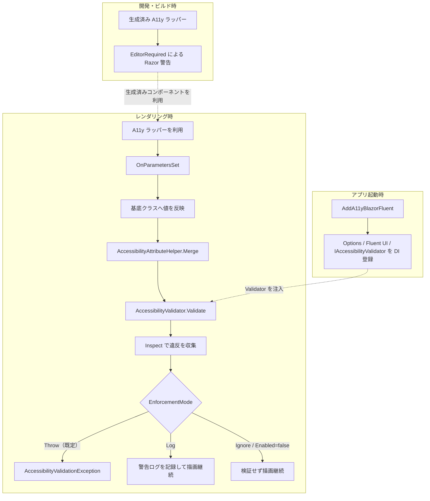

## はじめに

Fluent UI Blazor のコンポーネントを使っていても、ラベル、代替テキスト、操作名などは利用側で与える必要があります。たとえば入力欄を置いたことと、その入力欄の目的が支援技術へ伝わることは、別の確認です。

今回は、Fluent UI Blazor 5 のコンポーネントを継承した非公式拡張パッケージ「[A11yBlazor.Fluent](https://github.com/tomokusaba/A11yBlazor)」を、公開されているソースコードから追います。対象は .NET と Blazor のコンポーネント開発に慣れている開発者です。この記事では、実際のコードに沿って各処理を解説します。`AddA11yBlazorFluent` による登録から、生成ラッパー、属性マージ、実行時検証、違反処理までを追います♿

:::message
この記事は 2026 年 11 月 17 日時点で、`main` のコミット `8275e4d6519391cf4b76f78b1d063205f06f0c44` を対象にしています。
:::

## 本記事のゴール

- A11yBlazor.Fluent の登録から違反通知までの実行経路を説明できる
- `EditorRequired` と実行時の条件付き検証の違いを理解できる
- `Throw`、`Log`、`Ignore` の使い分けを選べる
- リポジトリから試す方法と、公開 NuGet パッケージがない現状を区別できる
- 自動検証できる範囲と、人間による確認が必要な範囲を整理できる

次に、対応バージョンと利用方法を確認します。

## 前提条件と対応バージョン

- ✅ .NET 8、9、10、11 のいずれか
- ✅ Fluent UI Blazor 5 と Blazor コンポーネントの基本
- ✅ Generic Host または ASP.NET Core の DI（依存性注入）を利用できる

プロジェクトは [Directory.Build.props](https://github.com/tomokusaba/A11yBlazor/blob/8275e4d6519391cf4b76f78b1d063205f06f0c44/Directory.Build.props) で Fluent UI Blazor を `5.0.1` に固定しています。ライブラリの [A11yBlazor.Fluent.csproj](https://github.com/tomokusaba/A11yBlazor/blob/8275e4d6519391cf4b76f78b1d063205f06f0c44/src/A11yBlazor.Fluent/A11yBlazor.Fluent.csproj) は `net8.0;net9.0;net10.0;net11.0` を対象とし、パッケージメタデータの `Version` は `0.1.0` です。

:::message alert
2026 年 11 月 17 日現在、**NuGet パッケージは未公開**です。`Version` が `0.1.0` と設定されていても、NuGet からインストールできる状態ではありません。A11yBlazor.Fluent は**非公式の試作段階**であるため、`PackageReference Include="A11yBlazor.Fluent"` を利用可能な手順として紹介しません。

試作段階なので、実際に試したうえでの不具合報告や改善案のテスト協力を歓迎しています。利用前には、このパッケージの契約が自分の画面に合うかを評価してください。
:::

まずはプロジェクト参照でソースを試す方法が、リポジトリに存在するコードと一致する最小の入口です。

## Step 1: リポジトリから参照して試す

まず A11yBlazor をクローンし、利用する Blazor アプリからライブラリプロジェクトを参照します。

```pwsh
git clone https://github.com/tomokusaba/A11yBlazor.git
dotnet add .\MyApp\MyApp.csproj reference .\A11yBlazor\src\A11yBlazor.Fluent\A11yBlazor.Fluent.csproj
```

この方法は、NuGet の公開状態に依存せず、現在のソースと同じプロジェクトをアプリへ読み込めます。実際のテストプロジェクトも、この方式で [A11yBlazor.Fluent.Tests.csproj](https://github.com/tomokusaba/A11yBlazor/blob/8275e4d6519391cf4b76f78b1d063205f06f0c44/tests/A11yBlazor.Fluent.Tests/A11yBlazor.Fluent.Tests.csproj) からライブラリを参照しています。

上記では、アプリが `MyApp` にあり、A11yBlazor と同じ親ディレクトリからコマンドを実行する例を示しています。ローカルでパッケージ化を試したい場合も、リポジトリの README に記載された次のコマンドが利用できます。

```pwsh
cd .\A11yBlazor
dotnet pack .\src\A11yBlazor.Fluent\A11yBlazor.Fluent.csproj -c Release
```

公開 NuGet へアップロードする手順ではありません。生成された `.nupkg` の出力先とローカル参照方法は、各自の環境に合わせて確認してください。

次は、利用開始時に呼ばれる DI 登録をたどります。

## 処理の入口をフェーズ別に分ける

このライブラリの入口は 1 本の実行列ではありません。アプリ起動時の DI 登録、開発・ビルド時の Razor 診断、コンポーネントがパラメーターを受け取るレンダリング時を分けて考える必要があります。

| フェーズ | 入口 | 役割 |
|---|---|---|
| 🚀 アプリ起動時 | `AddA11yBlazorFluent` | Options、Fluent UI、Validator のサービスを登録 |
| 🛠️ 開発・ビルド時 | `[EditorRequired]` | 固定的に必須の Razor パラメーター欠落を警告 |
| 🖥️ レンダリング時 | `OnParametersSet` | 状態に依存する契約を検証し、属性を反映 |

## アプリ起動時: `AddA11yBlazorFluent`

アプリ起動時の入口は [ServiceCollectionExtensions.cs](https://github.com/tomokusaba/A11yBlazor/blob/8275e4d6519391cf4b76f78b1d063205f06f0c44/src/A11yBlazor.Fluent/ServiceCollectionExtensions.cs) の `AddA11yBlazorFluent` です。

```csharp
services.AddOptions<AccessibilityOptions>();
if (configure is not null)
{
    services.Configure(configure);
}

services.AddFluentUIComponents();
services.AddSingleton<IAccessibilityValidator, AccessibilityValidator>();
```

この拡張メソッドは、次の 3 点をまとめて行います。

1. `AccessibilityOptions` を Options パターンで構成する
2. Fluent UI Blazor 本体のサービスを登録する
3. `IAccessibilityValidator` を `AccessibilityValidator` の Singleton として登録する

既定では検証が有効で、違反時のモードは `Throw` です。段階的に導入するときは、たとえば次のようにログモードへ変更できます。

```csharp
builder.Services.AddA11yBlazorFluent(options =>
{
    options.EnforcementMode = AccessibilityEnforcementMode.Log;
});
```

`AccessibilityOptions` は [AccessibilityOptions.cs](https://github.com/tomokusaba/A11yBlazor/blob/8275e4d6519391cf4b76f78b1d063205f06f0c44/src/A11yBlazor.Fluent/Accessibility/AccessibilityOptions.cs)、モードの定義は [AccessibilityEnforcementMode.cs](https://github.com/tomokusaba/A11yBlazor/blob/8275e4d6519391cf4b76f78b1d063205f06f0c44/src/A11yBlazor.Fluent/Accessibility/AccessibilityEnforcementMode.cs) にあります。違反の扱いは、後述する検証後の分岐で決まります。

## 開発・ビルド時: 生成ラッパーと Razor 診断

A11yBlazor は Fluent UI の公開具体コンポーネントを継承したラッパーを生成します。たとえば [A11yFluentTextInput.g.cs](https://github.com/tomokusaba/A11yBlazor/blob/8275e4d6519391cf4b76f78b1d063205f06f0c44/src/A11yBlazor.Fluent/Components/Generated/A11yFluentTextInput.g.cs) は `FluentTextInput` を継承し、`IAccessibilityValidator` をインジェクトしています。

```csharp
public class A11yFluentTextInput :
    Microsoft.FluentUI.AspNetCore.Components.FluentTextInput
{
    [Inject]
    public IAccessibilityValidator AccessibilityValidator { get; set; } = default!;

    [Parameter, EditorRequired]
    public new string? Label { get; set; }
}
```

生成処理自体は [.tools/ComponentInventory/Program.cs](https://github.com/tomokusaba/A11yBlazor/blob/8275e4d6519391cf4b76f78b1d063205f06f0c44/.tools/ComponentInventory/Program.cs) にあります。Fluent UI アセンブリから公開・具象・非ネストの `IComponent` を列挙し、ラッパーを出力する実装です。[README](https://github.com/tomokusaba/A11yBlazor/blob/8275e4d6519391cf4b76f78b1d063205f06f0c44/README.md) では、確認対象を 109 種類として説明しています。生成済みファイルを直接修正せず、生成元と検証規則を更新する設計です。

Razor からは通常のコンポーネントとして利用できます。

```razor
@using A11yBlazor.Fluent.Components

<A11yFluentTextInput Label="氏名"
                     Required="true"
                     @bind-Value="Name" />

<A11yFluentImage Source="/images/product.png"
                 AlternateText="青い外装の製品を正面から写した写真" />

<A11yFluentButton IconOnly="true"
                  AccessibleName="一覧を再読み込み"
                  Loading="@isLoading"
                  LoadingLabel="一覧を読み込み中"
                  OnClick="ReloadAsync" />
```

ここで重要なのは、検証が 1 種類ではないことです。

### `EditorRequired` と実行時検証は別です

`Label` に付いている `[EditorRequired]` は、コンポーネント利用時にそのパラメーターを指定すべきことを Razor のエディターやビルドへ伝えます。Microsoft Learn の [EditorRequiredAttribute](https://learn.microsoft.com/dotnet/api/microsoft.aspnetcore.components.editorrequiredattribute?view=aspnetcore-11.0&WT.mc_id=DT-MVP-5004827) でも、値が指定されていない場合にエディターまたはビルドツールが警告を示せると説明されています。

つまり、次のような欠落は Razor の**コンパイル時診断**の対象です。

```razor
<!-- Label 未指定。Razor の診断対象 -->
<A11yFluentTextInput @bind-Value="Name" />
```

一方、`Target="LinkTarget.Blank"` のときだけ必要な `NewWindowDescription` や、`Loading="true"` のときだけ必要な `LoadingLabel` は、パラメーターの組み合わせに依存します。これらは `OnParametersSet` の処理中に実行時検証されます。

したがって、**すべてのアクセシビリティ検証がビルドエラーになるわけではありません**。`EditorRequired` は警告を提供する属性であり、ビルド失敗を常に保証するものでも、実行時の値検証を行うものでもありません。固定的に必須な `Label` は Razor のコンパイル時診断の対象です。条件付き契約はコンポーネントの `OnParametersSet` 処理中に判定され、既定の `Throw` なら `AccessibilityValidationException` へつながります。

次の節で、この境界を含む実際の処理経路を追います。

## レンダリング時: `OnParametersSet` からの処理経路

生成された各ラッパーの `OnParametersSet` は、概ね次の順序で実行されます。

```csharp
protected override void OnParametersSet()
{
    base.OnParametersSet();
    base.Label = Label;
    AdditionalAttributes = AccessibilityAttributeHelper.Merge(this);
    AccessibilityValidator.Validate(this);
}
```

`FluentTextInput` の例では、まず新しく宣言した `Label` を基底クラスへ渡し、次に追加属性をマージし、最後に検証器を呼びます。処理全体は以下のようになります。



`AddA11yBlazorFluent` が DI コンテナーを準備する段階と、生成済みラッパーを Razor から利用して `OnParametersSet` が呼ばれる段階は別です。

### `AccessibilityAttributeHelper.Merge` が属性を反映する

[AccessibilityAttributeHelper.cs](https://github.com/tomokusaba/A11yBlazor/blob/8275e4d6519391cf4b76f78b1d063205f06f0c44/src/A11yBlazor.Fluent/Accessibility/AccessibilityAttributeHelper.cs) は、コンポーネントの公開プロパティをリフレクションで読み取り、既存の `AdditionalAttributes` をコピーしてアクセシビリティ属性を追加します。

たとえば、次の値を DOM（Document Object Model）へ渡す属性に変換します。

- `AccessibleName` → `aria-label`
- 読み込み中の `LoadingLabel` → `aria-label` と `aria-busy="true"`
- `AccessibleDescription` と `NewWindowDescription` → `aria-description`
- `Decorative` → `aria-hidden="true"` と `focusable="false"`
- 対応するキーボードコールバック → `role`、`tabindex`、`onkeydown`

既存属性をそのまま破棄せず辞書へコピーした後、このライブラリが必要と判断した `aria-label`、`aria-description`、`aria-busy` などを上書き・追加します。`role`、`tabindex` は `TryAdd` のため既存値を維持します。なお、文字列が「意味のある名前か」までは判断できません。空でないことと状態を確認し、適切な属性を付ける役割に留まります。

### `Validate` と `Inspect` が違反を集める

[AccessibilityValidator.cs](https://github.com/tomokusaba/A11yBlazor/blob/8275e4d6519391cf4b76f78b1d063205f06f0c44/src/A11yBlazor.Fluent/Accessibility/AccessibilityValidator.cs) の `Validate` は、無効化または `Ignore` なら終了します。それ以外では `Inspect` を呼び、`AccessibilityValidationResult` に違反を蓄積します。

`Inspect` は、基底コンポーネント型をたどって `FluentTextInput` のような Fluent UI 型名を特定し、次のような規則を呼び出します。

- 可視ラベル: `A11Y-LABEL`
- アイコンだけの操作名: `A11Y-NAME`
- 画像の代替: `A11Y-IMAGE-ALT`
- 条件付き入力説明: `A11Y-CONDITIONAL-INSTRUCTIONS`
- 新しいタブの事前説明: `A11Y-NEW-WINDOW`
- クリックと同等のキーボード操作: `A11Y-KEYBOARD-ACTIVATE`
- ドラッグのキーボード代替: `A11Y-KEYBOARD-ALTERNATIVE`
- 読み込み状態: `A11Y-LOADING`
- エラー説明: `A11Y-ERROR`

`Throw` の場合、結果は [AccessibilityValidationException.cs](https://github.com/tomokusaba/A11yBlazor/blob/8275e4d6519391cf4b76f78b1d063205f06f0c44/src/A11yBlazor.Fluent/Accessibility/AccessibilityValidationException.cs) へ渡されます。例外メッセージには規則 ID、修正メッセージ、関連する WCAG 達成基準が並びます。`Log` なら同じ違反を警告ログへ書き、描画は続行されます。

| モード | 違反時の動作 | 主な用途 |
|---|---|---|
| 🚨 `Throw` | `AccessibilityValidationException` をスロー | 開発・テストで早期に止める |
| 📝 `Log` | 警告ログを出して描画を継続 | 既存画面へ段階的に導入する |
| ⏭️ `Ignore` | 検証を行わず描画を継続 | 一時的な除外。ただし別途確認が必要 |

`Ignore` は違反を解決したことにはなりません。この分岐を理解しておくと、「コンパイル時診断がなくても、画面をレンダリングすると条件付き契約が実行時例外になる」といった挙動を正しく説明できます。

次に、これらの契約が Razor の利用例ではどのように表れるかを確認します。

## 条件付き契約の利用例

### 新しいタブを開くリンク

`Target="LinkTarget.Blank"` を使うときは、事前説明を追加します。

```razor
<A11yFluentLink Href="/help"
                Target="LinkTarget.Blank"
                AccessibleName="ヘルプ"
                NewWindowDescription="ヘルプは新しいタブで開きます。">
    ヘルプ
</A11yFluentLink>
```

`NewWindowDescription` は [A11yFluentLink.g.cs](https://github.com/tomokusaba/A11yBlazor/blob/8275e4d6519391cf4b76f78b1d063205f06f0c44/src/A11yBlazor.Fluent/Components/Generated/A11yFluentLink.g.cs) で受け取り、ヘルパーが `AccessibleDescription` と結合して `aria-description` へ反映します。同時に検証器が `A11Y-NEW-WINDOW` を確認します。

### 書式制約のある入力

```razor
<A11yFluentTextInput Label="電話番号"
                     MaskPattern="+81-000-000-000"
                     AccessibleDescription="国番号を含め、数字とハイフンで電話番号を入力してください。"
                     @bind-Value="PhoneNumber" />
```

`MaskPattern` などの制約がある場合は `AccessibleDescription` が必要です。これは静的な必須項目ではなく、入力規則が設定されたかを実行時に調べる条件付き契約です。

### 装飾画像と情報画像

```razor
<!-- 情報を持つ画像 -->
<A11yFluentImage Source="/images/result.png"
                 AlternateText="アクセス障害件数が前月比で半減したグラフ" />

<!-- 純粋な装飾 -->
<A11yFluentImage Source="/images/divider.png"
                 Decorative="true" />
```

情報画像では `AlternateText`、純粋な装飾画像では `Decorative="true"` が必要です。[A11yFluentImage.g.cs](https://github.com/tomokusaba/A11yBlazor/blob/8275e4d6519391cf4b76f78b1d063205f06f0c44/src/A11yBlazor.Fluent/Components/Generated/A11yFluentImage.g.cs) は、装飾画像の基底 `AlternateText` を空文字にし、検証器もこの組み合わせを確認します。

コンポーネントの契約一覧は、生成された [component-contracts.md](https://github.com/tomokusaba/A11yBlazor/blob/8275e4d6519391cf4b76f78b1d063205f06f0c44/docs/component-contracts.md) にまとまっています。

## テストで契約を確認する

リポジトリには [AccessibilityContractTests.cs](https://github.com/tomokusaba/A11yBlazor/blob/8275e4d6519391cf4b76f78b1d063205f06f0c44/tests/A11yBlazor.Fluent.Tests/AccessibilityContractTests.cs) があり、次のような内容を検証します。

- Generic Host で DI 登録を解決できること
- `TextInput` の可視ラベルが必須であること
- `Label` に `EditorRequiredAttribute` が付くこと
- 画像に代替テキストまたは装飾指定があること
- アイコンのみのボタンと読み込み状態に名前があること
- 条件付き入力説明、新しいタブ、キーボード操作、自動入力目的を検証すること
- 公開 Fluent UI コンポーネントすべてに生成ラッパーがあること

クローンしたリポジトリでは、README と同じコマンドでテストできます。

```pwsh
dotnet test .\A11yBlazor.Fluent.slnx
```

テストは、規則の判定と公開コンポーネントに対応する生成ラッパーが存在することを確認します。テストが成功しても、利用する画面の WCAG 適合を保証するものではありません。ここで確認できるのは契約単位の検証までです。次に、画面単位で残る確認を整理します。

## 自動検証と人間による確認の境界

A11yBlazor.Fluent は、Web Content Accessibility Guidelines（WCAG）2.1 の複数の達成基準を参考にした契約違反を、コンポーネントの入力値と状態から検出するツールです。`A11Y-IMAGE-ALT` や `A11Y-KEYBOARD-ALTERNATIVE` のような規則を機械的に確認できても、WCAG 2.1 AA 適合の判定にはできません。規則には新しい閲覧コンテキストに関する 3.2.5（Level AAA）も含まれるため、単純に「AA の規則だけ」とも言えません。

[README](https://github.com/tomokusaba/A11yBlazor/blob/8275e4d6519391cf4b76f78b1d063205f06f0c44/README.md) と [PRODUCT.md](https://github.com/tomokusaba/A11yBlazor/blob/8275e4d6519391cf4b76f78b1d063205f06f0c44/PRODUCT.md) でも、次の項目は画面単位・アプリ固有の確認が必要だと限定しています。

| 確認方法 | 確認しやすい領域 |
|---|---|
| 🧪 自動検証 | パラメーターの欠落、状態と必要入力の組み合わせ、属性の付与 |
| 👩‍💻 人手確認 | ラベルと説明の意味、見出し構造、読む順序、ページタイトル、エラー文 |
| 👥 利用者・支援技術での確認 | キーボード操作、フォーカス順序、フォーカス表示、スクリーンリーダーの読み上げ |
| 🎨 デザイン・実装の人手確認 | コントラスト、200% 拡大、320 CSS px のリフロー、点滅や時間制限 |

たとえば画像に `AlternateText="画像"` があれば、空でない値としては検証を通ります。しかし、その文字列が画像の目的を表すかは人間が内容を見て判断する必要があります。同様に、`OnKeyboardAlternative` にコールバックがあることは検出できますが、実装した操作がマウス操作と同等かは自動判定できません。

Blazor のライフサイクルやパラメーターについては、[ASP.NET Core Razor コンポーネント](https://learn.microsoft.com/aspnet/core/blazor/components/?view=aspnetcore-11.0&WT.mc_id=DT-MVP-5004827) も参照すると整理しやすいです。最終確認では、次のような達成基準と実際の操作を合わせて確認してください。

- [非テキストコンテンツ 1.1.1](https://www.w3.org/TR/WCAG21/#non-text-content)
- [キーボード 2.1.1](https://www.w3.org/TR/WCAG21/#keyboard)
- [エラーの特定 3.3.1](https://www.w3.org/TR/WCAG21/#error-identification)
- [名前・役割・値 4.1.2](https://www.w3.org/TR/WCAG21/#name-role-value)

:::message alert
A11yBlazor.Fluent を導入しただけでは、WCAG 2.1 AA 適合にはなりません。自動チェックをリリース工程の一部に置きつつ、キーボード試験、画面構造、内容の意味、支援技術での試験を別途行ってください。
:::

自動化できる契約を早く見つける一方、人間の判断が必要な品質条件を明確に残すことが、このパッケージの現実的な使い方です。

## ハマりどころ

### ローカルパックの出力先を確認する

`dotnet pack` はリポジトリが明記している生成手順ですが、利用するアプリへローカルパッケージとして追加する場合は、実際の出力先とプロジェクトの NuGet ソース構成を自分で確認する必要があります。公開 NuGet から同じ ID とバージョンを解決できる前提にはしないでください。

### `Log` や `Ignore` を「問題なし」と解釈しない

`Log` は実行を止めずに違反を可視化するためのモードです。`Ignore` は `Validate` 自体をスキップします。どちらも、違反を修正したこととは別です。継続的インテグレーション（CI）でログを収集する、手動確認項目へ残すなど、運用側で追跡してください。

### `[EditorRequired]` だけを過信しない

`EditorRequired` は固定的なパラメーター欠落を警告する仕組みです。条件付き契約は Razor のコンパイル時点では分からないため、`OnParametersSet` の処理中に実行時評価されます。この違いをチーム内で共有し、単体テストだけでなく実際のレンダリング経路も確認します。

## まとめ

A11yBlazor.Fluent は、Fluent UI Blazor 5 のコンポーネントを継承したラッパーへ、アクセシビリティ契約を加える非公式プロジェクトです。入口からの処理は明確で、DI 登録から生成ラッパーの `OnParametersSet`、属性マージ、検証、例外・ログ・無視まで追えます。

特に覚えておきたい点は次の 3 つです。

- `EditorRequired` は Razor のコンパイル時警告、条件付き契約は `OnParametersSet` の処理中に行う実行時検証
- 既定の `Throw` は違反時に `AccessibilityValidationException`、`Log` と `Ignore` は継続モード
- WCAG 2.1 AA を意識した機械的契約であり、意味・画面構造・支援技術の確認を置き換えない

公開 NuGet パッケージとしては現時点で利用できないため、まずはクローンとプロジェクト参照、必要なら README のローカル `dotnet pack` 手順から試してください。自動検出できる欠落を早く見つけつつ、最後の品質判断は人と利用者の確認に残す構成が現実的です。♿
