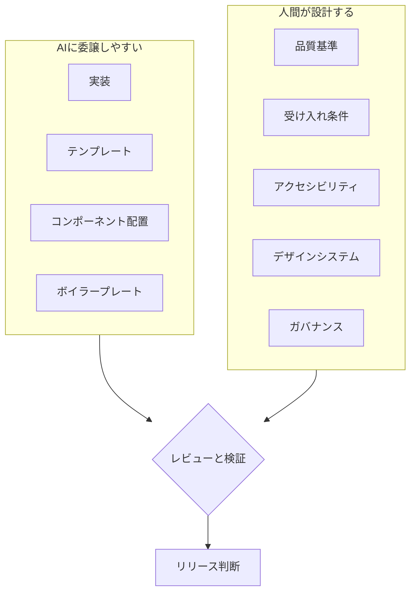

## はじめに

「GitHub Copilot に頼めば、ユーザー管理画面くらいすぐできる」。最近はそう感じる場面が増えました。[GitHub Copilot の公式ドキュメントでは、自然言語の要件からコードを生成する方法が紹介されています](https://docs.github.com/en/copilot/tutorials/copilot-cookbook/generate-code)。ただし、同ドキュメントはユーザー管理画面が一度で要件どおり完成することを保証するものではありません。また、[Fluent UI Blazor](https://github.com/microsoft/fluentui-blazor) は、Blazor アプリケーションで利用できる UI コンポーネントを提供しています。

私は、インフラからバックエンド、フロントに至るまで設計しています。その中で、正直なところ、フロント部分の設計に多くの工数を割ける状況ではありません。だからこそ、コンポーネントライブラリや AI を道具として活用したいと考えています。ただし、それらを使うことが必ず工数削減につながるとは限りませんし、アクセシビリティ、受け入れ条件、ガバナンスといった最低限の品質判断まで手放せるわけでもありません。

私自身、動作を保証する観点からバックエンドやインフラを先に固める判断を優先し、その分、フロントの設計は二の次になりがちでした。これはフロントが重要でないという意味ではなく、限られた工数の中で優先順位を付けた結果、UI の設計が後回しになっていたという問題意識です。だからこそ、実装支援の道具を活用しつつ、フロント品質をどの受け入れ条件で確かめるかの判断は人に残ると考えています。

限られた工数で実装を進めたい現実と、品質判断を省けないこと。その両方を考えたとき、フロントエンドの設計は不要になったのでしょうか。この記事では、画面を作る作業と品質を決める作業がどこで分かれるのかを整理します。

想定読者は、Blazor と Fluent UI で業務画面を作る方や、複数のレイヤーを担当しながらフロントの品質を考える開発者です。読み終えると、AI が生成した画面のどこを人間が設計すべきかを判断できる状態を目指します。

## 2015年と2026年の比較

### 2015年頃の作り方（私の経験に基づく整理）

ここで振り返りたいのは、当時、ライブラリや既製コンポーネントが存在しなかったということではありません。私の経験では、画面に必要な状態や操作を自分で考え、調整する範囲が大きい場面がありました。ボタン、ダイアログ、テーブル、入力フォームも、既存の選択肢を使うか、自分で補うかを含めて判断していました。

私が苦労したのは、部品を一度表示させることよりも、状態や操作の条件を繰り返し考え、その都度実装・調整することでした。たとえば、次のような点です。

- 入力中、エラー、無効、処理中など、状態ごとの見せ方と操作
- キーボード操作やフォーカスの移動・復帰
- 入力値のバリデーションとエラーの伝え方
- ダイアログの開閉と、その前後の操作
- アクセシビリティに関する細かな確認

個別の部品を作って終わりではなく、画面間の一貫性を保ち、共通の修正を反映し、動作を確認しながら保守することも負担になり得ました。確認事項が積み重なる一方で、限られた工数をどこに配分するかも難しくなりがちでした。

現代の道具で個々の実装を支援できるようになった今も、状態や操作の条件をどう定め、画面間でどう保つかは考える必要があります。次に、ライブラリや AI を使う状況で、実装と設計の役割を整理します。

### 2026年の作り方（想定する状況）

ここでは、Fluent UI のようなコンポーネントライブラリと、GitHub Copilot のような AI アシスタントを組み合わせて画面を作る状況を考えます。ボタン、ダイアログ、データグリッド、入力欄などの UI 部品をライブラリから選ぶことは、実装を進めるための選択肢の一つです。

Microsoft の Fluent 2 Design System には、[設計原則](https://fluent2.microsoft.design/design-principles)も文章化されています。これらは設計の意思決定を導く共通の価値観として示されており、「どのような体験を目指すか」を考える土台になります。私自身、こうした既存の原則やコンポーネントに則って UI を組み立てることで、毎回独自に考える範囲が少なくなってきたと感じています。

もちろん、これらの原則が業務固有の操作条件や、個別画面の受け入れ基準まで決めてくれるわけではありません。共通的な UI 判断の一部は既存の原則に委ねられても、何を満たせばその業務で使えるのかは別に設計する必要があります。

そこで、次の問いを立てます。

> では、設計も減ったのでしょうか？

私の答えは「一から考える共通的な UI 判断は減らせますが、業務固有の設計まで不要になるわけではない」です。

## 実装と品質の境界

画面を一度作れることと、その画面を業務で使ってよいことは、別の話です。例として、ユーザー管理画面の削除機能を考えます。

- 一覧、検索、編集、削除が動く
- Fluent UI の部品で組まれている
- キーボードだけで操作でき、ダイアログにフォーカスが移る
- 削除失敗時のエラーが、スクリーンリーダーで読み上げられる

ここまでは、実装の確認です。AI が実装を支援できる場合もありますが、結果や必要な手直しは要件によって変わります。

一方で、削除ボタンには次の問いが残ります。

- この操作を実行できるのは誰か（権限）
- 誰が、いつ、何を消したかは残るか（監査）
- 削除すると、どの業務や契約に影響するか（影響範囲）

ラベルが `Delete User` だけでも画面は正しく動きます。しかし「押してよいかどうか」は、要件として人間が定義しなければなりません。必要な判断は画面や要件によって異なりますが、少なくとも権限や影響範囲、アクセシビリティに関する受け入れ条件は明確にしておく必要があります。限られた工数の中でも、これらの条件を満たしているかの確認は省けません。ここが、実装と設計の境界だと私は考えています。

### アクセシビリティの確認

権限や監査が業務上の品質判断であるのに対し、アクセシビリティは操作や情報伝達に関する品質判断です。ダイアログや結果通知を考えるときは、WCAG（Web Content Accessibility Guidelines）2.2 の達成基準や W3C の WAI-ARIA APG（ARIA Authoring Practices Guide）を参照できます。それぞれが扱う範囲は同じではありません。

- [2.1.1 キーボード](https://www.w3.org/WAI/WCAG22/Understanding/keyboard.html)
- [2.4.3 フォーカス順序](https://www.w3.org/WAI/WCAG22/Understanding/focus-order.html)
- [3.3.1 エラーの特定](https://www.w3.org/WAI/WCAG22/Understanding/error-identification.html)
- [4.1.3 ステータスメッセージ](https://www.w3.org/WAI/WCAG22/Understanding/status-messages.html)
- [WAI-ARIA APG: モーダルダイアログパターン](https://www.w3.org/WAI/ARIA/apg/patterns/dialog-modal/)

3.3.1 は自動的に検出された入力エラーを対象とする達成基準であり、削除処理の API（Application Programming Interface）の失敗全般を直接定めるものではありません。削除結果を画面内の通知として示す場合は、その通知がステータスメッセージに該当するかを踏まえて 4.1.3 を確認します。ダイアログを開いたときにフォーカスを内部へ移すといった具体的な操作パターンは、WAI-ARIA APG のモーダルダイアログパターンが説明しています。

自動チェックツールは、機械的に判定できるアクセシビリティ上の問題を見つける助けになります。一方、[W3C はツールだけで適合性やアクセシビリティを判断することはできず、知識のある人による評価が必要だと説明しています](https://www.w3.org/WAI/test-evaluate/)。「そのフォーカス移動が文脈に合っているか」「そのエラー文が利用者に伝わるか」も、人による確認が必要です。こうした観点をどこまで受け入れ条件に含めるかは、実装を支援する道具ではなく、要件に応じた設計判断です。

## 気づき：設計の重心の移動

ここまでの整理から、作業は次のように分けられると考えています。

実装は AI に寄せ、品質の基準と判断は人間の側に残る、という構図です。

### CAF の考え方を借りる

ここで Cloud Adoption Framework（CAF）とフロントエンドを同じものとして扱うわけではありません。CAF は Azure の導入に関するガイダンスであり、フロントエンド設計のフレームワークではありません。借りたいのは、両者に見られる**抽象的な構造**です。

クラウドの設計を個々の VM の構築・管理だけに限らず考えると、ワークロードを支える共通基盤やランディングゾーン、標準、セキュリティ、ガバナンス、管理も設計対象になります。CAF の概要では、Azure の基盤や標準を整え、ワークロードチームが成功する条件を支える考え方が説明されています（[Cloud Adoption Framework の概要](https://learn.microsoft.com/ja-jp/azure/cloud-adoption-framework/overview?WT.mc_id=DT-MVP-5004827)）。

フロントエンドでも、コンポーネントライブラリや AI によって部品の個別実装や定型コードを減らせるとしても、画面をどのような条件で使うのか、アクセシビリティや受け入れ基準をどう定めるのか、デザインシステムや業務上のガバナンスをどう整えるのかという設計は残ります。なくなるというより、個々の部品を作る作業から、画面を支える共通のルールや仕組みへ再配置されます。

この比喩から私が引き出したいのは、**個々の実装を抽象化・共有化しても、品質と利用条件に関する責任は消えない**という見方です。責任の所在が別の担当へ移るという意味ではありません。設計の重心が、個々の実装から、より上位の共通ルールや設計へ移ります。私はインフラからバックエンド、フロントまで設計する一方、フロントの設計に十分な工数を割けるとは限りません。だからこそ、共通する条件や基準を先に決め、すべての画面で一から検討しなくて済むようにすることは、限られた工数を活かす考え方の一つです。ここで借りているのは、「共通基盤を整え、利用するチームや画面の成功条件を支える」という思考の形です。

## おわりに

この記事では、AI やコンポーネントライブラリを使って画面の実装を支援できる状況を出発点にしました。そのうえで、次の 2 点を主張したいと思います。

- コンポーネントライブラリや設計原則は、共通的な UI 判断を一から行う範囲を減らします。
- 既存の設計原則は共通的な判断の土台になりますが、どの受け入れ条件や品質基準を満たすべきかは人間が判断します。

実装を委譲できる場面でも、品質と利用条件に関する責任は消えません。設計の重心が、個々の実装から、アクセシビリティや受け入れ条件、ガバナンスなどの共通ルールへ移ります。限られた工数の中で道具を活用するときも、どの品質を満たす必要があるかは判断しなければなりません。AI 時代のフロントエンドエンジニアは、コードを書く人から、品質を設計する人へ変わっていくのだと思います。

Fluent UI、GitHub Copilot、アクセシビリティ、そして CAF の考え方は、どれもこの一点に収束します。画面を作れることと、使える画面を設計できることは別の能力です。後者を磨き続けることが、これからのフロントエンドの仕事だと私は考えています。
