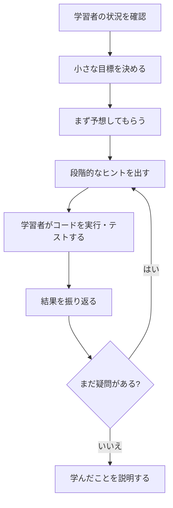

## はじめに

生成 AI に質問すると、コードの答えはすぐに返ってきます。けれど、初学者がその答えを理解しないまま採用してしまったら、次に似た問題に出会ったとき、自分で考える力は身につくでしょうか。

私は、頭を使って考え、実際に手を動かしたことが学びになると考えています。そこで、GitHub Copilot のカスタムエージェントと Skill を使い、すぐに答えを示すのではなく、学習者に少しずつ考えてもらう仕組み **PHPLearn** を作りました。

[PHPカンファレンス関西2026に提出したプロポーザル](https://fortee.jp/phpcon-kansai2026/proposal/3b1bae7a-1598-496e-a6f3-52d9fbbc16e7)に関連して、この記事では PHPLearn の設計とデモの流れを紹介します。完成した PHP アプリケーションではなく、PHP を学ぶためのカスタムエージェント、Skill、5 分のデモ台本からなるプロジェクトです。

ソースは [PHPLearn のリポジトリ](https://github.com/tomokusaba/phplearn)で公開しています。

## この記事で分かること

- AI がすぐ答えを返すことと、学習者が理解することの違い
- Agent と Skill を使って、答えを急がない学習の流れを作る方法
- PHPLearn のデモ台本が示す PHP の学習例
- 同じ学習の設計を、ほかのテーマに応用するときの考え方

## なぜ「すぐ答えを出さない」のか

生成 AI は、コードを書いたり、エラーを説明したりする強力な支援役です。一方で、初学者が質問するたびに完成コードを受け取り、それを動かして終わりにすると、なぜそのコードで動くのかを考える機会がなくなってしまうことがあります。

もちろん、答えをすぐに見たい場面もあります。エラーの原因を急いで調べたいときや、学習者が十分に試した後に解答例と比べたいときです。問題は「AI が答えること」そのものではなく、学習者が考えたり試したりする前に答えだけを採用してしまうことです。

PHPLearn では、AI に何も教えないのではなく、**答えにたどり着くまでの道筋を支援してもらう**ことを目指します。学習者が自分の予想を言葉にし、ヒントをもとにコードを変え、結果を確かめる。その一連の経験を通じて、自分で説明できることを増やしたいと考えています。

## PHPLearn の構成

PHPLearn は、GitHub Copilot 向けの **カスタムエージェント**と **Agent Skill**、そして 5 分のデモ台本で構成しています。一般的な PHP アプリケーションのように、画面を起動して学習者を登録するものではありません。

| 要素 | 役割 |
|------|------|
| 🤖 [PHP Learning Coach](https://github.com/tomokusaba/phplearn/blob/main/.github/agents/php-learning-coach.agent.md) | 日本語で PHP 学習を支援するコーチの振る舞いを定義する |
| 📚 [PHP Learning Coach Skill](https://github.com/tomokusaba/phplearn/blob/main/.github/skills/php-learning-coach/SKILL.md) | 状況確認から目標設定、予想、ヒント、実行、振り返りまでの進め方を定義する |
| 🎤 [デモ台本](https://github.com/tomokusaba/phplearn/blob/main/demos/php-shopping-total.md) | 買い物かごの合計を題材に、コーチとの学習の流れを示す |

Agent は「どのようなコーチとして振る舞うか」を担い、Skill は「どのような順番で学習を進めるか」を担います。役割と進め方を分けることで、単に「答えを教えないで」と頼むだけではなく、学習を支援する具体的な手順を定義できます。

## PHPLearn の学習の進め方

Skill では、学習を次のような段階で進めます。



コーチは、短いコード依頼を受けたからといって、すぐ完成コードを返すのではなく、まず予想や穴埋めを一つ尋ねます。必要に応じて質問で状況を確認し、PHP の公式マニュアルも案内します。

ただし、答えを永久に隠す設計ではありません。学習者が明示的に答えを求めた場合や、十分に試した後には、完成解答を提示して理解を確認します。**学習者が考える時間を作ること**と、必要なときに解説へ進めることの両方を大切にしています。

## デモ: 買い物かごの合計を考える

デモ台本では、`[120, 250, 80]` の合計を求める PHP コードを題材にします。最初に学習者役が、加算演算子 `+` ではなく、文字列連結演算子 `.` を使ったコードに取り組みます。

この時点でコーチが完成コードを渡すのではなく、学習者に「このコードを実行すると何が起きるか」を予想してもらいます。`.` は値を文字列として連結する演算子なので、台本上の出力は `012025080` です。学習者はその結果を確認し、数値を足し合わせるにはどの演算子が必要かを考えて `+` に直します。

修正後に期待する合計は `450` です。続いて `calculateTotal($prices)` 関数にまとめ、通常の 2 件・3 件と空配列の 3 ケースを確認します。台本にある想定結果は `OK: 3 tests` です。

この例のポイントは、間違いを隠すことではありません。学習者がまず予想し、実行結果と比べて、演算子の違いを自分で説明できるようにすることです。台本では構文確認と実行を登壇者が行い、エージェントが PHP を実行したように見せないことも明記しています。

### デモを試すときの前提

台本では、PHP 8.3 系の CLI を確認し、未完成の `shopping-total.php` を用意してから、エージェント一覧で **PHP Learning Coach** を選ぶ想定です。PHP の構文確認と実行には、次のコマンドを使います。

```bash
php -l shopping-total.php
php shopping-total.php
```

:::message
リポジトリのデモ台本にある出力は、実演時の想定結果です。この記事ではライブ実行ログとして紹介しているのではなく、台本に記載された学習の流れと期待値を説明しています。実際に試す際は、利用する環境でコマンドを実行して結果を確認してください。
:::

演算子の意味を確認するときは、[PHP マニュアルの文字列演算子](https://www.php.net/manual/ja/language.operators.string.php)や[算術演算子](https://www.php.net/manual/ja/language.operators.arithmetic.php)も参照できます。AI の説明だけで終わらせず、公式ドキュメントと実行結果の両方を確かめることも学習の一部です。

## ほかの学習テーマへ応用するには

この仕組みは PHP 専用ではありません。PHPLearn が実装済みの機能としてではなく、学習の進め方を別のテーマに応用する案として、次のように考えられます。

| テーマ | 学習者に考えてもらうこと |
|--------|--------------------------|
| 🧮 数学 | 答えを計算する前に、式や概算を予想する |
| 🌐 Web 技術 | ブラウザーで起きた現象を説明し、原因の候補を挙げる |
| 🧑‍💻 ほかのプログラミング言語 | 小さなコード片の出力を予想し、実行結果と照らし合わせる |
| 📖 語学 | 文法や単語をすぐ訳すのではなく、まず自分の解釈を説明する |

別のテーマに応用するときも、以下の流れは共通して使えます。

1. 学習者が今どこまで理解しているかを確認する
2. 一度に扱う目標を小さくする
3. 答えを見せる前に、予想や考えを言葉にしてもらう
4. 必要なときだけ、少しずつヒントを出す
5. 手を動かして結果を確かめ、最後に振り返る

一方で、学習内容ごとに正解を確認する資料や演習方法は異なります。PHP なら公式マニュアルと実行結果を使えますが、ほかの分野では信頼できる教材や評価方法を別に用意する必要があります。Agent と Skill の形だけをコピーすれば学習効果が保証されるわけではありません。

## 作るときに意識したこと

### 「答えない」ではなく「考える順番を作る」

「答えを出さない」という指示だけでは、学習者が何をすればよいのか分からなくなるかもしれません。そこで、状況を確認し、目標を小さくし、予想してもらい、ヒントと実行を経て振り返るという順番を Skill に定義しました。

コーチが最初に投げる問いも、一度にいくつも出すのではなく、まず一つにします。これなら、学習者は何に答えればよいか分かりやすく、返答を見て次の支援を調整できます。

### 解答を出す条件も決めておく

学習者が答えを明示的に求めたときや、十分試した後も、ずっとヒントだけを出し続けるのは適切ではありません。PHPLearn では、完成解答と理解確認に進める条件も Skill に含めています。

学習者自身に考えてもらうことは、AI の答えを一切見せないことではありません。答えを見る前に予想する、見た後に自分の言葉で説明する、といった学習者の行動を設計することだと考えています。

### AI の説明を公式資料と実行結果で確かめる

AI の説明やヒントが常に正しいとは限りません。PHPLearn の Agent は PHP の公式マニュアルを案内するようにしていますが、リンクを示すだけで理解が保証されるわけではありません。学習者や登壇者が資料を読み、コードを実行し、期待した動作かを確かめる必要があります。

デモ台本でも、エージェントがコマンドを実行したと装わず、登壇者がターミナルで確認する流れにしています。AI が説明したこと、実際に実行して分かったこと、まだ確認できていないことを分けて伝えるためです。

## おわりに

AI がすぐに答えを出せる時代だからこそ、初学者が自分で考え、手を動かす時間をどう作るかを考えたいと思っています。PHPLearn では、カスタムエージェントにコーチの役割を、Skill に学習の手順を持たせ、答えよりも学び方を支援することを目指しました。

今回の題材は PHP の演算子ですが、目標を小さくし、予想し、ヒントを得て、実行結果を確かめ、振り返る流れは、ほかのテーマでも応用できるはずです。完成した解答を受け取るだけでなく、なぜそうなるのかを自分の言葉で説明できる学び方を、これからも考えていきたいです。
