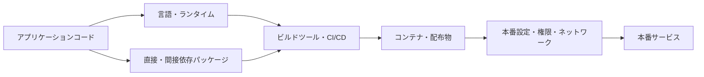
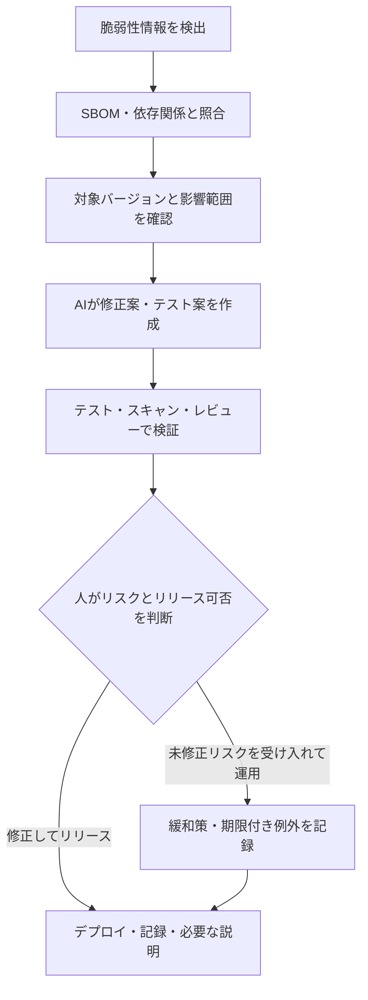

## はじめに

最近、著名な言語やランタイム、パッケージで重大な脆弱性が報告されるたびに、「結局、どの言語が安全なのだろう」と考えたくなります。

しかし、脆弱性が報告された技術を並べても、安全な言語のランキングにはなりません。利用規模も、調査の活発さも、脆弱性を報告して修正する仕組みも違うからです。

技術選定で本当に問うべきなのは、脆弱性が一度も見つかっていないことではありません。脆弱性が見つかったときに、影響範囲を把握し、修正を検証し、残るリスクを説明できることです。

これは、私がアクセシビリティについて考えるときにも大切にしてきたことと似ています。自動テストは検出対象の問題を見つける助けになりますが、利用体験や残存リスクを受け入れる判断まで代わりに行うわけではありません。セキュリティでも、AIや自動化に作業を任せることと、リリースの責任を任せることは別です。

本記事では、AIを使って開発する時代の技術選定を、脆弱性対応の能力という観点から整理します。

## 1. 脆弱性の公表件数を言語ランキングにしても意味が薄い

公表・登録された脆弱性の件数は、ソフトウェアが持つ欠陥の総数をそのまま表したものではありません。利用規模や調査・報告の状況などに左右される、観測された件数です。

その数には、利用者やコード量、セキュリティ研究者の関心、報告窓口の整備、開発チームの開示方針、記録対象の違いなど、複数の要因が影響します。広く使われ、よく調査されている技術では、脆弱性が見つかりやすくなる一方、報告や修正の仕組みも成熟しているかもしれません。

特定の言語で重大な脆弱性が公表されたという事実だけを理由に、その言語の利用を避けると決めるのも短絡的です。脆弱性が存在することと、自分たちのシステムで受け入れられないリスクがあることは同じではありません。反対に、公表件数が少ないことも安全の証明にはなりません。

[CVE Program](https://www.cve.org/About/Overview) は、公開された脆弱性に共通の識別子を付ける仕組みです。また、脆弱性の深刻度と、自分たちの環境におけるリスクも同じものではありません。[FIRST の CVSS v4.0 仕様](https://www.first.org/cvss/v4.0/specification-document)では、利用者が自分たちの脅威や環境に関する情報を加え、リスク評価に活用することを説明しています。件数やスコアだけで、技術スタック全体の安全性を順位付けすることはできません。

比較するなら、少なくとも「何を数えたのか」「いつからいつまでか」「どの範囲の製品か」「どの程度使われているか」を揃える必要があります。それでも、その数字だけから自分たちのシステムのリスクが分かるわけではありません。

「脆弱性の報告件数が多いから危険」「少ないから安全」と結論づけるのではなく、**自分たちの製品に何が含まれ、どのように影響するのかを説明できるか**に目を向ける必要があります。

## 2. 脆弱性は言語だけでなくエコシステム全体に存在する

アプリケーションは、プログラミング言語だけで動いているわけではありません。ランタイム、直接・間接依存パッケージ、ビルドツール、コンテナのベースイメージ、CI/CD の仕組み、デプロイ設定などが組み合わさっています。次の図は、脆弱性の影響範囲を考えるために本記事で整理したものです。

言語のメモリ安全性がリスクを減らす場面はあります。しかし、それだけで依存パッケージやビルド環境、認証設定、アクセス制御まで安全になるわけではありません。反対に、脆弱性のあるコンポーネントが見つかっても、すべての利用形態で同じ影響が生じるとは限りません。

つまり、選定単位は「言語」だけではなく、**その言語を含む技術スタックと、それを運用する仕組み**です。

## 3. AIは修正作業を支援するが、受け入れ責任は引き取らない

AI支援ツールは、脆弱性対応の作業を補助し得ます。たとえば、アドバイザリの要点をまとめる、リポジトリから該当する依存関係の候補を探す、更新差分を作る、テスト案を提示する、修正内容を説明するといった作業です。

ただし、AIが提案した修正が正しいことや、テストが必要な振る舞いを十分に確認していることは、別途確かめなければなりません。AIが書いたテストが、実装の誤りを見逃す可能性もあります。依存パッケージを更新した結果、互換性や運用上の前提が変わることもあります。

たとえば GitHub は、Copilot のインライン提案の責任ある利用に関するガイドで、もっともらしくても事実ではない出力（ハルシネーション）があり得ること、人によるレビューが重要であることを説明しています — [GitHub Copilot inline suggestions](https://docs.github.com/en/copilot/responsible-use/inline-suggestions)。

ここで分けて考えたいのは、**作業の実行**と**リスクを受け入れる判断**です。

- AIに任せやすいこと: 影響候補の調査、差分の作成、テスト案、変更点の要約
- 人が判断すること: 影響度、修正の妥当性、残存リスク、リリース可否、顧客への説明

ここでいう責任は、法的責任の一般論ではなく、開発プロセス上の承認やリスク受容の役割です。AIの出力を採用してリリースする判断は、チームや組織が定めた担当者と手順に従います。ツールがコードを書いたとしても、その変更を受け入れた理由を説明する役割はなくなりません。

## 4. 責任を持てる技術スタックの六つの条件

技術選定では、平常時に開発しやすいかだけでなく、問題が起きたときに対応可能かも確認します。次の六つは規格や普遍的な要件ではなく、私が選定時に確認したい観点です。

1. **構成と所有者を把握できる**
   どのサービスに何のコンポーネントが入り、誰が対応を判断するのかを特定できます。
2. **上流の保守状況を確認できる**
   サポート期間、セキュリティ報告窓口、修正版の配布状況を追えます。
3. **修正版へ更新できる**
   依存関係の更新経路が分かり、互換性を確認しながら適切な期間内に適用できます。
4. **修正を検証できる**
   自動テストやビルド、統合テストなどで、変更によるデグレードを確認できます。
5. **本番環境を追跡し、戻せる**
   実際にデプロイされたバージョンを特定でき、問題があればロールバックや緩和策を実行できます。
6. **判断と説明を記録できる**
   対応者、判断の根拠、残存リスク、例外の期限、顧客への説明を記録できます。

すべての技術スタックが、これらを同じ方法で満たす必要はありません。大切なのは、選定時に不足を認識し、補う運用を決められることです。

## 5. SBOMで「何を使っているか」を説明できる状態にする

SBOM（Software Bill of Materials、ソフトウェア部品表）は、ソフトウェアに含まれるコンポーネントを一覧化するための情報です。たとえば、製品のどのバージョンに、どのライブラリや依存関係が含まれているかを把握する手がかりになります。

[NTIA の SBOM Minimum Elements](https://www.ntia.gov/report/2021/minimum-elements-software-bill-materials-sbom) は、SBOMに含める基本要素を示しています。フォーマットには、[SPDX](https://spdx.dev/specifications/) や [CycloneDX](https://cyclonedx.org/specification/overview/) などがあります。

SBOMを作成すれば、ただちに脆弱性対応が完了するわけではありません。SBOMは対象や生成時点・範囲を明確にして使う構成情報であり、それだけでは、脆弱なコードが実行されるか、攻撃条件が成立するか、実際のリスクがどの程度かまでは判断できません。生成範囲や鮮度が不十分なら、重要なコンポーネントを見落とすこともあります。

そのため、SBOMは「作って保管するファイル」ではなく、リリースやデプロイされた成果物と結び付けて使います。脆弱性が公表されたときに、次の問いへ答えるためです。

- どの製品・バージョンに該当コンポーネントが含まれているか
- そのコンポーネントは直接依存か、別のパッケージ経由の間接依存か
- 影響を受ける可能性があるリリースはどれか
- 修正バージョンへ更新し、検証する担当者は誰か

SBOMの価値は、生成数ではなく、こうした問いに答えるための構成情報として更新・利用できるかで決まります。

## 6. 自動検査とAI修正を人間の判断につなげる

脆弱性対応を、アラートを消す作業だけにしないために、検出からリリースまでの流れをあらかじめ決めておきます。次の図は一例です。実際の順序や優先度は、組織のリスクや脆弱性の状況に合わせて決めます。

ここで自動検査が示すのは、設定されたルールに基づく検出結果です。検出されなかったことだけで、脆弱性がないとは断定できません。一方、アラートが出たことだけで、実際に悪用可能だと決まるわけでもありません。

AIには、影響するリリースの候補整理や修正案の作成を任せられます。その後、次の観点を人間が確認します。

- アラートの対象バージョンと、自社の本番環境のバージョンが一致するか
- 推奨される修正版が適用され、意図した差分になっているか
- テストやスキャンの結果が、変更のリスクに対して十分か
- すぐ修正できない場合、何を緩和策とし、いつ再評価するか
- 誰が判断し、その根拠や顧客への説明をどこに記録するか

[NIST の Secure Software Development Framework（SSDF）](https://csrc.nist.gov/pubs/sp/800/218/final) も、安全なソフトウェアの開発と脆弱性への対応を、組織的なプラクティスとして扱っています。また、[NIST SP 800-40 Rev. 4](https://csrc.nist.gov/pubs/sp/800/40/r4/final) は、パッチ管理を計画的な予防保全として扱っています。ツールを導入するだけでなく、誰が結果を確認し、どう対応するかまでプロセスに含めることが重要です。

## 7. 技術選定を異常時の対応能力から考える

たとえば、ある製品の間接依存パッケージに脆弱性が見つかったとします。パッケージマネージャーのロックファイルで依存経路を調べ、リリースにひも付くSBOMで本番に含まれるバージョンを確認します。修正版が存在すれば、AIに更新差分やテスト案を作らせ、CIとレビューで検証できます。

ところが、リリース済みの成果物と構成情報が結び付いていなかったり、更新の担当者が決まっていなかったりすると、修正コードを作れても「どの顧客に影響するのか」「修正をどこまで検証すべきか」を判断できません。

選定時に、次の質問に答えられるかを確認してみてください。

| 確認すること | 根拠として確認できるもの |
|---|---|
| 🧭 影響範囲 | リリース別のSBOM、依存関係、デプロイ済みバージョン |
| 👤 対応責任 | コンポーネント・サービスの所有者、連絡先、対応手順 |
| 🔄 修正可能性 | 上流の保守状況、修正版の提供、更新方針 |
| 🧪 検証可能性 | 自動テスト、CI、統合テスト、レビュー手順 |
| ↩️ 運用上の備え | ロールバック、緩和策、監視、例外の期限 |
| 📝 説明可能性 | 判断者、根拠、残存リスク、顧客への連絡記録 |

「この技術は脆弱性が少ないか」だけではなく、「脆弱性情報が公表されたとき、私たちは何を確認し、誰が決め、どの証拠を残せるか」を問う。それが技術選定を現実の運用につなげます。

## 8. AIに任せるのは脆弱性対応の作業であって責任ではない

AIがコードを書く作業の一部を担うようになっても、何を使い、どのリスクを受け入れ、なぜその変更をリリースしたのかを説明する責任はなくなりません。

アクセシビリティの自動テストと同じく、自動検査は判断に必要な材料を増やすものです。問題を見つけたり、修正を助けたりはできますが、残ったリスクを受け入れてよいかを決める主体にはなりません。

だから、技術選定で選ぶべきなのは、AIが最も多くコードを書ける言語でも、脆弱性が一度も報告されていない言語でもありません。**自分たちが構成を把握し、修正を検証し、最後に「この状態で出してよい」と判断できる技術スタック**です。

AIには作業を任せ、人間は基準と判断を担う。その前提を支える技術と運用を選びたいと思います。
