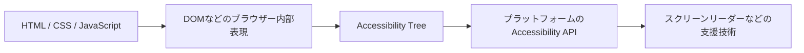

## はじめに

「Accessibility TreeもAIに見てもらったら、アクセシビリティレビューはもう少し変わるんじゃない？」

コードレビューをAIに頼むとき、私はHTMLやDOMを見てもらうことが多いです。そこから、ラベルがない、`button` ではなく `div` でクリック処理を書いている、といった問題を探してもらいます。

でも、ブラウザーはHTMLをそのまま支援技術に渡しているわけではありません。DOMをもとにアクセシビリティ情報を組み立て、アクセシビリティ API を通してスクリーンリーダーなどに伝えています。

では、そのブラウザーが作った **Accessibility Tree（アクセシビリティツリー）** もAIに見せたら、レビュー結果は変わるのでしょうか。今回は同じページを使い、「HTML/DOMだけ」「Accessibility Treeだけ」「両方」の3条件で実際に比べてみます。

## まずは、Webページから支援技術までの流れ

大まかな流れは次のとおりです。



HTML Accessibility API Mappings（HTML-AAM）は、HTMLの要素や属性をプラットフォームのアクセシビリティ API にどう対応付けるかを定義しています。Accessible Name and Description Computation（Accname）は、要素のアクセシブルネームや説明をどのように計算するかを扱います。参照したHTML-AAM 1.0とAccname 1.2はいずれもW3CのWorking Draftです。つまり、Accessibility Treeはソースコードを別の見た目で並べただけではなく、ブラウザーが解釈した意味を含む情報です。

この流れは概念図です。実際の公開方法やツリーの表現はブラウザーやプラットフォームによって異なり、支援技術はOSなどのアクセシビリティ API を介して情報を受け取ります。今回見るのは、そのうち **Chromeが生成したアクセシビリティ情報のテキストスナップショット**です。

## 何をアクセシビリティ上の問題として見るか

WCAG 2.2 は、今回の検証に関係する達成基準を次のように定めています。

> “For all user interface components … the name and role can be programmatically determined; states, properties, and values … can be programmatically set.”
>
> — [Understanding Success Criterion 4.1.2: Name, Role, Value](https://www.w3.org/WAI/WCAG22/Understanding/name-role-value.html)

> “All functionality of the content is operable through a keyboard interface…”
>
> — [Understanding Success Criterion 2.1.1: Keyboard](https://www.w3.org/WAI/WCAG22/Understanding/keyboard.html)

> “For user interface components with labels that include text or images of text, the name contains the text that is presented visually.”
>
> — [Understanding Success Criterion 2.5.3: Label in Name](https://www.w3.org/WAI/WCAG22/Understanding/label-in-name.html)

> “The visual presentation of text and images of text has a contrast ratio of at least 4.5:1…”
>
> — [Understanding Success Criterion 1.4.3: Contrast (Minimum)](https://www.w3.org/WAI/WCAG22/Understanding/contrast-minimum.html)

このほか、フォーム入力にラベルや説明があるか（3.3.2）、キーボードフォーカスが見えるか（2.4.7）も確認します。見出しレベルは単なる番号ではなく、文書内の階層を伝えます。WCAGに「番号を必ず連番にする」という独立した達成基準はありませんが、実装では内容の階層に沿って見出しを順にネストさせるのが基本です。飛びがあれば、構造が正しく伝わっているかを重点的に確認します（1.3.1、2.4.6）。

## 実験方法

### サンプルページ

意図的にいくつかの問題を入れた、読書会の申し込みページを用意しました。レビュー入力として使うHTMLには、CSSとインラインのクリック処理も含めています。ここでは「HTML/DOMだけ」を、通常のコードレビューでAIに渡す**ページソースだけ**という意味で使います。

```html
<!doctype html>
<html lang="ja">
<head>
  <meta charset="utf-8">
  <title>読書会の申し込み</title>
  <style>
    body { font-family: sans-serif; color: #222; }
    .help { color: #aaa; background: #fff; font-size: 14px; }
    :focus { outline: none; }
    .fake-button { cursor: pointer; padding: 8px; border: 1px solid #777; width: max-content; }
    .custom-check { cursor: pointer; padding: 8px; }
  </style>
</head>
<body>
  <main>
    <h1>週末の読書会</h1>
    <h3>参加申し込み</h3>
    <p class="help">入力内容は事務局への連絡にのみ使用します。</p>
    <button type="button" aria-label="送信">申し込む</button>
    <button type="button" class="icon-button">
      <svg aria-hidden="true" viewBox="0 0 24 24" width="24" height="24">
        <path d="M4 6h16M4 12h16M4 18h16"></path>
      </svg>
    </button>
    <p class="fake-button" onclick="alert('開催概要')">開催概要を開く</p>
    <form>
      <label for="email">メールアドレス</label>
      <input id="email" type="email">
      <input id="name" type="text">
      <div role="checkbox" class="custom-check" tabindex="0" aria-checked="false"
           onclick="this.setAttribute('aria-checked', this.getAttribute('aria-checked') === 'true' ? 'false' : 'true')">
        メールでお知らせを受け取る
      </div>
      <button type="submit">申し込みを確定</button>
    </form>
  </main>
</body>
</html>
```

### ブラウザーが生成したツリー

Chromeでページを開き、DevToolsのアクセシビリティツリーに基づくスナップショットを取得しました。以下は出力から要素IDなどを省いた抜粋です。

```text
RootWebArea "読書会の申し込み"
  main
    heading "週末の読書会" level="1"
    heading "参加申し込み" level="3"
    paragraph
      "入力内容は事務局への連絡にのみ使用します。"
    button "送信"
    button
    paragraph
      "開催概要を開く"
    form
      textbox "メールアドレス"
      textbox
      checkbox "メールでお知らせを受け取る"
      button "申し込みを確定"
```

ここから、アイコンボタンに名前がないことや、名前のない `textbox` があることは分かります。一方、表示文字が「申し込む」のボタンのアクセシブルネームは「送信」だという**食い違い**は、画面に見えるラベルとツリー上の名前を比べないと判断できません。

また、このスナップショットは `checkbox` の役割と名前を表示しましたが、`aria-checked="false"` の状態値まではテキスト上に出していません。これは今回使った表示形式についての観察です。Accessibility Tree全般が状態を持たない、という意味ではありません。

### 3つの条件

それぞれの条件で、次の共通プロンプトを使い、末尾に各条件の入力だけを加えました。

```text
提示した情報だけを根拠に、このページのアクセシビリティをレビューしてください。
アクセシブルネーム、role、state、見出し、フォーム、キーボード操作、
フォーカス表示、コントラストを確認し、問題ごとに根拠、確度、該当するWCAG基準を示してください。
判断材料がない場合は「要確認」としてください。roleやstateが見えても操作可能とは限らず、
Treeにイベント処理が見えないだけで操作不可とも断定しないでください。
見出しレベルが飛んでいるだけでWCAG違反と断定しないでください。
```

| 条件 | AIに渡した情報 |
|------|----------------|
| HTML/DOMのみ | サンプルページのHTML、CSS、インライン処理 |
| Accessibility Treeのみ | Chromeが生成したツリーのテキストスナップショット |
| 両方 | 上記2つを同時に提示 |

2026年10月26日に、このセッションのモデル設定（GPT-6 Luna）で条件ごとに独立したレビューを1回ずつ実行しました。温度などを固定したベンチマークではなく、これは小さな探索的実験です。実行日やプロンプト、モデルが変われば結果も変わり得るため、一般的なAIの性能を測定したものではありません。

## 実験結果

記号は、`○` が具体的な問題として指摘、`△` が要確認として提示、`—` がその問題を指摘しなかったことを表します。見出しについては、違反と断定したかではなく、構造上の確認事項として挙げたかを示しています。

| サンプルに入れた問題 | HTML/DOMのみ | Treeのみ | 両方 |
|----------------------|:-------------:|:--------:|:----:|
| アイコンだけのボタンに名前がない | ○ | ○ | ○ |
| 氏名入力欄にラベルがない | ○ | ○ | ○ |
| 表示ラベル「申し込む」と名前「送信」が不一致 | ○ | — | ○ |
| クリック可能な`p`要素がキーボード操作できない | ○ | — | ○ |
| カスタムチェックボックスがSpaceキーで切り替わらない | ○ | — | △ |
| 通常サイズの文字色コントラストが不足 | ○ | — | ○ |
| フォーカス時の表示をCSSで消している | ○ | — | ○ |
| `h1`の次が`h3` | △ | △ | △ |

見出しの`△`は「そのままでよい」ではなく、「AIが規格違反を断定する前に文書構造を確認した」という意味です。このサンプルではページタイトル直下の節が`h3`になっているため、私の最終判断としては修正対象です。スクリーンリーダーは見出しのレベルを伝え、見出し単位の移動にも使います。中間の階層がないのに`h3`を置くと、利用者に実際とは異なる深さを伝えたり、見出し一覧から構造を把握しづらくしたりする可能性があります。

修正は、見出しレベルを実際の階層に合わせます。

```diff
- <h3>参加申し込み</h3>
+ <h2>参加申し込み</h2>
```

### HTML/DOMだけで見つかったもの

ソースだけのレビューでは、コントラスト、フォーカス表示、名前の不一致、名前のないボタンと入力欄、キーボードで扱えないクリック処理が指摘されました。カスタムチェックボックスも、`onclick`だけでSpaceキーの処理がない点を指摘しています。

これはソースにCSSやイベント処理も含めたからです。HTMLタグだけに限定していたら、コントラストやフォーカスの問題はここまで明確には見られません。比較の前提を明示しておく必要があります。

### Accessibility Treeだけで見つかったもの

Treeだけでも、名前のないボタンと名前のない入力欄は指摘されました。ブラウザーが実際にどう解釈したかを見せる利点が出た部分です。

一方、表示上の「申し込む」とTree上の名前「送信」の食い違い、CSSのコントラストとフォーカス表示、クリック処理やキーボード処理は判断できません。ツリーには画面のスタイルや、キー入力に対するイベント処理の実装までは載っていないためです。TreeのみのAIも、キーボードやコントラストはこの入力だけでは評価できないと述べました。

### 両方を渡したとき

両方を渡すと、ソースの見えるラベルとTree上の名前を照合して、不一致を具体的に説明できました。名前のない入力欄やボタンも、ソースとブラウザーの解釈を併せて示せています。

ただし、ソースだけの条件より明確に多くの問題を発見したわけではありません。特にカスタムチェックボックスについては、両方の条件では「Spaceキーで操作できるか要確認」となり、ソースだけの条件のように問題だとは断定しませんでした。`role="checkbox"` と名前が見えるために、実際の操作処理の欠落が目立ちにくくなった可能性があります。ここは実験結果からの考察であり、原因を特定できたわけではありません。

### ブラウザー上での操作確認

AIの回答だけでは終わらせず、実際にChrome上で確認しました。カスタムチェックボックスにキーボードフォーカスを置いてSpaceキーを押しても、`aria-checked` は `false` のままでした。キーボードだけでは切り替えられません。

同じページでフォーカス時の `outline` が `none` であることも確認しました。補足テキストは `#aaa`、背景は白、文字サイズは14pxで、計算したコントラスト比は約2.32:1です。通常サイズのテキストに求められる4.5:1を下回ります。

このように、Treeのスナップショットとソースの読み取りだけではなく、キーボードで実際に操作する確認が必要でした。

## 見出しレベルの飛びは修正対象として扱う

3条件とも、`h1`から`h3`へ飛んでいる点を確認事項として挙げました。これは誤検出ではなく、実務上も見出し構造の問題として修正対象にすべきものです。見出しレベルはコンテンツの入れ子を伝え、支援技術を使う人が見出しを手がかりに移動したり、ページの構造を把握したりするための情報です。W3C WAIのチュートリアルも、見出しレベルの飛びは混乱を招くため、可能な限り避けるよう勧めています。Dequeのaxeルールも、`h1`の次は`h3`ではなく`h2`にするよう案内しています。

一方、WCAG 2.2の1.3.1は、見た目で伝えられる情報や関係性をプログラムでも判別できることを求め、2.4.6は見出しやラベルがトピックや目的を説明することを求めています。達成基準の本文に「見出しレベルは必ず連番でなければならない」とは書かれていません。W3Cの技法G141は適切なネストを勧めていますが、技法自体はWCAG適合の必須要件ではありません。また、WAIの見出しチュートリアルは、前の小節を閉じて新しい節へ移る場合などにはレベルを飛ばせる例外も説明しています。今回の`h1`から`h3`への飛びはその例には当たりません。axe-coreのルール一覧では`heading-order`はWCAG達成基準への直接マッピングではなく、`best-practice`として分類されています。

つまり、見出しレベルの飛びは一般的なアクセシビリティレビューで修正対象として扱われます。ただし、「飛んでいる」という形式だけで必ずWCAG違反と断定するのではなく、実際の関係性が正しくプログラムで伝わっているかも確認します。今回のサンプルはページタイトル直下の節を`h3`にしており、構造上`h2`が適切です。利用者にとっての問題を直すことと、達成基準への適合を形式的に判定することは分けて記述します。

今回のAIレビューでは、**明確に存在しない問題をWCAG違反と断定する誤指摘はありませんでした**。3条件とも見出しレベルの飛びを指摘しており、このサンプルでは`h2`への修正が必要です。レビュー指示で「飛びだけでWCAG違反と断定しない」と伝えたため、AIの表では「要確認」になっています。これは問題を放置してよいという判定ではありません。

## Accessibility Treeに現れない問題

今回の結果から、Treeが得意な範囲と、Treeだけでは判断しづらい範囲を分けて考えられます。

| 観点 | Treeから分かること | Treeだけでは分からないこと |
|------|--------------------|----------------------------|
| アクセシブルネーム | ブラウザーが計算した名前、名前が空の要素 | 名前が画面上の文言と一致しているか |
| role / state | ブラウザーが公開した役割や状態 | 操作後に状態が正しく更新されるか |
| 見出し | 見出しの役割、レベル、名前 | その階層がページ内容にとって適切か |
| フォーム | `textbox`などの役割、計算された名前 | 入力欄の見た目や説明が十分か |
| キーボード | フォーカス可能な要素など一部の手がかり | Tab順、Space/Enterの応答、フォーカス表示 |
| 視覚表現 | 通常は直接表現されない | 色のコントラスト、レイアウト、見た目の手掛かり |

とくに注意したいのは、**roleやstateがTreeに出ていることと、操作できることは別**だという点です。今回のカスタムチェックボックスは `checkbox` として公開されていても、Spaceキーで状態が変わりません。WAI-ARIA Authoring Practices Guideのチェックボックスパターンでも、フォーカス中にSpaceキーで状態を変更する操作が説明されています。カスタム実装では、意味を公開するだけでなく、操作も実装・確認する必要があります。

## では、AIレビューにTreeを加える価値はあるのか

今回の1回の比較では、Treeだけを渡した条件は、7つの明確な問題のうち名前に関係する2つを見つけました。HTML/DOMだけの条件は7つをすべて指摘し、両方の条件も7つすべてに触れましたが、チェックボックスは要確認という扱いでした。これらに加え、見出しレベルの飛びも3条件すべてが指摘しており、このサンプルでは修正対象と判断しました。

この結果だけを見ると、Treeを追加すればレビューの検出数が必ず増えるとは言えません。ソースだけで問題が十分見えるページでは、追加情報が冗長になることもあります。一方で、Treeは「ブラウザーがどう解釈したか」を確かめる別の観察窓です。ソースを見ただけでは見落とす、計算後の名前や役割の欠落を確認するには役立ちます。

私なら、次のように組み合わせます。

1. **自動検査**で、機械的に判定できるルール違反を継続的に探す。
2. **HTML/DOMとCSS、イベント処理**をAIに見せ、構造・ラベル・見える文言との不一致をレビューする。
3. **ブラウザーのAccessibility Tree**を追加し、実際に公開された名前・role・state・見出し・フォーム要素をソースと照合する。
4. **人がキーボードで操作**し、Tab順、Space/Enter、フォーカス表示、状態変化を確認する。必要に応じてスクリーンリーダーなどの支援技術でも試す。

AIに「アクセシビリティを改善して」と頼むだけでは、ページの視覚表現や操作時の挙動まで確実に評価できません。Treeはレビューの答えではなく、ブラウザーが支援技術に伝えようとしている情報をAIと人が確認するための、もうひとつの入力です。

## おわりに

「Accessibility TreeもAIに見せれば、レビューの質が変わるのでは？」という仮説を、同じページを使った3条件で試しました。

今回のサンプルでは、名前のないボタンや入力欄の検出にはTreeが役立ちました。一方、色、フォーカス表示、キーボード操作、画面上のラベルとの不一致は、Tree単体では分からないか、別の確認が必要でした。HTML/DOMとTreeの両方を使っても、キーボードで試す工程は省けません。

結論は「Treeを与えればAIが必ず賢くなる」ではありません。ソース、自動検査、ブラウザーが生成したTree、そして人による操作確認を組み合わせることで、見落としやすい観点を補い合うのが現実的だと感じました。

## 参考リンク

- [HTML Accessibility API Mappings 1.0](https://www.w3.org/TR/html-aam-1.0/)
- [Accessible Name and Description Computation 1.2](https://www.w3.org/TR/accname-1.2/)
- [Chrome DevTools Protocol: Accessibility domain](https://chromedevtools.github.io/devtools-protocol/tot/Accessibility/#method-getFullAXTree)
- [WCAG 2.2: 1.3.1 Info and Relationships](https://www.w3.org/WAI/WCAG22/Understanding/info-and-relationships.html)
- [WCAG 2.2: 2.4.6 Headings and Labels](https://www.w3.org/WAI/WCAG22/Understanding/headings-and-labels.html)
- [WCAG 2.2: 2.4.7 Focus Visible](https://www.w3.org/WAI/WCAG22/Understanding/focus-visible.html)
- [WCAG 2.2: 3.3.2 Labels or Instructions](https://www.w3.org/WAI/WCAG22/Understanding/labels-or-instructions.html)
- [WCAG Technique G141: Organizing a page using headings](https://www.w3.org/WAI/WCAG22/Techniques/general/G141)
- [WCAG Technique H42: Using h1-h6 to identify headings](https://www.w3.org/WAI/WCAG22/Techniques/html/H42)
- [WCAG Failure F43: Structural markup that does not represent content relationships](https://www.w3.org/WAI/WCAG22/Techniques/failures/F43.html)
- [WAI Tutorial: Headings](https://www.w3.org/WAI/tutorials/page-structure/headings/)
- [Deque axe rule: Heading levels should only increase by one](https://dequeuniversity.com/rules/axe/4.10/heading-order)
- [axe-core rule descriptions](https://github.com/dequelabs/axe-core/blob/develop/doc/rule-descriptions.md#best-practices-rules)
- [WAI-ARIA Authoring Practices Guide: Checkbox Pattern](https://www.w3.org/WAI/ARIA/apg/patterns/checkbox/)
