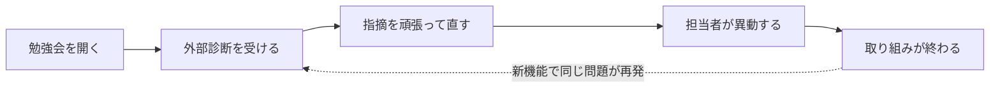
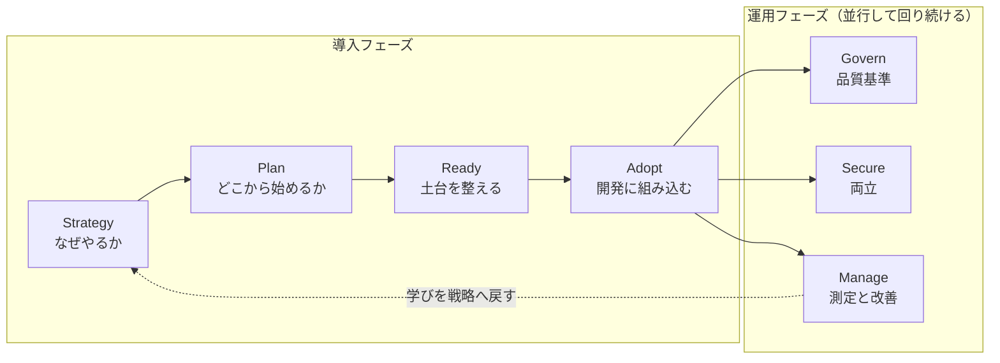
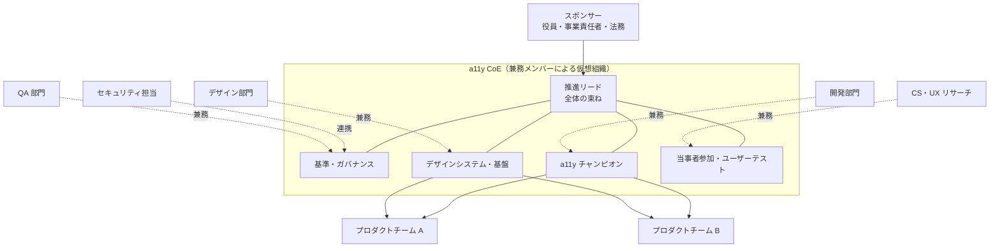
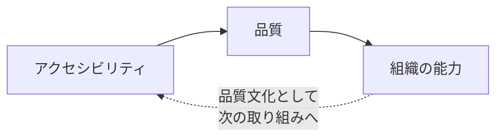

## はじめに

Azure CAF（Cloud Adoption Framework for Azure）の考え方は、あらゆる新しい考え方の導入や製品の購入について、多くの示唆を与えてくれます。その価値は、技術や製品を導入するだけでなく、組織の準備や継続的な運用まで見据える視点にあると私は考えています。

Microsoft の Cloud Adoption Framework for Azure（CAF）は、公式には Azure 導入のためのガイダンスです。[Microsoft Learn の概要](https://learn.microsoft.com/ja-jp/azure/cloud-adoption-framework/overview?WT.mc_id=DT-MVP-5004827)では、Azure を採用する理由、組織を準備する方法、継続的に運用する方法を考える枠組みとして説明されています。あらゆる導入や購入への示唆という捉え方は私の見解であり、CAF の公式な適用範囲を広げるものではありません。

この視点は、Web アクセシビリティ（a11y）にも応用できるはずです。たとえば、勉強会を開き、外部診断の指摘を直しても、新機能で同じ種類の問題が再び混入し、担当者の異動で取り組みが止まってしまうケースを考えてみてください。WCAG（Web Content Accessibility Guidelines）対応を支援する AI や、Playwright と axe-core による自動チェックを導入するだけでは、こうした定着の問題は解決できません。

そこで本記事では、CAF を補助線にして、アクセシビリティを「技術導入」ではなく「組織の能力の獲得」として捉え直してみます。CAF のフェーズをアクセシビリティに当てはめると、驚くほど筋が通ります。さらに、CAF がクラウド導入のために示す「仮想チーム」の考え方と対比して、アクセシビリティの仮想組織という仕組みも、私なりに提唱してみます。🧭

この記事は CAF の網羅的な紹介ではありません。CAF の考え方を借りて、アクセシビリティを品質文化として根付かせるための見取り図を描くことが目的です。アクセシビリティの推進担当、開発リード、デザインシステム担当、PM / PO の方を想定しています。CAF の予備知識は不要です。

## 本記事のゴール

- 🔁 アクセシビリティ施策が「打ち上げ花火」で終わる構造を言語化する
- ☁️ CAF の 7 つのフェーズを一次情報で確認する
- 🗺️ 主要な 6 フェーズ（Secure はセキュリティ要件との衝突論点として扱います）をアクセシビリティの取り組みに対応付けて、抜けている観点を見つける
- 🤝 クラウド導入の仮想チームと対比して、兼務メンバーで構成する「アクセシビリティの仮想組織」（本記事の提唱）の役割と組み方を知る
- 🏗️ 「善意」に頼らず、品質基準と測定で回る仕組みのイメージを持つ

## よくある失敗パターン

まず、冒頭で挙げたケースをもう少し丁寧に分解してみます。多くの組織でのアクセシビリティ施策は、次のような一方通行の流れになりがちです。



この流れの問題は、どのステップも「やっていること自体は正しい」点にあります。勉強会も診断も修正も必要です。足りないのは、それらを組織の仕組みとして回し続ける構造のほうです。

たとえば次のような状態に心当たりはないでしょうか。

- 「なぜやるのか」が経営や事業の言葉になっておらず、優先度の議論で負け続ける
- 「WCAG 2.2 AA 全対応」という目標だけがあり、現状がどこにあるか誰も知らない
- 知識が特定の熱心な個人に集中していて、その人がいないと止まる
- ツールを入れたが、開発の流れに組み込まれず定着しない
- 自動テストを入れたが、失敗しても誰も止めない
- 「対応した」という報告で終わり、その後の推移を誰も見ていない

これらは技術力の問題ではありません。目的、計画、土台、標準、運用のどれかが欠けている、という**導入の問題**です。そして、導入の問題を体系的に扱ってきたフレームワークの代表例が CAF です。

## Cloud Adoption Framework（CAF）とは

はじめにで触れたとおり、CAF は、Microsoft が提供するクラウド導入のためのガイダンスです。Microsoft Learn の概要ページでは、意思決定者がより良い判断をより速く下せるよう支援し、導入のリスクを減らして、ワークロードを支える基盤を作るためのものだと説明されています。

— [What is the Cloud Adoption Framework?](https://learn.microsoft.com/ja-jp/azure/cloud-adoption-framework/overview?WT.mc_id=DT-MVP-5004827)

2026 年 10 月時点の同ページでは、Azure 導入のフェーズが次の 7 つで整理されています。それぞれに「主な問い」が添えられているのが特徴です。

| フェーズ | CAF での主な問い（筆者による要約） | アクセシビリティに置き換えると |
|---|---|---|
| 🎯 Strategy | Azure 導入はどうあるべきか | なぜ自社はアクセシビリティに取り組むのか |
| 🗺️ Plan | 導入にどう備えるか | どこから、どの順番で始めるのか |
| 🏗️ Ready | ランディングゾーンをどう作るか | 組織とデザインシステムは準備できているか |
| 🚀 Adopt | ワークロードをどう移行・最新化・構築するか | 開発プロセスにどう組み込むか |
| 📏 Govern | 環境をどう統制するか | 何を品質基準として強制するか |
| 🔐 Secure | 環境をどう守るか | セキュリティとアクセシビリティをどう両立させるか |
| 📈 Manage | 継続的にどう運用・最適化するか | どう測定し、改善し続けるか |

概要ページの図では、Strategy から Adopt までの導入フェーズは順に流れます。Govern・Secure・Manage の運用フェーズは、運用中に並行して回るものとして描かれています。この「**導入は順に、運用は並行して回り続ける**」という構造こそ、アクセシビリティで欠けがちなものです。



:::message
Secure フェーズはクラウド環境の保護を扱うもので、アクセシビリティとの直接の対応は他のフェーズより薄めです。本記事では Govern の節の「Secure との衝突にも基準を」で、セキュリティ要件とアクセシビリティの衝突を扱います。
:::

CAF そのものの入門は、[Azure Cloud Adoption Framework（CAF）入門 〜導入戦略を中心に〜](https://zenn.dev/tomokusaba/articles/15a795d30bd0c8) や [Azure CAF の戦略で最重要なのは「動機」だと思う話](https://zenn.dev/tomokusaba/articles/33df5b8949eda4) もあわせてどうぞ。ここからは、各フェーズを順番にアクセシビリティへ対応付けていきます。

## Strategy：なぜアクセシビリティをやるのか

最初の落とし穴は、ここにあります。現場では「WCAG が大事だから」「やるべきことだから」で始まりがちです。その動機自体は自然なものです。ただ、CAF の Strategy は、導入の動機（motivations）とミッション、目標を明確にすることを求めています。

— [動機、ミッション、目標を決定する](https://learn.microsoft.com/ja-jp/azure/cloud-adoption-framework/strategy/motivations?WT.mc_id=DT-MVP-5004827)

動機が「大事だから」のままだと、予算や工数の取り合いで負けます。機能追加と比べられたとき、説明の言葉を持っていないからです。アクセシビリティの動機は、たとえば次のように整理できます。

| 動機の種類 | 具体例 | 経営・事業の言葉にすると |
|---|---|---|
| ⚖️ 法令・社会的要請 | 改正障害者差別解消法への対応 | リスクの低減、問い合わせ対応力の確保 |
| 🏛️ 調達要件 | 公共調達や大口顧客の要件 | 受注機会の確保 |
| 🤝 顧客要件 | 取引先からのアクセシビリティ方針の確認 | 取引継続の条件 |
| 🎨 UX の向上 | 誰にとっても迷いにくい操作 | 離脱率の低下、問い合わせ削減 |
| 👵 高齢化への対応 | 視力や操作の変化への備え | 市場の維持と拡大 |
| 🌱 ESG / CSR | 「誰一人取り残さない」姿勢 | 企業価値と採用力 |

法令面は正確に押さえておきたいところです。障害者差別解消法は令和 3 年に改正され、改正法は 2024 年 4 月 1 日に施行されました。<!-- TODO: 一次情報で要確認（施行日と義務区分） --> これにより、事業者による障害のある人への合理的配慮の提供が求められるようになりました。

— [内閣府「障害を理由とする差別の解消の推進」](https://www8.cao.go.jp/shougai/suishin/sabekai.html) / [改正法リーフレット](https://www8.cao.go.jp/shougai/suishin/sabekai_leaflet-r05.html)

一方で、Web サイトのアクセシビリティ向上のように、個別の求めに先立って行う「環境の整備」については、事業者に努力義務が課されるという整理です（詳細は上記の内閣府ページで確認してください）。つまり「法律で Web の WCAG 準拠が義務になった」と言い切るのは正確ではありません。とはいえ、合理的配慮の求めに応えるには、日頃の環境整備が土台になります。デジタル庁の [ウェブアクセシビリティ導入ガイドブック](https://www.digital.go.jp/resources/introduction-to-web-accessibility-guidebook) は、こうした整理と進め方を事業者向けにまとめています。

:::message
補足として、日本の規格には JIS X 8341-3:2016 があります（[ウェブアクセシビリティ基盤委員会（WAIC）](https://waic.jp/)）。本記事が目標に置く WCAG 2.2 は JIS X 8341-3:2016 とは別の版なので、「JIS 準拠」と「WCAG 2.2 AA 達成」は別の話として整理しておく必要があります。
:::

:::message alert
動機を法令だけに置くと、「最低限ここまで」という発想に寄りやすくなります。法令は下限として押さえつつ、顧客価値や UX と組み合わせて、自社の言葉でミッションを書くのがおすすめです。
:::

問いはシンプルです。**「うちの会社は、なぜアクセシビリティをやるのか」**。この一文に答えられるかどうかで、後続のすべてのフェーズの強さが変わります。答えが決まったら、次は「どこから始めるか」です。

## Plan：どこから始めるのか

Strategy で「WCAG 2.2 AA を目指す」と決めたとします。ところが、多くの現場では次の瞬間に手が止まります。対象のサイトやアプリがいくつあり、どれがどの程度できていて、どこから直すべきかが分からないからです。目標はあるのに、現在地が分からない状態です。

CAF の Plan は、戦略を実行可能な計画に変換するフェーズです。既存のワークロードを移行する場合は、準備、計画、発見（discovery）、選択、評価、見積もり、文書化という流れで進め、ワークロードごとに廃止（retire）、リホスト、リファクター、再設計、置き換え、再構築、維持（retain）といった方針を決めると説明されています。

— [Prepare your organization for the cloud](https://learn.microsoft.com/ja-jp/azure/cloud-adoption-framework/plan/?WT.mc_id=DT-MVP-5004827)

これはアクセシビリティの「現状診断 → 優先順位付け → ロードマップ」にそのまま重なります。デジタル資産を棚卸しし、すべてを同じ優先度で直すのではなく、資産ごとに方針を決めます。

| CAF の方針 | アクセシビリティでの方針 | 向いている資産の例 |
|---|---|---|
| 🗑️ Retire（廃止） | 改修せずに廃止・統合する | アクセスがほぼない古いキャンペーンページ |
| 🔁 Replace（置き換え） | アクセシブルな製品や SaaS に置き換える | 自前の古い問い合わせフォーム |
| 🔧 Refactor（リファクター） | 既存構造を保ったまま修正する | ラベル不足やコントラスト不足が中心の画面 |
| 🏗️ Rebuild（再構築） | アクセシブルなコンポーネントで作り直す | 独自 UI 部品が多く、キーボード操作が破綻している画面 |
| 📌 Retain（維持） | 現状維持し、代替手段を用意する | 近く刷新予定の社内ツール |

優先順位は「利用者への影響 × 利用頻度 × 業務上の重要度」で付けると議論しやすくなります。ログイン、購入、申し込み、問い合わせのように、そこで詰まると目的を達成できない導線から着手するのが定石です。

ここでのポイントは、計画に「誰が持つか」まで書くことです。CAF の Plan も、ガバナンス、セキュリティ、運用の責任を早い段階で割り当てることの大切さに触れています（[Prepare your organization for the cloud](https://learn.microsoft.com/ja-jp/azure/cloud-adoption-framework/plan/?WT.mc_id=DT-MVP-5004827)）。これが、担当者の異動で取り組みが止まる問題を防ぐ第一歩です。担当を支える組織の形も含めて、次の Ready で土台を整えていきましょう。

## Ready：組織は準備できているか

私がいちばん面白いと感じているのが、この Ready です。アクセシビリティの失敗要因は、技術よりも人にあると私は考えているからです。デザイナーは知らない、開発者も知らない、QA も知らない。その状態で「各自で気をつけて」と言っても回りません。

ここでは Ready を「土台」「人」「組織」の 3 つに分けて見ていきます。まずは、人が働く土台から見ていきます。

### 土台：デザインシステムをランディングゾーンに

CAF の Ready は、Azure ランディングゾーンを設計するフェーズです。ランディングゾーンとは、ガバナンスやセキュリティ、共有リソースを備えた土台のことで、組織全体の基盤となる「プラットフォーム ランディングゾーン」と、各ワークロードチームがそのガードレール内で運用する「ワークロード ランディングゾーン」から成ると説明されています。

— [What is an Azure landing zone?](https://learn.microsoft.com/ja-jp/azure/cloud-adoption-framework/ready/landing-zone/?WT.mc_id=DT-MVP-5004827)

この比喩は、アクセシビリティにとても効きます。なお、CAF では「サブスクリプションの自動販売機（subscription vending）」が、ワークロード ランディングゾーンを払い出す仕組みとして紹介されています。

| ランディングゾーンの要素 | アクセシビリティでの対応物 |
|---|---|
| 🏢 プラットフォーム ランディングゾーン | デザインシステム、アクセシブルな共通コンポーネント、デザイントークン |
| 🧱 ガードレール（ポリシー） | ガイドライン、Lint ルール、PR テンプレートのチェック項目 |
| 📦 ワークロード ランディングゾーン | 各プロダクトチームの画面や機能 |
| 🎫 サブスクリプションの自動販売機（払い出し） | 新規プロジェクトのテンプレート（a11y テスト込み） |

各チームがボタンやダイアログをゼロから作っている限り、フォーカス管理やアクセシブルネーム（支援技術に伝わる名前）の不備は、チームの数だけ再生産されます。逆に、アクセシブルなコンポーネントが共通基盤として提供されていれば、各チームはその上で作るだけで一定の品質を得られます。

### 人：役割ごとのスキル準備

もう 1 つの柱が人の準備です。CAF ではスキル準備のガイダンスは Plan 側にありますが、アクセシビリティでは Ready の土台に含めて考えます。そのガイダンスには、必要なスキルを把握し、スキルギャップを埋め、継続的な学習を組織に根付かせるための内容があります。学習用のサンドボックスを用意すること、学習時間を毎週確保すること、スキルマトリックスで役割ごとの必要スキルを整理することが挙げられています。

— [Prepare your people for the cloud](https://learn.microsoft.com/ja-jp/azure/cloud-adoption-framework/plan/prepare-people-for-cloud?WT.mc_id=DT-MVP-5004827)

アクセシビリティに置き換えると、役割ごとに次のような準備が必要になります。

- 🎨 デザイナー: コントラスト、フォーカス表示、ターゲットサイズの基準を知っている
- 💻 開発者: セマンティックな HTML、キーボード操作、ARIA の使いどころを知っている
- 🧪 QA: 自動テストの読み方と、スクリーンリーダーでの基本的な確認ができる
- 📋 PM / PO: 受け入れ条件にアクセシビリティを書ける

単発の勉強会は、この準備のごく一部にすぎません。役割ごとのスキルマトリックスと、継続的に学ぶ仕組みがあって初めて「組織の能力」になります。では、そのスキルを持った人たちを、どんな組織で束ねればよいのでしょうか。

### 組織：クラウド導入の仮想チームと、アクセシビリティの仮想組織

人の準備を考えるうえで、私が CAF からいちばん借りたいと思っているのが「チームの組み方」です。2026 年 10 月時点の CAF では、チーム構成のガイダンスは冒頭の 7 つのフェーズとは別に、「組織の調整（Organize）」のページにまとめられています。Ready の内容そのものではありませんが、本記事では人と組織の準備として Ready に含めて考えます。そのページでは、CAF が示すチーム構造は組織図と一致している必要はなく、アジャイルなマトリックス型の組織では仮想チーム（virtual teams）として表すのが最適な場合もあると説明されています。

<!-- TODO: 一次情報で要確認（原文との一字一句の一致） -->
> In an agile, matrix organization, these structures might be best represented as virtual teams.

— [Manage organizational alignment](https://learn.microsoft.com/en-us/azure/cloud-adoption-framework/organize/?WT.mc_id=DT-MVP-5004827)（英語版の原文より）

同じページでは、組織構造を実現する方法が 3 つ挙げられています。組織図に合わせる方法、組織図は変えずに仮想チームを作って必要な機能を担わせる方法、そして両者を組み合わせる方法です。つまり CAF は、クラウド導入を「新しい部署を作る話」に限定していないと読めます。<!-- TODO: 一次情報で要確認（組織構造の 3 つの方法と組み合わせの記述） -->既存の部署に所属したまま、横断的に役割を担う形も示されています。

CAF には、戦略、導入、ガバナンス、プラットフォーム、運用、セキュリティの各チームと、それらの機能を束ねる Cloud Center of Excellence（CCoE）が登場します。各チームの役割は、次の折りたたみにまとめました。

:::details CAF に登場する主なチーム・機能（抜粋）

| CAF のチーム・機能 | 主な役割（公式ドキュメントの要約） |
|---|---|
| 🎯 クラウド戦略チーム | 導入の動機とビジネス目標を定め、事業の優先順位と導入の取り組みの整合を保つ（経営層、事業と IT の意思決定者、セキュリティ、コンプライアンス、財務などで構成） |
| 🚀 クラウド導入チーム | 導入の中核として技術的な変更を進め、ソリューションをクラウドへ載せる |
| 📏 クラウドガバナンスチーム | 導入チームとバランスを取り、リスク評価、ポリシーの文書化と強制、監視を担う |
| 🏢 プラットフォームチーム | ガバナンス、サブスクリプションの払い出し、ネットワークなどの共通機能を、再利用できる「社内向けの製品（internal products）」として提供する |
| ⚙️ クラウド運用チーム | ビジネス成果に必要な安定した運用を担う（既存の IT 運用部門が担うことも、他の部門に委ねることもある） |
| 🔐 セキュリティチーム | パターン、ガイダンス、自動化、ガードレールを提供し、安全な実装を既定（デフォルト）にする |
| 🧭 Cloud Center of Excellence（CCoE） | 導入、戦略、ガバナンス、プラットフォーム、自動化の各機能が協調し、セルフサービスと責任の委譲でクラウド導入を加速する |

— [Define your cloud strategy team](https://learn.microsoft.com/ja-jp/azure/cloud-adoption-framework/strategy/define-your-team?WT.mc_id=DT-MVP-5004827) / [Mature team structures](https://learn.microsoft.com/ja-jp/azure/cloud-adoption-framework/organize/organization-structures?WT.mc_id=DT-MVP-5004827) / [Build a cloud governance team](https://learn.microsoft.com/ja-jp/azure/cloud-adoption-framework/govern/build-cloud-governance-team?WT.mc_id=DT-MVP-5004827) / [Shared management cloud operations](https://learn.microsoft.com/ja-jp/azure/cloud-adoption-framework/plan/shared-management-operating-model?WT.mc_id=DT-MVP-5004827) / [Security teams, roles, and functions](https://learn.microsoft.com/ja-jp/azure/cloud-adoption-framework/secure/teams-roles?WT.mc_id=DT-MVP-5004827) / [Cloud center of excellence (CCoE) functions](https://learn.microsoft.com/ja-jp/azure/cloud-adoption-framework/organize/cloud-center-of-excellence?WT.mc_id=DT-MVP-5004827)

:::

興味深いのは、成熟度の説明の中で、クラウド導入チームだけで進める状態が、避けるべき典型的な失敗（アンチパターン）とされている点です。最低限、導入チームとガバナンスチームの 2 つでバランスを取る「実用最小限の体制」が勧められています。<!-- TODO: 一次情報で要確認（MVP の用語と「アンチパターン」の語） -->

これをアクセシビリティに置き換えると、2 つの側面から捉えられます。1 つ目は**機能の偏り**です。直す人はいても、基準を決めて止める人がいない。これは Govern の欠落です。2 つ目は、その偏った役割を熱心な個人が 1 人で抱え込む**個人への依存**です。こちらは「担当者が異動すると取り組みが終わる」という、「よくある失敗パターン」の節にそのままつながります。

そこで私は、クラウド導入の仮想チームと対比する形で、**アクセシビリティの仮想組織**を作ることを提唱したいと考えています。本記事ではこれを「Accessibility Center of Excellence（a11y CoE）」と呼びます。社内での呼び名は「a11y 推進の仮想チーム」などでも構いません。大事なのは、部署を新設するのではなく、各部署に籍を置いたまま兼務メンバーで構成する横断組織にすることです。そうすれば、機能の偏りと個人への依存の両方に手を打てます。特に後者への処方箋になる理由は、この後で説明します。

:::message
本記事で提唱する「アクセシビリティの仮想組織（a11y CoE）」は、CAF の考え方を参考にした私独自の提唱です。CAF がアクセシビリティのための仮想組織やチームを定義しているわけではありません。
:::

CAF のチームと a11y CoE の役割を対比すると、次のようになります。

| 役割 | CAF での対応（クラウド） | a11y CoE での役割（本記事の提唱） | 兼務メンバーの例 |
|---|---|---|---|
| 🎯 スポンサー・戦略 | クラウド戦略チーム | 動機とミッションを定め、優先度の議論で後ろ盾になる | 役員、事業責任者、法務・コンプライアンス |
| 🚀 推進・導入支援 | クラウド導入チーム | 各プロダクトチームに入り込み、修正や設計の相談に乗る「a11y チャンピオン（現場の推進役）」 | 各プロダクトチームの開発者・デザイナー 1 名ずつ |
| 📏 基準・ガバナンス | クラウドガバナンスチーム | 品質基準の策定、例外の承認、PR チェックの運用と測定 | QA リード、アーキテクト |
| 🏢 デザインシステム・基盤 | プラットフォームチーム | アクセシブルな共通コンポーネント、プロジェクトテンプレート、Lint ルールを「製品」として提供する | デザインシステム担当、フロントエンドの基盤担当 |
| 🔐 セキュリティとの両立 | セキュリティチーム | 認証や CAPTCHA などで起きるセキュリティ要件との衝突について、基準を合意する窓口 | セキュリティ担当（連携先として参加） |
| 🗣️ 当事者参加・ユーザーテスト | 直接の対応はなし | 障害のある当事者に参加してもらい、ユーザーテストや問い合わせの声を基準と優先度に反映する | CS・問い合わせ窓口、UX リサーチャー、当事者の社員や外部協力者 |
| 🧭 全体の束ね | CCoE | 上記の機能を束ね、セルフサービスで品質を確保できる状態を目指す | 推進リード（兼務でも可） |

このうち基準・ガバナンスの役割は Govern の節で、当事者の声を含む手動評価は Manage の節で、それぞれ具体的に見ていきます。

表の「当事者参加・ユーザーテスト」行は、CAF のチーム定義には明示されていない、アクセシビリティならではの役割です。W3C の [Accessibility Maturity Model](https://www.w3.org/TR/maturity-model/)（AMM、2025 年 11 月 4 日付の W3C Group Note）でも、成熟度を確かめる証拠（proof points）の例として、障害のある人をアクセシビリティの取り組みに含めることが挙げられています。原文は次のとおりです。<!-- TODO: 一次情報で要確認（文書日付・節番号・引用文） -->

> Include people with disabilities in accessibility initiatives

— [W3C, Accessibility Maturity Model（3.7.2.2 Organizational Support）](https://www.w3.org/TR/maturity-model/)

自動テストでも専門家の診断でも見えない困りごとを拾うには、この役割を最初から組織に組み込んでおくのがよいと私は考えています。

組織のイメージを図にすると、次のようになります。スポンサーは仮想組織に後ろ盾を与える立場、セキュリティ担当は連携先として、それぞれ外側に置いています。



なぜ専任の部署ではなく、兼務メンバーの横断組織なのか。それが、「よくある失敗パターン」の節にある「担当者が異動すると取り組みが終わる」への処方箋になるからです。

- 👥 知識と責任が 1 人に閉じない: 複数部署の複数人で持つので、誰か 1 人が異動しても組織としての役割は残ります。Plan の節で触れた仮想組織の中で主担当と副担当を決めておけば、引き継ぎも仕組みになります。
- 🧩 知識が現場に染み出す: チャンピオンは普段の所属チームで働き続けるので、アクセシビリティの観点が日々のレビューや設計に自然に持ち込まれます。
- 🌱 組織図を変えずに小さく始められる: CAF も、[戦略チーム](https://learn.microsoft.com/ja-jp/azure/cloud-adoption-framework/strategy/define-your-team?WT.mc_id=DT-MVP-5004827)について「小さく始めて広げる（Start small and expand）」ことを勧めています。仮想組織なら、まず数名から始められます。
- 🛡️ スポンサーの承認で正式な役割になる: 兼務でも、スポンサーが役割を公式に認めて権限を与えることで、「善意の有志」から「組織の役割」に変わります。

一方で、兼務には「本業に押されて後回しになる」というリスクもあります。CAF の [CCoE のページ](https://learn.microsoft.com/ja-jp/azure/cloud-adoption-framework/organize/cloud-center-of-excellence?WT.mc_id=DT-MVP-5004827)でも、成熟するまでの間にメンバーが他の IT の取り組みに引き抜かれるリスクが指摘されています。同ページでは、立ち上げ初期に事業側の関係者と定期的に進捗を共有することも勧められています。<!-- TODO: 一次情報で要確認（期間と頻度の具体的な数値は未確認のため記載を控えた） -->アクセシビリティの仮想組織でも、稼働の割合を明文化し、評価に反映し、スポンサーと定期的に進捗を共有します。ここまでやって初めて、兼務は「名ばかり」ではなくなります。🤝

組織と土台が整ったら、いよいよ現場への組み込みです。

## Adopt：現場へ組み込む

ここでようやく技術の話になります。この節だけ技術寄りで、やや長くなります。PM / PO の方は、コードを読み飛ばして「自動で潰せる範囲」から読み進めても全体の流れは追えます。CAF の Adopt は、ワークロードを移行・最新化・構築するフェーズです。アクセシビリティでは、日々の開発プロセスにチェックを組み込む段階に当たります。

— [Adopt（Azure Cloud Adoption Framework）](https://learn.microsoft.com/ja-jp/azure/cloud-adoption-framework/adopt/?WT.mc_id=DT-MVP-5004827)

代表的な道具を整理しておきます。

| ツール | 役割 | 組み込みどころ |
|---|---|---|
| 🔍 axe-core | アクセシビリティ検査エンジン | テストコード、ブラウザー拡張 |
| 🎭 Playwright | ブラウザー自動操作とテスト | E2E テストの中で axe を実行 |
| 💡 Lighthouse | ページ監査とスコア化 | 定点観測、リリース前確認 |
| ⚙️ GitHub Actions | CI / CD | PR ごとの自動チェック |
| 🤖 GitHub Copilot | 実装と修正の支援 | 修正案の作成、テストの雛形づくり |

axe-core の README では、WCAG の問題のうち自動で検出できるのは一部であることが示されています。<!-- TODO: 一次情報で要確認（自動検出の割合の数値と母数。確認できるまで数値は記載しない） -->確信を持てない要素は「incomplete」として手動確認に回します。裏を返せば、残りは人が確認する必要があります。

— [dequelabs/axe-core README](https://github.com/dequelabs/axe-core/blob/develop/README.md)

Playwright の公式ガイド（JavaScript 版の内容です。C# の API は .NET 向けのドキュメントを参照してください）も、自動テストで検出できるのは一部の問題であり、自動テスト、手動評価、インクルーシブなユーザーテストを組み合わせることを推奨しています。

— [Playwright: Accessibility testing](https://playwright.dev/docs/accessibility-testing)

### 自動で潰せる範囲と、人が判断する範囲

自動チェックを入れたら、次の線引きをチームで共有しておきます。

| 確認方法 | 主に見ること |
|---|---|
| 🤖 自動チェック | ラベルやアクセシブルネームの欠落、ARIA の機械的な誤り、重複 ID、前景色と背景色のコントラスト比不足（検出できる条件に限る） |
| 🧑 人による確認 | 代替テキストが目的に合っているか、フォーカス順序が自然か、エラーから回復できるか |
| 🧑‍🦯 支援技術での確認 | スクリーンリーダーで状態を理解し、次の操作を見つけられるか |

`alt` 属性の有無は機械で分かっても、その文章が画像の目的を伝えているかは文脈の判断です。Lighthouse のスコアも、監査項目の結果から算出される指標であり、100 点が WCAG への適合を意味するわけではありません（[Lighthouse accessibility scoring](https://developer.chrome.com/docs/lighthouse/accessibility/scoring)）。

### PR ごとに自動チェックを回す最小例

ここでは、Microsoft.Playwright.NUnit と Deque.AxeCore.Playwright で主要ページを検査し、GitHub Actions で PR ごとに実行する最小構成を示します。

前提は次のとおりです。テストは `BASE_URL` 環境変数で指すアプリに対して実行します。アプリは事前に起動しておく前提です。`wcag22aa` タグには axe-core 4.5 以降が必要です。

記事用の最小例であり、動作は未検証です。GitHub Actions のアクションと .NET SDK のバージョンは 2026 年 10 月時点の例です。最新版に合わせてください。

```bash
# テストプロジェクトを作成する
dotnet new nunit -n A11yTests -o tests/A11yTests

# 必要なパッケージを追加する
dotnet add tests/A11yTests package Microsoft.Playwright.NUnit
dotnet add tests/A11yTests package Deque.AxeCore.Playwright

# ビルドする
dotnet build tests/A11yTests

# Playwright のブラウザーインストールスクリプト（PowerShell）で Chromium を入れる
pwsh tests/A11yTests/bin/Debug/net10.0/playwright.ps1 install --with-deps chromium
```

`dotnet new nunit` は `UnitTest1.cs` というサンプルを生成するため、削除してから次のコードを配置してください。

```csharp
// tests/A11yTests/PageAccessibilityTests.cs
using System;
using System.IO;
using System.Linq;
using System.Collections.Generic;
using System.Text.Json;
using System.Threading.Tasks;
using Deque.AxeCore.Commons;
using Deque.AxeCore.Playwright;
using Microsoft.Playwright;
using Microsoft.Playwright.NUnit;
using NUnit.Framework;

namespace A11yTests;

[TestFixture]
public class PageAccessibilityTests : PageTest
{
    // テスト対象のアプリ。事前に起動しておく
    public override BrowserNewContextOptions ContextOptions() => new()
    {
        BaseURL = Environment.GetEnvironmentVariable("BASE_URL") ?? "http://localhost:3000",
    };

    // まずは「そこで詰まると目的を達成できない導線」から検査する
    [TestCase("/")]
    [TestCase("/login")]
    [TestCase("/contact")]
    public async Task HasNoBlockingViolations(string path)
    {
        await Page.GotoAsync(path);

        AxeResult result = await Page.RunAxe();
        var violations = result.Violations;

        // すべての違反はレポートに残し、Manage フェーズの計測に使う
        var slug = path.Trim('/');
        if (slug.Length == 0) slug = "root";
        var fileName = $"axe-{slug}.json";
        var filePath = Path.Combine(TestContext.CurrentContext.WorkDirectory, fileName);
        await File.WriteAllTextAsync(filePath,
            JsonSerializer.Serialize(violations, new JsonSerializerOptions { WriteIndented = true }));
        TestContext.AddTestAttachment(filePath, "axe-violations");

        // マージを止めるのは critical / serious のみ（Govern で決めた基準）。
        // Impact の型に依存しないよう文字列化して比較する
        var blocking = violations?
            .Where(v => $"{v.Impact}".Equals("critical", StringComparison.OrdinalIgnoreCase)
                     || $"{v.Impact}".Equals("serious", StringComparison.OrdinalIgnoreCase))
            .Select(v => $"{v.Id}: {v.HelpUrl}")
            .ToList() ?? new List<string>();
        Assert.That(blocking, Is.Empty);
    }
}
```

CI では、テスト対象のアプリを別途起動するステップが必要です。本記事では省略しています。

```yaml
# .github/workflows/a11y.yml
name: a11y-check

on:
  pull_request:
    branches: [main]

jobs:
  a11y:
    runs-on: ubuntu-latest
    steps:
      - uses: actions/checkout@v7
      - uses: actions/setup-dotnet@v6
        with:
          dotnet-version: 10.0.x
      - run: dotnet build tests/A11yTests
      - run: pwsh tests/A11yTests/bin/Debug/net10.0/playwright.ps1 install --with-deps chromium
      - run: dotnet test tests/A11yTests
        env:
          BASE_URL: http://localhost:3000
      - uses: actions/upload-artifact@v7
        if: ${{ !cancelled() }}
        with:
          name: a11y-report
          path: tests/A11yTests/bin/Debug/net10.0/axe-*.json
          retention-days: 30
```

ポイントは 2 つあります。1 つは、**すべての違反を記録しつつ、ブロックする基準は絞っている**ことです。最初から全違反でマージを止めると、既存の負債で PR が通らなくなり、チェックそのものが外されがちです。critical / serious で止める基準の根拠は Govern の節で扱います。もう 1 つは、レポートを成果物として残していることです。これが後の Manage フェーズで効いてきます。

ここで検査しているのは固定の 3 ページだけです。これは出発点であり、新規機能のルートを追加していくことで、Govern の基準と接続させます。

### AI は導入を加速するが、文化までは作れない

GitHub Copilot のような AI は、アクセシビリティの修正案の作成やテストの雛形づくりを支援してくれます。🤖

ただし、AI が作れるのは修正の差分です。「なぜやるのか」を決めることも、デザインシステムに基準を埋め込むことも、PR チェックを必須にする合意を取ることも、AI は代わりにやってくれません。**ツールを導入しただけで、定着するわけではありません**。だからこそ、次の Govern が必要になります。

## Govern：善意を品質基準へ昇格させる

アクセシビリティが続かない理由の 1 つは、取り組みが善意だけで支えられていることにあると私は考えています。善意は尊いものですが、締め切り前には真っ先に削られてしまいます。

CAF の Govern は、ガードレール（許容される活動とされない活動を定めるポリシー、手順、ツール）によってクラウドの利用を統制するフェーズです。公式ドキュメントでは、ガバナンスは一度きりのプロジェクトではなく継続的なプロセスだと説明されています。チームを作った後は、リスク評価、ポリシーの文書化、ポリシーの強制、コンプライアンスの監視を繰り返すとされています。<!-- TODO: 一次情報で要確認（経営層のスポンサーとガバナンスチームへの権限付与の記述） -->

— [クラウドガバナンスチームを構築する（Build a cloud governance team）](https://learn.microsoft.com/ja-jp/azure/cloud-adoption-framework/govern/build-cloud-governance-team?WT.mc_id=DT-MVP-5004827)

これをアクセシビリティに対応付けると、「善意」を「品質基準」に昇格させる作業になります。たとえば次のような基準です。

- 📏 新規機能は、自動チェックで critical / serious の違反ゼロをマージ条件にする
- ✅ a11y チェックを PR の必須ステータスチェックにする
- 📝 主要導線の変更は、キーボード操作とスクリーンリーダーでの確認を受け入れ条件に含める
- 🧾 例外を認める場合は、理由・期限・代替手段を記録する

必須ステータスチェックは、GitHub のブランチ保護ルールやルールセットで設定できます（[About protected branches](https://docs.github.com/en/repositories/configuring-branches-and-merges-in-your-repository/managing-protected-branches/about-protected-branches)）。仕組みで自動的に止まるようになれば、「指摘する人」が嫌われ役を引き受ける構図も解消できます。

### 責任分担

以下は、CAF のガバナンスチームの考え方を参考にした本記事独自の責任分担です。誰が何を持つかは、表にすると明確になります。表中の「a11y CoE（基準・ガバナンス）」と「デザインシステム担当（基盤機能）」は、Ready の節で提唱した仮想組織の機能です。Ready の節で「スポンサーが役割を公式に認めて権限を与える」と書いたことも、この CAF の推奨に沿ったものです。

| タスク | a11y CoE（基準・ガバナンス） | 経営スポンサー | デザインシステム担当（a11y CoE の基盤機能） | プロダクトチーム |
|---|---|---|---|---|
| 品質基準の策定・更新 | R, A | I | C | C |
| 共通コンポーネントの準拠 | C | I | R, A | I |
| PR チェックの運用 | A | I | C | R |
| 例外の承認 | R, A | I | C | C |
| 進捗の報告 | R, A | I | C | C |

（R: 実行責任、A: 説明責任、C: 相談、I: 報告）

### Secure との衝突にも基準を

CAF の [Secure](https://learn.microsoft.com/ja-jp/azure/cloud-adoption-framework/secure/?WT.mc_id=DT-MVP-5004827) は環境の保護を扱うフェーズです。アクセシビリティの文脈では、セキュリティ要件との衝突が論点になります。WCAG 2.2 では、達成基準 3.3.8 が AA に追加されました。認証の手順で、記憶やパズルのような認知機能テストを必須にしないことを求めるもので、代替手段や支援機構がある場合は除かれます。

> 3.3.8 Accessible Authentication (Minimum) (Level AA)

— [W3C, WCAG 2.2](https://www.w3.org/TR/WCAG22/#accessible-authentication-minimum)

CAPTCHA やセッションのタイムアウトのように、セキュリティチームが決める仕様がアクセシビリティを損なうことはよくあります。だからこそ、両者の判断を個別の現場に任せず、ガバナンスの場で基準として決めておく価値があります。基準ができたら、それが守られているかを確かめます。

## Manage：測定し続ける

ここが、多くの組織でいちばん弱いところです。アクセシビリティは「対応した」という報告で終わりやすく、その後の推移を誰も見ていません。

CAF の Manage は、Ready（準備）・Administer（管理）・Monitor（監視）・Protect（保護）の頭文字を取った RAMP というアプローチで運用を整理しています。ここでの Ready は、本記事の Ready（土台・人・組織）とは別で、運用側の準備を指します。「運用を改善する」の項では、継続的な改善を促すとともに、主要な指標や最近のインシデント、デプロイされた変更、予想されるリスクを話し合う運用レビューを行うことが勧められています。

— [Ready your Azure cloud operations](https://learn.microsoft.com/ja-jp/azure/cloud-adoption-framework/manage/ready-cloud-operations?WT.mc_id=DT-MVP-5004827)

前述の AMM も、アクセシビリティを長期にわたって維持するための枠組みとして、継続的な改善のプロセスを重視しています。

> It provides a framework for evaluating operational effectiveness to adhere to accessibility principles, identify gaps in the effectiveness of operations to support accessibility, and follow a continuous process of accessibility improvement.

— [W3C, Accessibility Maturity Model](https://www.w3.org/TR/maturity-model/)

アクセシビリティで追いかけたい指標の例を挙げます。

| 指標 | 何が分かるか | データの取り方 |
|---|---|---|
| 📉 自動検出違反数の推移 | 負債が減っているか | PR チェックのレポートを集計 |
| 🔁 リグレッション件数 | 一度直したものが再発していないか | 同一ルール・同一画面の再検出 |
| 🧪 テスト実施率 | 対象画面のうち検査されている割合 | テスト対象リストと画面一覧の突合 |
| 🎓 教育受講率 | 役割ごとの準備が進んでいるか | スキルマトリックスの更新状況 |
| 🙋 利用者からの問い合わせ | 実際の困りごとが減っているか | 問い合わせ窓口の記録 |
| ⏱️ 例外の滞留期間 | 例外が放置されていないか | 例外台帳の期限管理 |

注意したいのは、自動検出違反数だけを追うと「機械が見つけられる範囲」しか改善されない点です。違反数がゼロになっても、手動でしか見つからない問題は残ることがあります。数値と、利用者の声や手動評価の結果を**並べて見る**ことが大切です。📊

そして、測定の結果は Strategy に戻します。「調達要件で求められる水準に届いたか」「問い合わせは減ったか」を振り返り、動機や目標を更新します。この循環ができて初めて、施策は一度きりの取り組みで終わらなくなります。この振り返りを、Ready の節で提唱した a11y CoE とスポンサーの定例会議に組み込めば、継続しやすくなります。

## 技術課題ではなく導入課題だった

ここまで CAF の各フェーズをアクセシビリティに対応付けてきました。並べてみると、「よくある失敗パターン」の節で挙げた欠けていたものがはっきりします。

| よくある失敗 | 欠けていたフェーズ | 足りなかったもの |
|---|---|---|
| 優先度の議論で負け続ける | 🎯 Strategy | 自社の言葉で書かれた動機 |
| 現状が分からない | 🗺️ Plan | 棚卸しと優先順位、担当者 |
| 熱心な個人に依存し、異動で終わる | 🏗️ Ready | デザインシステム、スキルの仕組み、横断の仮想組織（本記事の提唱） |
| ツールを入れても定着しない | 🚀 Adopt | 開発プロセスへの組み込み |
| 失敗しても誰も止めない | 📏 Govern | 品質基準と権限 |
| 「対応した」で終わる | 📈 Manage | 測定と改善の循環 |
| セキュリティ要件と衝突しても個別の現場任せになる | 🔐 Secure | 衝突を扱う基準と合意の場 |

勉強会は Ready（人の準備）、診断は Plan、修正・自動テスト・AI は Adopt に対応する施策です。どれも個別の「点の施策」としては正しいものです。しかし、それを支える横断の組織や、Strategy・Govern・Manage のように施策を回し続ける仕組みが欠けると定着しません。アクセシビリティを技術の問題としてだけ捉えると、現場への手当てに偏り、こうした構造を見落としかねません。

CAF の考え方に照らすと、導入は技術だけでなく、組織と運用がそろって初めて成功すると整理できます。アクセシビリティにも同じ視点が必要だと私は考えています。つまり、アクセシビリティは**技術課題ではなく導入課題**だと言えます。

さらに一歩進めると、これは**組織課題**でもあります。誰が決め、誰が持ち、何を基準とし、どう測るのか。その答えを持っている組織は、担当者が入れ替わっても品質を保ちやすくなります。Ready の節で提唱した兼務の仮想組織（a11y CoE）は、この「誰が決め、誰が持つか」に対する私なりの答えの 1 つです。

アクセシビリティは品質特性の 1 つです。そして品質は、基準を決め、測り、教育するという組織の仕組みによって保たれます。この流れを図にすると、次のようになります。



## おわりに

この記事は、WCAG の話のようでいて、実は WCAG の話ではありません。CAF というレンズを通して、**品質文化をどう作るか**を考えた記事です。アクセシビリティは、品質文化が根付いているかをそのまま映す鏡だと私は感じています。

もしあなたの組織でアクセシビリティの取り組みが止まりかけているなら、ツールを足す前に、次の問いから始めてみてください。Adopt は後回しで構いません。

1. うちの会社は、なぜアクセシビリティをやるのか（Strategy）
2. 現在地はどこで、誰が持っているのか（Plan）
3. 土台と人、そして人を束ねる横断の仮想組織は準備できているか（Ready）
4. それは品質基準として守られているか（Govern）
5. その結果を測り、戦略に戻しているか（Manage）

この問いはアクセシビリティに限らず、新しい考え方や製品を導入するときにも使えると私は考えています。

AI とツールは、これからも取り組みを加速してくれるはずです。だからこそ、その加速を受け止められる組織の仕組みを、一緒に作っていきましょう。♿

### 参考資料

- [What is the Cloud Adoption Framework?](https://learn.microsoft.com/ja-jp/azure/cloud-adoption-framework/overview?WT.mc_id=DT-MVP-5004827)
- [動機、ミッション、目標を決定する](https://learn.microsoft.com/ja-jp/azure/cloud-adoption-framework/strategy/motivations?WT.mc_id=DT-MVP-5004827)
- [Prepare your organization for the cloud](https://learn.microsoft.com/ja-jp/azure/cloud-adoption-framework/plan/?WT.mc_id=DT-MVP-5004827)
- [Prepare your people for the cloud](https://learn.microsoft.com/ja-jp/azure/cloud-adoption-framework/plan/prepare-people-for-cloud?WT.mc_id=DT-MVP-5004827)
- [What is an Azure landing zone?](https://learn.microsoft.com/ja-jp/azure/cloud-adoption-framework/ready/landing-zone/?WT.mc_id=DT-MVP-5004827)
- [Manage organizational alignment](https://learn.microsoft.com/ja-jp/azure/cloud-adoption-framework/organize/?WT.mc_id=DT-MVP-5004827)
- [Mature team structures](https://learn.microsoft.com/ja-jp/azure/cloud-adoption-framework/organize/organization-structures?WT.mc_id=DT-MVP-5004827)
- [Cloud center of excellence (CCoE) functions](https://learn.microsoft.com/ja-jp/azure/cloud-adoption-framework/organize/cloud-center-of-excellence?WT.mc_id=DT-MVP-5004827)
- [Define your cloud strategy team](https://learn.microsoft.com/ja-jp/azure/cloud-adoption-framework/strategy/define-your-team?WT.mc_id=DT-MVP-5004827)
- [Shared management cloud operations](https://learn.microsoft.com/ja-jp/azure/cloud-adoption-framework/plan/shared-management-operating-model?WT.mc_id=DT-MVP-5004827)
- [Security teams, roles, and functions](https://learn.microsoft.com/ja-jp/azure/cloud-adoption-framework/secure/teams-roles?WT.mc_id=DT-MVP-5004827)
- [Build a cloud governance team](https://learn.microsoft.com/ja-jp/azure/cloud-adoption-framework/govern/build-cloud-governance-team?WT.mc_id=DT-MVP-5004827)
- [Ready your Azure cloud operations](https://learn.microsoft.com/ja-jp/azure/cloud-adoption-framework/manage/ready-cloud-operations?WT.mc_id=DT-MVP-5004827)
- [W3C, Web Content Accessibility Guidelines (WCAG) 2.2](https://www.w3.org/TR/WCAG22/)
- [W3C, Accessibility Maturity Model](https://www.w3.org/TR/maturity-model/)
- [dequelabs/axe-core](https://github.com/dequelabs/axe-core)
- [Playwright: Accessibility testing](https://playwright.dev/docs/accessibility-testing)
- [内閣府「障害を理由とする差別の解消の推進」](https://www8.cao.go.jp/shougai/suishin/sabekai.html)
- [デジタル庁「ウェブアクセシビリティ導入ガイドブック」](https://www.digital.go.jp/resources/introduction-to-web-accessibility-guidebook)
