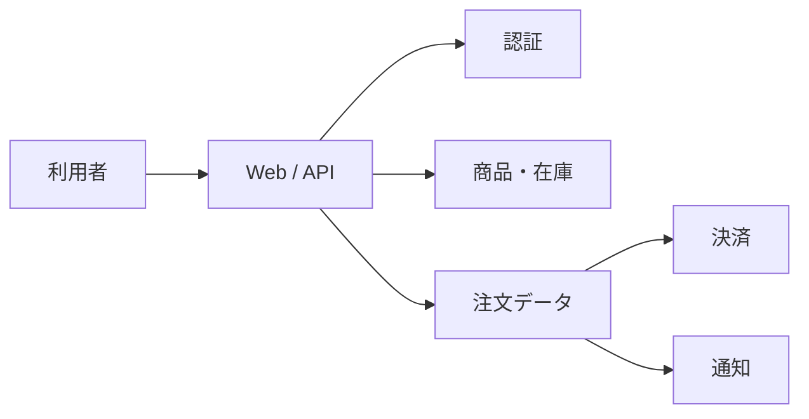

## はじめに 🌟

[前回の記事](https://qiita.com/tomokusaba/items/b3c4c624dfea8dfefcca)では、リトライやサーキットブレーカー、冗長化など、障害を受け止めて影響を小さくする回復性（resiliency）について整理しました。今回は、その先にある「システム全体を、利用者にとって使える状態へ戻す」観点を考えます。

コンピューティング、ネットワーク、データベース、ストレージ。それぞれのリソースが回復できることは重要です。しかし、リソース単体が復旧しても、利用者がログインできない、注文を完了できない、必要なデータが戻っていないのであれば、業務は復旧したとは言えません。

では、どの業務をどれくらいの時間で再開し、どの時点までのデータを戻す必要があるのでしょうか。さらに、通常の回復性では対処しきれない障害が起きたとき、誰が、何を、どの順序で復旧するのでしょうか。

本記事では、Microsoft Learn の Azure Well-Architected Framework の信頼性ガイダンスをもとに、**ビジネス目標からシステム全体の復旧目標と設計を導く方法**を整理します。Azure 固有のサービス構成よりも、業務や利用者の視点から考えるための枠組みを中心に扱います。

## 個々のリソースが復旧しても、利用者の体験は戻らない

たとえば、EC サイトで注文するには、画面を表示するだけでは足りません。認証、商品情報、在庫確認、注文登録、決済など、複数のコンポーネントが連携して初めて一つのユーザーフローが完了します。

各リソースに冗長化や自動フェイルオーバーを設定していても、依存関係や切り替え手順に抜けがあれば、フロー全体は止まります。認証基盤が使えない、接続先の設定が切り替わらない、注文データと決済結果の整合性が取れない、といったことが起きるためです。

Microsoft Learn の信頼性設計原則では、一般的な稼働率だけではなく、**重要なユーザーフローごとに信頼性の成果を定義すること**が勧められています。また、個々の依存コンポーネントではなく、ユーザーやビジネスが期待するワークロード全体の品質を考える必要があります。

つまり、問いの出発点は「このデータベースは何分で復旧するか」だけではありません。**「利用者が何をできるようになったら、業務が復旧したと言えるか」**です。

## ビジネス目標を復旧目標に変換する

まず、システムを機能やユーザーフローに分け、止まったときの影響を業務担当者と確認します。売上や顧客対応に直結するフローと、翌日まで待てる集計処理では、許容できる停止時間もデータ損失も異なるはずです。

その話し合いを、少なくとも次の指標に結びつけます。

| 指標 | 意味 | 決めるための問い |
|---|---|---|
| 🎯 SLO（サービスレベル目標） | 利用者に約束する、測定可能な品質の目標 | 重要な操作が成功した割合や応答時間を、どの水準に保つか |
| ⏱️ RTO（目標復旧時間） | インシデント後、機能を復旧させるまでに許容される最大時間 | その業務を何分・何時間止められるか |
| 💾 RPO（目標復旧時点） | インシデント時に許容できるデータ損失の最大時間幅 | 何分前までのデータが戻れば業務を続けられるか |

SLO と RTO / RPO は関連しますが、同じ指標ではありません。SLO は一定期間にわたる利用者向けの品質目標であり、RTO と RPO は障害後の復旧に関する目標です。Microsoft Learn も、これらの信頼性・回復目標をビジネス関係者と定め、監視やテストによって現実性を確かめる考え方を示しています。

以下は、検討の仕方を説明するための**仮の例**です。数値は推奨値ではなく、実際には業務影響やコストを踏まえて関係者が合意します。

| ユーザーフロー | 停止したときの影響 | 仮の RTO | 仮の RPO | 設計上の論点 |
|---|---|---:|---:|---|
| 🛒 注文の確定 | 売上と顧客体験に直結 | 30 分 | 5 分 | 受付再開の速さ、注文と決済の整合性、失われた注文の照合方法 |
| 🔎 商品の検索 | 顧客が購入判断できない | 2 時間 | 1 時間 | 在庫表示が古い場合の扱い、縮退運転で提供できる機能 |
| 📊 日次レポート | 社内の分析が遅れる | 翌営業日 | 24 時間 | バックアップからの復元で足りるか、再集計が可能か |

ここで大切なのは、目標を決めるときに「データを何分失ってもよいか」だけで終わらせないことです。注文を失うことが許容されないなら、RPO の数値だけでなく、再送や照合、重複注文防止など、業務上の補完手順も決める必要があります。

## 目標に合わせてシステム全体を設計する

合意した目標は、アーキテクチャと運用の両方を選ぶ基準になります。短い RTO を求めるほど、待機環境の事前準備や切り替えの自動化が必要になり、費用や運用の複雑さも増します。長い停止を許容できる処理であれば、バックアップからの復元や再デプロイを選べる場合があります。

ただし、コンピューティングだけを複数リージョンに置けばよいわけではありません。ユーザーフローをたどり、次のような依存関係を含めて復旧できるかを確認します。

- **入口とネットワーク**: DNS、ルーティング、ファイアウォール、証明書
- **アプリケーション**: 実行環境、構成値、シークレット、デプロイ手順
- **データ**: レプリケーション方式、整合性、バックアップ、復元先
- **外部依存**: 認証、決済、通知などの外部サービスや共有プラットフォーム
- **運用**: 監視、アラート、復旧用の権限、手順書、担当者と連絡経路

これらの一部が復旧目標を満たせなければ、ユーザーフロー全体の目標も達成できない可能性があります。依存先が停止している場合に一部機能を安全に止める、読み取り専用で提供するなど、**縮退運転（機能を制限しながらサービスを続けること）**も選択肢です。その場合は「何を止め、何を提供し続けるか」を利用者と業務の観点から決めておきます。

復旧目標を技術選定だけで決めないことも重要です。Microsoft Learn の信頼性メトリックのガイダンスでは、SLO の範囲に利用者の体験へ直接影響する依存サービスを含めることや、重要なフローに合わせて目標を設定することが説明されています。個々のサービスの SLA を足し合わせるだけでは、利用者が実際に感じる品質や復旧能力を保証できません。

## 回復性を超える障害に備える

リトライやフェイルオーバーなどの回復性は、主にコンポーネントの障害や一時的な停止を吸収し、影響を抑えるためのものです。一方、広範囲の障害やデータ破損、重大な設定ミスなど、用意した回復性の範囲を超えた状況では、災害復旧（Disaster Recovery、DR）の手順が必要になります。

Microsoft Learn は、DR 計画について、復旧目標に合わせて構造化し、テストし、文書化すること、個々のコンポーネントだけでなく**システム全体**を対象にすることを勧めています。計画には、少なくとも以下を含めます。

1. **発動条件**: どの状態を通常の障害対応ではなく DR と判断するか
2. **意思決定と役割**: 誰が DR を宣言し、誰が復旧・検証・社内外への連絡を担うか
3. **復旧の順序**: ネットワークや認証、データ、アプリケーションなど、依存関係に沿って何から戻すか
4. **復旧ポイントの選択**: データ破損や誤操作が判明した場合、いつの状態へ戻すか
5. **利用者向けの確認**: 監視上の正常だけでなく、代表的なユーザーフローが完了することをどう検証するか
6. **フェイルバック**: 代替環境から通常の運用環境へ戻す条件と手順

たとえば、データが破損したまま複製されている場合、単純に別リージョンへ切り替えても正しい状態には戻りません。バックアップやポイントインタイム復元から、破損前の整合した時点を選び、アプリケーションとの整合性や復元後のデータを確認する必要があります。ここでは「何分前まで戻すか」という RPO だけでなく、「どの状態なら業務を再開してよいか」という判断も必要です。

また、復旧手順、スクリプト、構成情報、必要な権限や連絡先が、本番環境の障害時にも参照できるとは限りません。復旧に必要な資産を本番系とは独立して保管し、誰がどのようにアクセスできるかまで確認しておきます。

## 計画を訓練し、実測で更新する

手順書に「30 分で復旧」と書いてあっても、実際にその時間で利用者向けの機能が戻るとは限りません。検知、判断、担当者の招集、環境の切り替え、データの復元、整合性確認、利用者への案内までを含めると、想定より時間がかかることがあります。

そのため、コンポーネント単位の復元テストに加えて、**ユーザーフローを入口から出口まで通す復旧訓練**を行います。たとえば注文処理なら、注文画面が表示されるだけではなく、認証、在庫確認、注文登録、決済との整合性まで確かめます。訓練で実際にかかった時間と、どの時点までのデータを復旧できたかを記録し、RTO / RPO を満たせなければ、目標・設計・手順のいずれを見直すかを話し合います。

DR 訓練は、本番へ影響を与える可能性があります。まずは非本番環境や机上演習で手順を検証し、本番で行う場合は影響範囲、停止条件、承認者を明確にします。フェイルオーバーだけでなく、復旧後に元の環境へ戻すフェイルバックも別の手順として確認しましょう。

## おわりに 🌈

回復性を考えるとき、個々のリソースが故障から戻れるかは大切な問いです。しかし、最終的に守りたいのはリソースではなく、**利用者が必要な業務を続けられること**です。

まず重要なユーザーフローと業務影響を整理し、SLO、RTO、RPO を関係者と合意する。その目標から依存関係を含むシステム全体の設計を選び、回復性を超える障害に対する DR 計画を用意する。そして、訓練で復旧時間と復旧ポイントを測り、計画を更新する。このサイクルが、実際に使える回復性につながります。

「どのリソースを何台にするか」を決める前に、「どの利用者の、どの業務を、どこまでの時間とデータ損失で戻すのか」を話し合う。システム全体の復旧設計は、そこから始まります。

## 参考リンク（Microsoft Learn）

- [Reliability design principles](https://learn.microsoft.com/en-us/azure/well-architected/reliability/principles?WT.mc_id=DT-MVP-5004827)
- [Architecture strategies for defining reliability targets](https://learn.microsoft.com/en-us/azure/well-architected/reliability/metrics?WT.mc_id=DT-MVP-5004827)
- [Architecture strategies for disaster recovery](https://learn.microsoft.com/en-us/azure/well-architected/reliability/disaster-recovery?WT.mc_id=DT-MVP-5004827)
- [Develop a disaster recovery plan for multi-region deployments](https://learn.microsoft.com/en-us/azure/well-architected/design-guides/disaster-recovery?WT.mc_id=DT-MVP-5004827)

*参考リンクの確認日: 2026 年 10 月*
